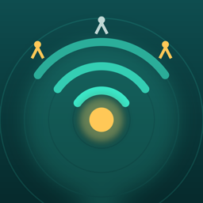
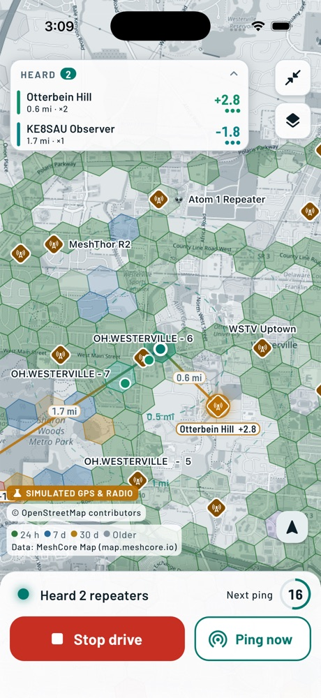
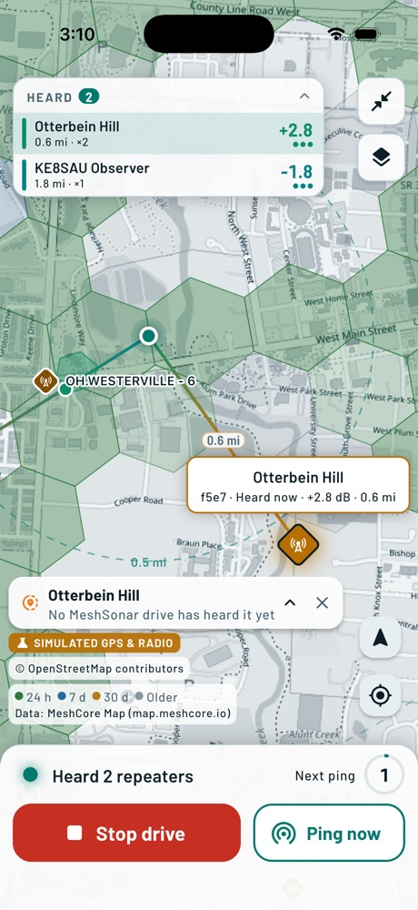
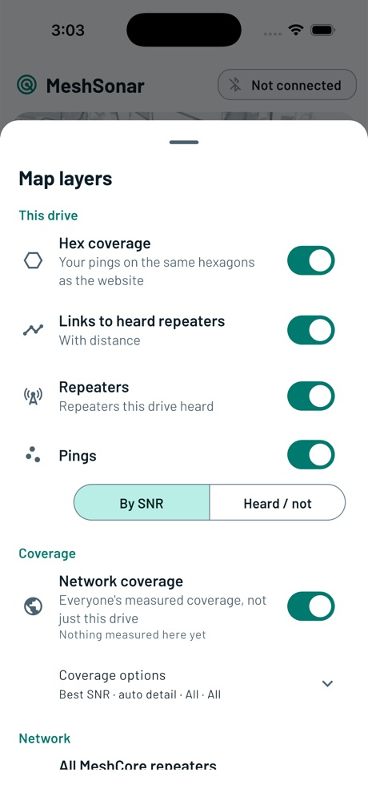
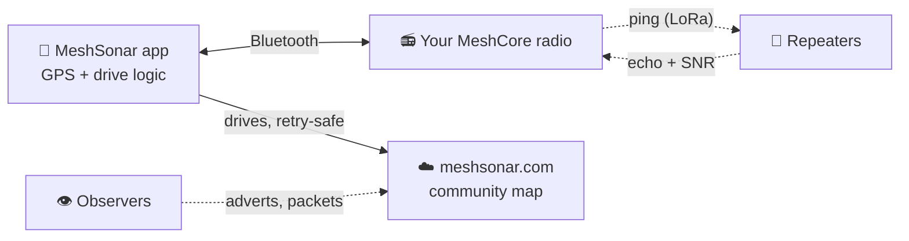

<div align="center">



# MeshSonar

**Drive. Ping. See who hears you.**<br>
Open-source coverage mapping for [MeshCore](https://meshcore.co.uk) LoRa mesh radios, for iPhone and iPad.

[](https://meshsonar.com)
[](#get-the-app)
[](https://flutter.dev)
[](LICENSE)

</div>

MeshSonar turns your MeshCore companion radio into a coverage survey tool. While you drive, it sends a short ping
through your radio, listens for every repeater that echoes it, and records where the ping went and how strong the
signal was (SNR). The drive lands on a live map, in a drive report, and on the shared community map at
**[meshsonar.com](https://meshsonar.com)**, so everyone can see where the mesh actually reaches and where it does not.

No account. No sign-up. Open the app and it creates its own driver key.

<table>
<tr>
<td width="33%"></td>
<td width="33%"></td>
<td width="33%"></td>
</tr>
<tr>
<td align="center"><sub><b>Drive</b><br>who hears you, live</sub></td>
<td align="center"><sub><b>Link lines</b><br>tap a repeater or a cell</sub></td>
<td align="center"><sub><b>Layers</b><br>your drive and the network</sub></td>
</tr>
</table>

<sub>Screenshots are from a debug build with the built-in simulator (no radio, simulated GPS); release builds always use your real radio and GPS.</sub>

## What you get

**Survey**
- **Pings through your own radio.** Connect a MeshCore companion radio over Bluetooth. The app pings on the interval and distance you choose and listens for 7 seconds for echoes. A ping carries no location and nothing about you on the air: just `MS:` and 10 random characters.
- **Every echo recorded.** Which repeater, SNR, RSSI, hops and path, for every ping, including the pings nobody heard. "Heard nothing" is data too.
- **Save first.** Every ping is on disk the moment it finishes. Drives upload when you are online, retry safely, and can be exported as files.
- **Built for the road.** Keeps recording with the screen locked, reconnects a dropped radio, handles bad GPS and clock drift, and keeps working offline (offline map packs).

**See**
- **A map that tells the truth.** Hexagons on the same grid as the website (H3, finer as you zoom in). Green and the other strength colours mean measured signal; **grey means mapped but nothing heard**; purple means heard but no signal reading.
- **Link lines.** Tap a repeater: orange lines run to every cell it was heard in. Tap a cell or a ping: lines run to every repeater that heard it. Each line carries its SNR. A small collapsed panel keeps the map in front, and expands for the numbers.
- **Heard box and drive report.** Who is in range right now with distance and SNR, then after the drive: new hexagons and repeaters, signal over time, best and dead spots, and weather along the route.

**Own your radios**
- **Claim your radio or repeater.** Prove you control it by signing a challenge with your radio's key, or by logging in to your repeater over the mesh. Claiming only lets you manage a radio (name, position visibility); it never decides whether its data counts. Your repeater's admin password never leaves your phone.

**Open and private by design**
- Anyone with a key contributes; nothing is held back for approval. Start and end of each drive, and your own privacy zones, are trimmed before anything is shown. You can delete all your data and your key from inside the app.
- The wire format is open: the [MeshSonar Drive Format](https://github.com/Innovatex-AI/meshcore-insights/blob/main/docs/MESHSONAR_DRIVE_FORMAT.md) is documented so other apps can feed the same map.

## How it works



1. The app sends a ping on a channel (default `#wardriving`) through your radio.
2. Repeaters that hear it relay it; your radio hears the relays and reports who and how well.
3. The app saves the ping with GPS, and uploads the drive to [meshsonar.com](https://meshsonar.com).
4. The site rolls every driver's pings up onto hexagons, so the map shows real, measured coverage.

## Get the app

- **iPhone and iPad:** TestFlight beta, invite only while it is small. Ask via [meshsonar.com](https://meshsonar.com).
- **Build it yourself:** see below. The code is MIT licensed, and builds exist for Android, macOS and Linux too, but iPhone and iPad are the supported platforms.

You also need a **MeshCore companion radio** (Bluetooth) and, to cover ground, a car.

## Build and test

```sh
flutter pub get
flutter analyze
flutter test                       # unit, widget, contract and end-to-end tests
flutter build ios --release        # needs your own Apple team: see docs/DEVELOPMENT.md
```

Your Apple team ID goes in the untracked `ios/Flutter/Signing.xcconfig`; nothing secret is committed. Use
`xcrun devicectl device install app` to put a build on a phone (never `flutter install`: it wipes on-device drives).
Some contract tests run the real website endpoint code when a checkout of the website repo is available, and skip
otherwise. Full details are in [docs/DEVELOPMENT.md](docs/DEVELOPMENT.md).

## Documentation

| Document | What is in it |
|---|---|
| [ARCHITECTURE](docs/ARCHITECTURE.md) | Layers and dependency rules, a drive end to end, state, timers, the save-first rule |
| [PROTOCOL](docs/PROTOCOL.md) | The MeshCore companion protocol as implemented: BLE, frames, channel crypto, ping text, echo recognition, claims |
| [DATA_MODEL](docs/DATA_MODEL.md) | Every record field with units, on-device storage, crash recovery, export format, sync rules |
| [FEATURES](docs/FEATURES.md) | Every screen and behaviour rule |
| [DEVELOPMENT](docs/DEVELOPMENT.md) | Mac set-up, signing, installing on a phone, running every kind of test, release checklist |
| [TESTING](docs/TESTING.md) | What each test file covers and how to run subsets |
| [APP_STORE](docs/APP_STORE.md) | App Store and TestFlight answers: privacy, review notes, encryption |
| [PORTING](docs/PORTING.md) | Reusable code, platform seams, and a rewrite guide for other platforms |
| [REGIONS_AT_SCALE](docs/REGIONS_AT_SCALE.md) | How the app copes with hundreds of regions |
| [CHANGELOG](docs/CHANGELOG.md) · [ROADMAP](docs/ROADMAP.md) | What changed, and what is next |

Code lives in `lib/core` (model, store, server client, sync; pure Dart), `lib/radio` (MeshCore protocol, wardrive
engine, Bluetooth), `lib/app` (state and wiring) and `lib/ui` (screens, map, report). Contributors and coding agents:
start with [AGENTS.md](AGENTS.md).

## Community and credits

MeshSonar is built for the MeshCore community and shares the idea of crowd-sourced coverage with
[MeshMapper](https://meshmapper.net); the two projects are independent. Map data © [OpenStreetMap](https://www.openstreetmap.org/copyright)
contributors; repeater positions from [MeshCore Map](https://map.meshcore.io); weather from [Open-Meteo](https://open-meteo.com).
Ported and adapted code from the MeshCore firmware, the MeshMapper web client and MeshCore Open is credited in
[THIRD_PARTY_NOTICES.md](THIRD_PARTY_NOTICES.md).

## License

[MIT](LICENSE). Bluetooth uses `flutter_reactive_ble` (BSD-3-Clause), so there is no paid licence to carry.
