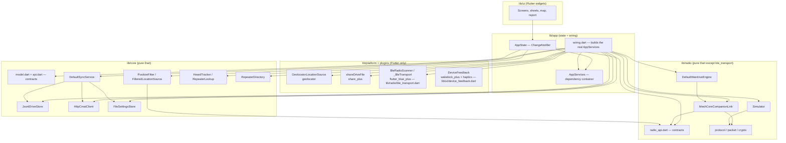
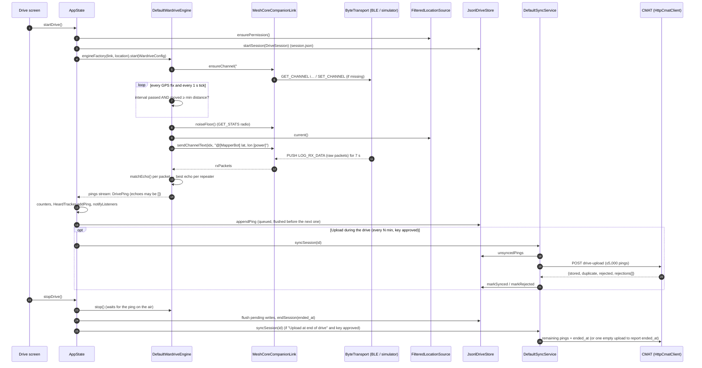

# MeshSonar architecture

MeshSonar is a Flutter app (Dart 3.13+, Flutter 3.44+; developed on Flutter 3.47.7) with one codebase for iPhone/iPad,
Android, macOS and Linux. A Windows runner is configured too, but it has not been tested with a radio. This document describes how the code is split up, how a drive
flows from the radio to the server, and what each file does. Everything here is checked against the source as of
v0.2.0.

Related documents: [PROTOCOL.md](PROTOCOL.md) (radio bytes), [DATA_MODEL.md](DATA_MODEL.md) (records and files),
[FEATURES.md](FEATURES.md) (screens and rules), [PORTING.md](PORTING.md), [CONTRACTS.md](CONTRACTS.md) (the original
build contracts).

## 1. Layers

| Layer | Folder | Flutter? | What it owns |
|---|---|---|---|
| **core** | `lib/core/` | No (pure Dart; `dart:io` and `package:http` only) | Data model and wire format, server contract, on-device store, sync, settings, CMAT client, GPS filter, "who did we hear" tracker, public node directory |
| **radio** | `lib/radio/` | No, except `ble_transport.dart` | MeshCore companion protocol codec, over-the-air packet parsing, crypto, companion link, wardrive engine, simulator, BLE transport |
| **app** | `lib/app/` | `foundation` only (ChangeNotifier) | `AppState` (all runtime state), `AppServices` (dependency container), `wiring.dart` (real services), user-facing error text |
| **ui** | `lib/ui/` | Yes | Screens, bottom sheets, map, report, onboarding, theme |
| **platform** | `lib/platform/` (+ `ble_transport.dart`, `device_feedback.dart`) | Yes (plugins) | GPS, share sheet, BLE, wake lock, haptics |

### Dependency rules (as implemented)

1. **`lib/core` and `lib/radio` (except `ble_transport.dart`) never import Flutter.** They run under plain `dart test`
   and can be lifted into any Dart program (CLI, server, another UI). Checked: the only `package:flutter` import in
   these two folders is in `ble_transport.dart`.
2. **Contracts live in three files:** `lib/core/model.dart` (records, Drive Format v1), `lib/core/api.dart` (store,
   client, sync, settings interfaces) and `lib/radio/radio_api.dart` (transport, scanner, link, location, engine
   interfaces). Implementations depend on contracts, not on each other where avoidable.
3. **core ↔ radio contract cross-references are allowed, and they go both ways.** `radio_api.dart` imports
   `core/model.dart` (`Radio`, `DrivePing`). `core/position_filter.dart` imports `radio/radio_api.dart` (`GeoFix`,
   `LocationSource`). `radio/wardrive_engine.dart` imports `core/api.dart` for the `Settings` range constants. Both
   folders are pure Dart, so this doesn't break rule 1. A port should still treat them as one "domain" package.
4. **The UI talks to `AppState` (through `AppScope`) and to contract types.** The UI never builds a store, a client or a
   radio. `wiring.dart` is the only file that names the concrete store, sync, client, link, engine, BLE and GPS
   classes. Known exceptions: `AppServices`/`AppState` reference the concrete `RepeaterDirectory` class, and
   `ui/drive/drive_map_model.dart` imports `defaultSimulatedRepeaters()` from the simulator so it can draw the
   simulator's made-up repeaters.
5. **Tests build `AppServices` from fakes** (`test/ui/fakes.dart`, `Harness`), so every screen can be tested without
   plugins, network or hardware.

## 2. A drive, end to end

Step by step:

1. **Connect.** `AppState.connect()` asks the chosen `RadioScanner` for a `ByteTransport`, wraps it in
   `services.linkFactory` (a `MeshCoreCompanionLink`), and calls `link.start()`: APP_START → DEVICE_QUERY →
   SET_DEVICE_TIME. That returns `SelfInfo` (public key, name, radio params, firmware). The connect timeout is 25 s
   and the start timeout is 20 s.
2. **Start drive.** `AppState.startDrive()` checks location permission, then builds a `DriveSession`. The session gets
   a new UUID, `started_at` in UTC, the channel and antenna from settings, and radio and companion details from
   `SelfInfo`. The session is written to the store before the engine starts. The engine is then started with
   `WardriveConfig(channel, intervalSec, minDistanceM, txPowerW)`, where `txPowerW` is computed from the radio's
   `tx_dbm`.
3. **Engine cadence.** The engine pings once **both** of these are true: the interval has passed since the last ping
   (and never sooner than one listen window), and the phone has moved `minDistanceM` from where that ping was sent.
   The first ping goes out as soon as the drive starts. See [FEATURES.md §Cadence](FEATURES.md#auto-ping-cadence).
4. **One ping.** The engine reads the noise floor and takes a GPS fix. It sends the MeshMapper-format text on the
   channel, then collects every `RxPacket` for the listen window (7 s). Packets that are repeats of *this* ping
   (matching channel hash, MAC, decrypted text and timestamp) become `Echo`s. The engine keeps one echo per repeater.
   It then emits a finished `DrivePing`. A ping that heard nothing is emitted too, with `echoes: []`.
5. **Save first.** `AppState._onPing` updates counters and the heard tracker, then queues `store.appendPing`. Writes
   are serialised on one future chain. If a write fails, the ping stays in memory (`_unsaved`) and is retried before
   the next ping and again at Stop. See §5.
6. **Upload during the drive** (optional; on by default). A periodic timer runs `syncSession` for the current drive
   every `syncEveryMin` minutes. It only runs while the key is approved and both upload toggles are on. Each upload
   waits for pending writes first, so only pings that are already on disk are sent.
7. **Stop.** `stopDrive()` cancels the upload timer and stops the engine (a ping on the air finishes its listen
   window). It flushes writes, writes `ended_at`, waits for any in-flight upload, and then (if "Upload at end of
   drive" is on and the key is approved) runs a final `syncSession`. That sync sends what's left plus `ended_at`.
8. **Sync rules.** See [DATA_MODEL.md §Sync](DATA_MODEL.md#5-sync-rules): chunks of ≤ 5,000 pings, pings marked synced
   only after a 200, rejected pings recorded and never re-sent, and one empty upload to report `ended_at` if nothing
   else carried it.
9. **CMAT** validates with `src/lib/drive/validate.ts` and stores pings by UUID, so a re-send counts as a duplicate.
   The format is specified in `meshcore-insights/docs/MESHSONAR_DRIVE_FORMAT.md`.

## 3. State management

There are no state-management packages. All of it is plain Flutter:

- **`AppState`** (`lib/app/app_state.dart`) is a single `ChangeNotifier` that holds settings, the radio connection,
  the running drive and its live stats, the saved-drive list, sync status, the driver key, repeater names and the
  public directory. It exposes read-only getters and async commands (`connect`, `startDrive`, `pingNow`,
  `stopDrive`, `syncSession`, `syncAll`, `exportAndShare`, `deleteSession`, `updateSettings`, `requestKey`, …).
- **`AppScope`** (`lib/ui/app.dart`) is an `InheritedNotifier<AppState>`. `AppScope.of(context)` subscribes, and
  `AppScope.read(context)` reads without subscribing (for callbacks).
- **Notices.** `AppState` keeps one pending plain-language message (`_say`). `HomeShell` listens and shows it as a
  SnackBar via `takeNotice()`.
- **`DriveMapModel`** (`lib/ui/drive/drive_map_model.dart`) is a second `ChangeNotifier`, owned by the Drive screen and
  shared with the full-screen map. It holds the ping list, a frozen heard snapshot (`HeardView`s), the selected
  repeater, the layer toggles and the live GPS position. It recomputes only when a ping finishes or the lookup changes.
- **`UiPrefs`** (`lib/ui/onboarding/ui_prefs.dart`) is a `ChangeNotifier` for UI-only preferences (intro seen, local
  drive names). It hangs off `AppState` through an `Expando`. `DriveStatsCache` in `sessions_screen.dart` works the
  same way.
- Widgets keep their own small state (`StatefulWidget`): the heard box collapse, the ping log filters, slider drag
  positions.

## 4. Concurrency, timers and streams

Dart is single-threaded per isolate; MeshSonar uses **no isolates**. Ordering is enforced with future chains and
flags:

| Mechanism | Where | Purpose |
|---|---|---|
| Command queue (`_queue`) + one pending `Completer` | `MeshCoreCompanionLink._command` | One companion command at a time; reply or 5 s timeout. Late replies are dropped. |
| Ping chain (`_pingChain`, `_busy`, `_evaluating`) | `DefaultWardriveEngine._serial` | Pings never overlap: the radio is half-duplex and echoes are matched per ping. A manual ping queues behind an auto ping. |
| Cadence timer (`Timer.periodic(tick = 1 s)`) + GPS fix subscription | `DefaultWardriveEngine._startAuto` | Re-checks "interval AND distance" on every fix and every second. |
| Listen window (`Timer(window)`) + 250 ms disconnect poll | `DefaultWardriveEngine._listen` | Collects echoes; ends early if the radio goes away. |
| 5 s retry back-off (`_retryAfter`) | engine | After a failed auto ping, the engine waits before trying again. |
| Per-session lock map (`_locks`) | `JsonlDriveStore._locked` | Writes and reads of one session never interleave. |
| Save chain (`_writeChain`) | `AppState._enqueueWrite` | Pings are appended in order; earlier failures are retried first. |
| Sync serialiser (`_last`) | `DefaultSyncService._serial` | Overlapping sync calls run one after another, so the same pings are never uploaded twice. |
| Save serialiser | `FileSettingsStore.save` | Two quick saves can't race on the temp file. |
| In-drive upload timer (`Timer.periodic(syncEveryMin)`) | `AppState._scheduleDriveSync` | Skips a tick while the previous upload is still running (`_driveSyncInFlight`). |
| One shared download (`_inFlight`) | `RepeaterDirectory.refresh` | Concurrent refreshes share one HTTP download. |
| Countdown tick (1 s) | `NextPingIndicator` | Only runs while a countdown is on screen. |
| Scan guard (15 s) | `ConnectScreen` | Stops showing "Scanning" if a platform never closes the scan stream. |

Broadcast streams: `CompanionLink.rxPackets`, `MeshCoreCompanionLink.controlPackets` / `channelMessages`,
`WardriveEngine.pings` / `status`, `FilteredLocationSource.fixes` (one shared filter for every listener).

## 5. Error handling and the save-first rule

**Save first.** A ping is written to the device the moment the engine finishes it, and before anything else happens
to it (uploading, for example). Concretely:

- `AppState._onPing` de-duplicates by ping id (the stream and the `pingNow()` return value both deliver the same ping),
  updates the UI, then calls `_enqueueWrite`.
- `JsonlDriveStore.appendPing` appends one JSON line and flushes it before its future completes.
- If a write throws, the ping (and every ping after it in that batch) goes into `_unsaved`. The user sees "Couldn't
  save a ping to this device; will retry". The next ping's write retries the backlog first, and `stopDrive` flushes
  again. If pings are still unsaved at Stop, the user is told to export before closing the app. The Drive screen shows
  a banner while `unsavedCount > 0`.
- In-drive uploads `await _writeChain` first, so they never send a ping that isn't on disk yet.

**Never invent data.** Unmeasured values are `null`. The engine runs every measured number through range checks
(`_inRange`: SNR −40…40, RSSI −160…0, noise −160…0, accuracy 0…10,000, speed 0…150) and drops values outside them.
These are the server's limits, so nothing the app sends gets rejected for being out of range. A noise floor of `0`
from the radio means "not calibrated yet" and is stored as `null`. A listen window cut short by a disconnect is *not*
recorded as "heard nothing": the ping is discarded unless something was already heard.

**Errors in plain language.** `lib/app/messages.dart` maps exceptions to one-line messages (`friendlyError`,
`friendlySyncError`). Stack traces are never shown. Sync failures never touch stored pings. On a 403 or 401 the app
re-checks the key status quietly.

**Crash safety.** See [DATA_MODEL.md §Crash recovery](DATA_MODEL.md#crash-recovery-rules): atomic temp-file-and-rename
for every JSON document, truncated lines in the ping log are skipped and then repaired, and damaged caches only cost
names.

**Startup failure.** If `buildRealServices()` throws (for example, storage can't be opened), `main.dart` shows
`StartupErrorApp` instead of the app.

## 6. Every file in `lib/`

| File | Layer | Role |
|---|---|---|
| `main.dart` | app | Entry point: builds real services, runs `MeshSonarApp`, then `AppState.init()`; shows `StartupErrorApp` if storage can't open. |
| `app/app_state.dart` | app | `AppState`: settings, radio connection, drive lifecycle, save-first queue, live counters, heard tracker, in-drive/end uploads, sync, export/delete, driver key, repeater names, public directory. |
| `app/services.dart` | app | `AppServices` dependency container; `RepeaterCache` + `FileRepeaterCache` / `MemoryRepeaterCache`. |
| `app/wiring.dart` | app | `buildRealServices()`: data root, concrete store/client/sync/settings, BLE + simulator scanners, filtered GPS, engine factory, export dir, share, directory (7-day TTL); `appVersion` constant. |
| `app/messages.dart` | app | `friendlyError` / `friendlySyncError`: exceptions → short plain-language messages. |
| `core/model.dart` | core (contract) | Drive Format v1 records: `AppInfo`, `Radio`, `Antenna`, `Companion`, `DriveSession`, `Echo`, `Neighbor`, `DrivePing`, `DriveBatch`, `RepeaterRef`. |
| `core/api.dart` | core (contract) | `DriveStore`, `CmatClient`, `SyncService`, `SettingsStore` interfaces; `Settings`, `SessionSummary`, `DriverKeyStatus`, `UploadResult`, `SyncReport`, `CmatException`. |
| `core/drive_store.dart` | core | `JsonlDriveStore` (one folder per drive, JSONL pings, sync ledgers) and the `SyncLedger` extension interface. |
| `core/cmat_client.dart` | core | `HttpCmatClient` for `driver-request`, `driver-status`, `drive-upload`, `drive-repeaters`; `DetailedUploadResult`, `PingRejection`. |
| `core/sync_service.dart` | core | `DefaultSyncService`: chunked, serialised, retry-safe uploads; rejection discovery; end-time reporting. |
| `core/settings_store.dart` | core | `FileSettingsStore`: atomic JSON settings; missing/corrupt → defaults. |
| `core/position_filter.dart` | core | `PositionFilter` (accuracy gate, Kalman smoothing, stationary hold) and `FilteredLocationSource` wrapper. |
| `core/heard.dart` | core | `haversineM`, `bearingDeg`, `compass`; `RepeaterLookup` (prefix → repeater, CMAT first); `HeardTracker` (live/stale per repeater). |
| `core/repeater_directory.dart` | core | `RepeaterDirectory`: streams map.meshcore.io's node list, keeps nearby repeaters, caches to disk; `JsonArraySplitter`. |
| `radio/radio_api.dart` | radio (contract) | `ByteTransport`, `RadioScanner`, `RadioDevice`, `SelfInfo`, `RxPacket`, `CompanionLink`, `GeoFix`, `LocationSource`, `WardriveConfig`, `EngineState`, `PingWait`, `EngineStatus`, `WardriveEngine`. |
| `radio/protocol.dart` | radio | Companion protocol codes, command encoders, frame decoders, plus the radio-side encoders the simulator uses. |
| `radio/packet.dart` | radio | Over-the-air packet parser/serialiser, path-hash decoding, GRP_TXT build/decrypt, `matchEcho`. |
| `radio/crypto.dart` | radio | Pure-Dart SHA-256, HMAC-SHA256, AES-128; channel secrets and hash; MeshCore encrypt-then-MAC. |
| `radio/companion_link.dart` | radio | `MeshCoreCompanionLink`: serialised commands, push handling, `ensureChannel`, `sendChannelText`, `noiseFloor`, discovery request, offline-queue drain. |
| `radio/wardrive_engine.dart` | radio | `DefaultWardriveEngine`: cadence, one ping at a time, listen window, echo building, optional neighbour discovery; `formatPingText`. |
| `radio/simulator.dart` | radio | `SimulatedLocationSource` (Westerville loop), `SimulatedTransport` (speaks real frames and real encrypted packets), `SimulatedRadioScanner`, simulated repeaters. |
| `radio/ble_transport.dart` | platform | `BleRadioScanner` / `_BleTransport` over flutter_blue_plus (Nordic-UART-style service). |
| `platform/geolocator_location.dart` | platform | `GeolocatorLocationSource`: per-OS location settings (Android foreground notification, iOS background updates), permission. |
| `platform/share.dart` | platform | `shareDriveFile`: share sheet for exports (JSON) and reports (text). |
| `ui/app.dart` | ui | `MeshSonarApp`, `AppScope`, `HomeShell` (Drive / Drives / Settings tabs, SnackBar notices), `StartupErrorApp`. |
| `ui/theme.dart` | ui | Design system: `Gap`, `Corners`, palettes, `MeshSonarColors` (SNR scale, beacon, map tile matrix), `numberStyle`, theme mode. |
| `ui/widgets.dart` | ui | Shared formatters (`formatTime`, `formatDateTime`, `formatSnr`, `bestSnr`, `repeatersHeard`) and small widgets (`StatTile`, `StatStrip`, `EmptyState`, `ErrorBanner`, `SectionLabel`, `SignalBars`, `ResultDot`, `PingTile`). |
| `ui/device_feedback.dart` | platform | `DeviceFeedback` (wake lock + haptics) with a no-op under `flutter test`. |
| `ui/drive_screen.dart` | ui | Drive tab: map + heard box + controls; keeps the screen awake while driving; `ConnectionChip`. |
| `ui/drive/drive_controls.dart` | ui | Stats strip, status row, next-ping indicator, antenna toggle, Log button, report card, Start/Stop + Ping now, map hint, ping flash, map icon button. |
| `ui/drive/drive_map_model.dart` | ui | `DriveMapModel` shared by the Drive screen and full-screen map. |
| `ui/drive/heard_box.dart` | ui | `HeardBox`: live / holding / stale repeaters over the map. |
| `ui/map/coverage_map.dart` | ui | `CoverageMap` (flutter_map): grid, OSM tiles, rings, links, repeaters, ping dots, position, compass, recenter, attribution; `SimulatedTag`. |
| `ui/map/fullscreen_map.dart` | ui | Full-screen live map; `showMapLayersSheet`. |
| `ui/map/map_layers.dart` | ui | `MapLayers`, `PingColorMode`, `HeardView` / `HeardPhase`, `heardSnapshot`, `formatDistance` (map style), `formatSnrShort`. |
| `ui/connect_screen.dart` | ui | Scan for radios, connect/disconnect, Simulator entry. |
| `ui/ping_log_screen.dart` | ui | Ping log (live or saved): summary, filters, pings / repeaters tabs; `aggregateRepeaters`. |
| `ui/ping_detail_sheet.dart` | ui | One ping: facts, echoes, neighbour, ambiguous-prefix candidates, "Copy as text" (`pingAsText`). |
| `ui/repeater_detail_sheet.dart` | ui | One repeater on a drive: key, position, distance, times heard, SNR sparkline; `hearingsOf`. |
| `ui/repeater_widgets.dart` | ui | `EchoTile`, `HeardRepeaterTile`, `RepeaterIdChip`, `SnrPill`, `SourceBadge`, label helpers. |
| `ui/sessions_screen.dart` | ui | Drives tab: overview + Sync all, drive cards, sync badge, heard strip, rename/delete/export/report actions; `DriveStatsCache`. |
| `ui/drive_detail_screen.dart` | ui | One saved drive: map, stats grid, heard strip, repeaters, pings, Sync/Export/Ping log/Report/Rename/Delete. |
| `ui/drive_detail_map.dart` | ui | `CoverageMap` framed on a whole saved drive. |
| `ui/drive_stats.dart` | ui (pure Dart) | `DriveStats.of` (distance, duration, heard %, best/median SNR, repeaters, multi-hop, timeline); `formatDistance`, `formatMiles`, `formatDuration`. |
| `ui/report/drive_report.dart` | ui (pure Dart) | `DriveReport.compute`: CMAT-grid cells, new grids/repeaters vs earlier drives, speeds, hops, best/worst spot, text summary. |
| `ui/report/drive_report_screen.dart` | ui | Drive report screen and `loadDriveReport`; share as text. |
| `ui/settings_screen.dart` | ui | Settings sections, driver key request/status, sliders (`SliderTile`, stop lists), upload status, About/intro links. |
| `ui/about_screen.dart` | ui | About: version, MIT text, short third-party notices, licence page. |
| `ui/onboarding/first_run_gate.dart` | ui | Shows the intro once, then routes to Connect / Simulator / Settings. |
| `ui/onboarding/onboarding_screen.dart` | ui | Three-page intro. |
| `ui/onboarding/illustrations.dart` | ui | Code-drawn intro art; `Brand` colours. |
| `ui/onboarding/ui_prefs.dart` | ui | `UiPrefs` / `FileUiPrefs` (intro seen, local drive names); `driveLabel`. |

Other files: `tool/make_icon.py` draws the icon (Pillow), and `flutter_launcher_icons.yaml` generates the
platform icons from it. `assets/fonts/` holds Barlow (SIL OFL). `test/fixtures/cmat_server.ts` runs CMAT's real
handlers under bun. See [TESTING.md](TESTING.md).
