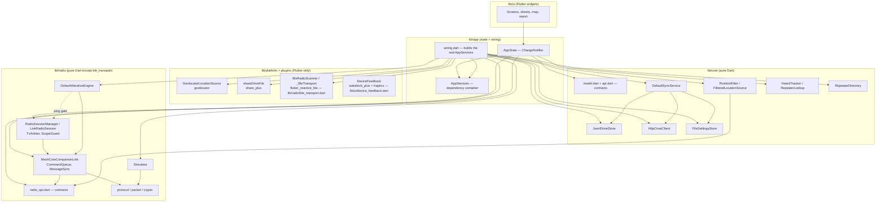
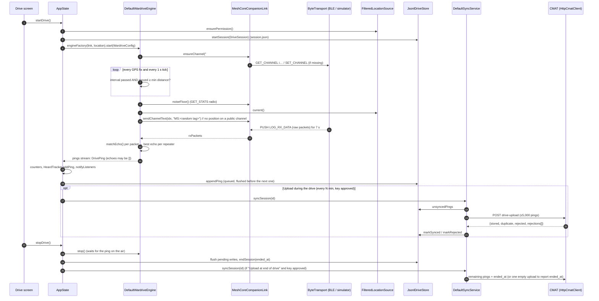

# MeshSonar architecture

MeshSonar is a Flutter app (Dart 3.13+, Flutter 3.44+; developed on Flutter 3.47.7) with one codebase for iPhone/iPad,
Android, macOS and Linux. A Windows runner is configured too, but it has not been tested with a radio. This document describes how the code is split up, how a drive
flows from the radio to the server, and what each file does. Everything here is checked against the source as of
v0.2.0; the file table and data flow notes were updated for v0.3.0.

Related documents: [PROTOCOL.md](PROTOCOL.md) (radio bytes), [DATA_MODEL.md](DATA_MODEL.md) (records and files),
[FEATURES.md](FEATURES.md) (screens and rules), [PORTING.md](PORTING.md), [CONTRACTS.md](CONTRACTS.md) (the original
build contracts).

## 1. Layers

| Layer | Folder | Flutter? | What it owns |
|---|---|---|---|
| **core** | `lib/core/` | No (pure Dart; `dart:io` and `package:http` only) | Data model and wire format, server contract, on-device store, sync, settings, CMAT client, GPS filter, "who did we hear" tracker, public node directory |
| **radio** | `lib/radio/` | No, except `ble_transport.dart` | MeshCore companion protocol codec, over-the-air packet parsing, crypto, companion link, wardrive engine, simulator, BLE transport |
| **chat** | `lib/chat/` | No (pure Dart; `package:sqlite3`, `crypto`, `cryptography`, `archive`) | On-device chat: models, SQLite store, `ChatService`, outbox/retries, backup, `meshcore://` links. App only, never uploaded |
| **app** | `lib/app/` | `foundation` only (ChangeNotifier) | `AppState` (all runtime state), `AppServices` (dependency container), `wiring.dart` (real services), user-facing error text |
| **ui** | `lib/ui/` | Yes | Screens, bottom sheets, map, report, onboarding, theme |
| **platform** | `lib/platform/` (+ `ble_transport.dart`, `device_feedback.dart`) | Yes (plugins) | GPS, share sheet, BLE, wake lock, haptics |

### 1.1 The radio session (Nov 2026, "one app, one radio")

`RadioSession` (`lib/radio/session.dart`) is the single owner of a radio link; design in
`meshsonar-infra/docs/planning/meshsonar-one-app-one-radio-design-2026-10-31.md` section 3. `AppState` no longer holds the
link: it holds a `RadioSessionManager` (`AppState.radioSessions`) and keeps only the drive UX (reconnect banner, resuming the
engine). Everything below is pure Dart.

| Piece | File | Job |
|---|---|---|
| `RadioSessionManager` | `session_manager.dart` | connect, disconnect, hand-over (nothing reconnects until the user connects again), reconnect loop with backoff and a "same radio" key check, the link state stream (`LinkState`), one `TxArbiter` for all its sessions so the airtime ledger survives a reconnect |
| `LinkRadioSession` | `radio_session_impl.dart` | one session over one `CompanionLink`: typed inbound stream, `sendChannelMessage` / `sendContactMessage` (result mapping), contacts and channels, events, `ClaimRadio` (claims run at P1 and are counted in the ledger), `RadioStatsSource` (health sampling reads through the session so a reconnect does not rebuild it) |
| `CommandQueue` | `command_queue.dart` | one command in flight, next one picked by priority (P0 user ... P4 discovery), FIFO inside a class; extracted from `companion_link.dart` |
| `TxArbiter` | `tx_arbiter.dart` | the ping gate and the airtime ledger (below) |
| `MessageSync` | `message_sync.dart` | persist-first, idempotent drain of the radio's offline message queue; poll fallback |
| `ScopeGuard` | `scope_guard.dart` | puts the flood scope on the radio inside the send's queue slot |
| `airtime.dart` | | Semtech LoRa time on air; packet sizes of a channel / direct text |
| `inbound.dart`, `ping_gate.dart` | | the plain types other layers use (`InboundMessage`, `SendResult`, `RadioContact`, `RadioEvent`, `PingGate`) |

**Priorities.** P0 user message, P1 maintenance/ack/login/status/trace/sync, P2 advert, P3 ping and its health reads, P4
discovery. A command nobody marks gets P3 (the wardrive engine does not know about priorities), so an unmarked caller can
never jump ahead of a user message. A running command is never interrupted.

**The ping gate.** `DefaultWardriveEngine.pingGate` (a `PingGate`) is asked before every ping. `AppState` sets it to the
session's `TxArbiter` for the default engine. The arbiter says go, or skip with a reason (`PingSkipReason`): radio outbound
queue not empty (GET_STATS core `queue_len`), a user message in the last 2 s, ping airtime over 2% of the last 10 minutes,
own transmit time over the region cap (unknown region 1%) in the last hour. A skipped ping is never queued for later: the
engine's cadence check asks again after `pingSkipRetry` (2 s) at the then-current position. A manual ping skips with a
`PingSkippedException` and is not held by the two budgets (the driver chose it), only by a busy radio and a just-sent message.
User messages are never refused or delayed by any of this; over the cap the caller is only told.

**"Arbiter idle" = wardrive behaviour of before.** The queue probe and the two budgets run only while `chatActive` is true
(the first user send sets it; the chat layer sets it when chat is in use). With it off, every ping is a go: the cadence tests
are unchanged. The 2 s rule has nothing to act on without user sends.

**Dependency rule added:** `lib/chat` (pure Dart, Wave 1B) and `AppState` talk to the radio only through `RadioSession`;
nothing outside `lib/radio` constructs a `MeshCoreCompanionLink` except `wiring.dart`'s `linkFactory`.

### Dependency rules (as implemented)

1. **`lib/core` and `lib/radio` (except `ble_transport.dart`) never import Flutter.** They run under plain `dart test`
   and can be lifted into any Dart program (CLI, server, another UI). Checked: the only `package:flutter` import in
   these two folders is in `ble_transport.dart`.
1a. **`lib/chat` never imports Flutter** and imports `lib/radio` in exactly one file (`session_adapter.dart`). Chat state lives in its own SQLite file; it shares nothing with the drive store and never reaches the network.
2. **Contracts live in three files:** `lib/core/model.dart` (records, Drive Format v1), `lib/core/api.dart` (store,
   client, sync, settings interfaces) and `lib/radio/radio_api.dart` (transport, scanner, link, location, engine
   interfaces). Implementations depend on contracts, not on each other where avoidable.
3. **core ↔ radio contract cross-references are allowed, and they go both ways.** `radio_api.dart` imports
   `core/model.dart` (`Radio`, `DrivePing`). `core/position_filter.dart` imports `radio/radio_api.dart` (`GeoFix`,
   `LocationSource`). `radio/wardrive_engine.dart` imports `core/api.dart` for the `Settings` range constants. Both
   folders are pure Dart, so this doesn't break rule 1. A port should still treat them as one "domain" package.
4. **The UI talks to `AppState` (through `AppScope`) and to contract types.** The UI never builds a store, a client or a
   radio. `wiring.dart` is the only file that names the concrete store, sync, client, link, engine, BLE and GPS
   classes. Known exceptions: `AppServices`/`AppState` reference the concrete `RepeaterDirectory` class, and
   `ui/drive/drive_map_model.dart` imports `defaultSimulatedRepeaters()` from the simulator so it can draw the
   simulator's made-up repeaters.
5. **Tests build `AppServices` from fakes** (`test/ui/fakes.dart`, `Harness`), so every screen can be tested without
   plugins, network or hardware.

## 2. A drive, end to end

Step by step:

1. **Connect.** `AppState.connect()` asks the chosen `RadioScanner` for a `ByteTransport`, wraps it in
   `services.linkFactory` (a `MeshCoreCompanionLink`), and calls `link.start()`: APP_START → DEVICE_QUERY →
   SET_DEVICE_TIME. That returns `SelfInfo` (public key, name, radio params, firmware). The connect timeout is 25 s
   and the start timeout is 20 s.
2. **Start drive.** `AppState.startDrive()` checks location permission, then builds a `DriveSession`. The session gets
   a new UUID, `started_at` in UTC, the channel and antenna from settings, and radio and companion details from
   `SelfInfo`. The session is written to the store before the engine starts. The engine is then started with
   `WardriveConfig(channel, intervalSec, minDistanceM, txPowerW)`, where `txPowerW` is computed from the radio's
   `tx_dbm`.
3. **Engine cadence.** The engine pings once **both** of these are true: the interval has passed since the last ping
   (and never sooner than one listen window), and the phone has moved `minDistanceM` from where that ping was sent.
   The first ping goes out as soon as the drive starts. See [FEATURES.md §Cadence](FEATURES.md#auto-ping-cadence).
4. **One ping.** The engine reads the noise floor and takes a GPS fix. It sends the MeshMapper-format text on the
   channel, then collects every `RxPacket` for the listen window (7 s). Packets that are repeats of *this* ping
   (matching channel hash, MAC, decrypted text and timestamp) become `Echo`s. The engine keeps one echo per repeater.
   It then emits a finished `DrivePing`. A ping that heard nothing is emitted too, with `echoes: []`.
5. **Save first.** `AppState._onPing` updates counters and the heard tracker, then queues `store.appendPing`. Writes
   are serialised on one future chain. If a write fails, the ping stays in memory (`_unsaved`) and is retried before
   the next ping and again at Stop. See §5.
6. **Upload during the drive** (optional; on by default). A periodic timer runs `syncSession` for the current drive
   every `syncEveryMin` minutes. It only runs while the key is approved and both upload toggles are on. Each upload
   waits for pending writes first, so only pings that are already on disk are sent.
7. **Stop.** `stopDrive()` cancels the upload timer and stops the engine (a ping on the air finishes its listen
   window). It flushes writes, writes `ended_at`, waits for any in-flight upload, and then (if "Upload at end of
   drive" is on and the key is approved) runs a final `syncSession`. That sync sends what's left plus `ended_at`.
8. **Sync rules.** See [DATA_MODEL.md §Sync](DATA_MODEL.md#5-sync-rules): chunks of ≤ 5,000 pings, pings marked synced
   only after a 200, rejected pings recorded and never re-sent, and one empty upload to report `ended_at` if nothing
   else carried it.
9. **CMAT** validates with `src/lib/drive/validate.ts` and stores pings by UUID, so a re-send counts as a duplicate.
   The format is specified in `meshcore-insights/docs/MESHSONAR_DRIVE_FORMAT.md`.

## 3. State management

There are no state-management packages. All of it is plain Flutter:

- **`AppState`** (`lib/app/app_state.dart`) is a single `ChangeNotifier` that holds settings, the radio connection,
  the running drive and its live stats, the saved-drive list, sync status, the driver key, repeater names and the
  public directory. It exposes read-only getters and async commands (`connect`, `startDrive`, `pingNow`,
  `stopDrive`, `syncSession`, `syncAll`, `exportAndShare`, `deleteSession`, `updateSettings`, `requestKey`, …).
- **`AppScope`** (`lib/ui/app.dart`) is an `InheritedNotifier<AppState>`. `AppScope.of(context)` subscribes, and
  `AppScope.read(context)` reads without subscribing (for callbacks).
- **Notices.** `AppState` keeps one pending plain-language message (`_say`). `HomeShell` listens and shows it as a
  SnackBar via `takeNotice()`.
- **`DriveMapModel`** (`lib/ui/drive/drive_map_model.dart`) is a second `ChangeNotifier`, owned by the Drive screen and
  shared with the full-screen map. It holds the ping list, a frozen heard snapshot (`HeardView`s), the selected
  repeater, the layer toggles and the live GPS position. It recomputes only when a ping finishes or the lookup changes.
- **`DriveLiveStats`** (`lib/ui/drive/drive_live_stats.dart`) is a third `ChangeNotifier`, owned by the Drive screen,
  behind the mid-drive-only second stats strip's new-vs-repeat grid-cell tally. On a new drive it reads every earlier
  local drive's tx-ping cells once (async, same store reads `loadDriveReport` uses), then classifies each new tx ping
  against that set incrementally — same `cellIndexOf` cell identity as the after-drive report, just kept running
  instead of recomputed once at the end.
- **`UiPrefs`** (`lib/ui/onboarding/ui_prefs.dart`) is a `ChangeNotifier` for UI-only preferences (intro seen, plus
  drive names typed under 0.2.x until they're migrated into the drives). It hangs off `AppState` through an `Expando`. `DriveStatsCache` in `sessions_screen.dart` works the
  same way.
- Widgets keep their own small state (`StatefulWidget`): the heard box collapse, the ping log filters, slider drag
  positions.

## 4. Concurrency, timers and streams

Dart is single-threaded per isolate; MeshSonar uses **no isolates**. Ordering is enforced with future chains and
flags:

| Mechanism | Where | Purpose |
|---|---|---|
| Command queue (`_queue`) + one pending `Completer` | `MeshCoreCompanionLink._command` | One companion command at a time; reply or 5 s timeout. Late replies are dropped. |
| Ping chain (`_pingChain`, `_busy`, `_evaluating`) | `DefaultWardriveEngine._serial` | Pings never overlap: the radio is half-duplex and echoes are matched per ping. A manual ping queues behind an auto ping. |
| Cadence timer (`Timer.periodic(tick = 1 s)`) + GPS fix subscription | `DefaultWardriveEngine._startAuto` | Re-checks "interval AND distance" on every fix and every second. |
| Listen window (`Timer(window)`) + 250 ms disconnect poll | `DefaultWardriveEngine._listen` | Collects echoes; ends early if the radio goes away. |
| 5 s retry back-off (`_retryAfter`) | engine | After a failed auto ping, the engine waits before trying again. |
| Reconnect loop (`_reconnectRadio`) + `WardriveEngine.resumeOnLink` | `AppState` / engine | A radio that drops mid-drive is reconnected with growing waits; the engine rejoins the channel on the new link and keeps `_lastPingTime`, so the cadence and the drive session are unchanged. Ends when the drive stops. |
| Sync back-off (`_syncBackoffUntil`) + pending-upload retry (`_retryPendingUploads`) | `AppState` | A 429 / 503 pauses automatic uploads for `Retry-After` (default 60 s); finished drives that never uploaded are retried at launch and on resume, at most every 2 minutes. |
| Summary cache (`_summaries`, keyed by file sizes and times) | `JsonlDriveStore.sessions` | A 5,000+ ping drive is parsed once, not on every list refresh. |
| Per-session lock map (`_locks`) | `JsonlDriveStore._locked` | Writes and reads of one session never interleave. |
| Save chain (`_writeChain`) | `AppState._enqueueWrite` | Pings are appended in order; earlier failures are retried first. |
| Sync serialiser (`_last`) | `DefaultSyncService._serial` | Overlapping sync calls run one after another, so the same pings are never uploaded twice. |
| Save serialiser | `FileSettingsStore.save` | Two quick saves can't race on the temp file. |
| In-drive upload timer (`Timer.periodic(syncEveryMin)`) | `AppState._scheduleDriveSync` | Skips a tick while the previous upload is still running (`_driveSyncInFlight`). |
| One shared download (`_inFlight`) | `RepeaterDirectory.refresh` | Concurrent refreshes share one HTTP download. |
| Countdown tick (1 s) | `NextPingIndicator` | Only runs while a countdown is on screen. |
| Scan guard (15 s) | `ConnectScreen` | Stops showing "Scanning" if a platform never closes the scan stream. |

Broadcast streams: `CompanionLink.rxPackets`, `MeshCoreCompanionLink.controlPackets` / `channelMessages`,
`WardriveEngine.pings` / `status`, `FilteredLocationSource.fixes` (one shared filter for every listener).

## 5. Error handling and the save-first rule

**Save first.** A ping is written to the device the moment the engine finishes it, and before anything else happens
to it (uploading, for example). Concretely:

- `AppState._onPing` de-duplicates by ping id (the stream and the `pingNow()` return value both deliver the same ping),
  updates the UI, then calls `_enqueueWrite`.
- `JsonlDriveStore.appendPing` appends one JSON line and flushes it before its future completes.
- If a write throws, the ping (and every ping after it in that batch) goes into `_unsaved`. The user sees "Couldn't
  save a ping to this device; will retry". The next ping's write retries the backlog first, and `stopDrive` flushes
  again. If pings are still unsaved at Stop, the user is told to export before closing the app. The Drive screen shows
  a banner while `unsavedCount > 0`.
- In-drive uploads `await _writeChain` first, so they never send a ping that isn't on disk yet.

**Never invent data.** Unmeasured values are `null`. The engine runs every measured number through range checks
(`_inRange`: SNR −40…40, RSSI −160…0, noise −160…0, accuracy 0…10,000, speed 0…150) and drops values outside them.
These are the server's limits, so nothing the app sends gets rejected for being out of range. A noise floor of `0`
from the radio means "not calibrated yet" and is stored as `null`. A listen window cut short by a disconnect is *not*
recorded as "heard nothing": the ping is discarded unless something was already heard.

**Errors in plain language.** `lib/app/messages.dart` maps exceptions to one-line messages (`friendlyError`,
`friendlySyncError`). Stack traces are never shown. Sync failures never touch stored pings. On a 403 or 401 the app
re-checks the key status quietly.

**Crash safety.** See [DATA_MODEL.md §Crash recovery](DATA_MODEL.md#crash-recovery-rules): atomic temp-file-and-rename
for every JSON document, truncated lines in the ping log are skipped and then repaired, and damaged caches only cost
names.

**Startup failure.** If `buildRealServices()` throws (for example, storage can't be opened), `main.dart` shows
`StartupErrorApp` instead of the app.

### App shell (`lib/ui/shell/`)

`HomeShell` owns a `ShellController` (selected `AppTab`, Analyze view, pending More row), exposed by `ShellScope`. Tabs are
kept alive in an `IndexedStack` (Map always, others built on first visit) under one `GlobalKey`d content column so rotating
between bar and rail keeps every tab's state. The More tab has its own `Navigator` (and corrects `MediaQuery.size` for it).
`MiniDriveBar` reads `AppState` (status, pingCount, heardCount, recentPings, `pingsPaused`) and nothing else. Chat plugs in
through `ChatTabHost.provider` (a `ChatTabProvider`); the shell never imports `lib/chat`.

## 6. Every file in `lib/`

| File | Layer | Role |
|---|---|---|
| `main.dart` | app | Entry point: builds real services, runs `MeshSonarApp`, then `AppState.init()`; shows `StartupErrorApp` if storage can't open. |
| `app/app_state.dart` | app | `AppState`: settings, radio connection, drive lifecycle, save-first queue, live counters, heard tracker, in-drive/end uploads, sync, export/delete, driver key, repeater names, public directory. |
| `app/drive_context_hook.dart` | app | Builds a drive's `DriveContextSession` from the services and the link; `collectionDisclosureVersion` (2) and the ui-prefs flag reader; `contextLedgerOf`. |
| `app/services.dart` | app | `AppServices` dependency container (incl. `openUrl` for web pages and `appInfo`); `RepeaterCache` + `FileRepeaterCache` / `MemoryRepeaterCache`. |
| `app/wiring.dart` | app | `buildRealServices()`: data root, concrete store/client/sync/settings, BLE + simulator scanners, filtered GPS, engine factory, export dir, share, browser, directory (7-day TTL); app version via `loadAppInfo` (package_info_plus). |
| `app/messages.dart` | app | `friendlyError` / `friendlySyncError`: exceptions → short plain-language messages. |
| `app/chat_controller.dart` | app | `ChatController`: what chat screens talk to. Owns the `ChatService` for the open store, follows the radio session (bind on connect, unbind on drop, outbox keeps waiting), `SwitchableSink`, `ChannelAdmin`, passenger lock, `send()` with plain-language errors, `incoming` stream for banners, `refreshFromRadio()`. No widgets, no network. |
| `app/chat_wiring.dart` | app | `ChatWiring.attach(AppState)` (called from `main.dart`): opens the chat store, builds service + controller, applies retention, follows `radioSessions.sessions`, feeds drive facts to the passenger lock, counts own pings on the System row (`AppState.onTxPing`), sets `ChatTabHost.provider`. |
| `chat/channel_admin.dart` | chat | Join Public / # / private / link, create, rename, delete, share link, `syncFromRadio` (slot conflicts, wardrive channel -> System). Radio first, phone second; every failure a plain sentence. `ChannelRadio` seam, `SessionChannelRadio` in `session_adapter.dart`. |
| `chat/passenger_lock.dart` | chat | Composer lock above 8 km/h (unlock below 6) while driving; "I'm a passenger" per drive; stale or missing speed never locks. |
| `ui/chat/conversation_screen.dart` | ui | `ConversationScreen` for channels, DMs and rooms (paged list, day headers, unread marker, delivery chips, search, long-press actions); `embedded` for the drive sheet. Parts: `composer.dart`, `message_bubble.dart`, `message_sheets.dart`, `message_format.dart`. |
| `ui/chat/channels_view.dart`, `channel_detail_screen.dart`, `channel_flows.dart`, `qr_widgets.dart` | ui | Channels list + System section + traffic, channel info (QR, link, notify, pin, region, rename, delete), add-channel flows, QR show (`package:qr`) and scan (`mobile_scanner`, camera only on that screen). |
| `ui/chat/chat_tab_provider.dart`, `contacts_view.dart`, `chat_search_screen.dart`, `chat_drive_sheet.dart`, `chat_banner_host.dart`, `chat_row.dart` | ui | The Chat tab provider (Contacts seam `contactsBuilder`), read-only real contacts, global search, Chat-in-Drive sheet, in-app banners, shared list row. |
| `chat/models.dart` | chat (pure Dart) | `Contact`, `Channel` (`ChannelKind` public/hashtag/private/system), `ChatMessage` + `MessageState` + `FailReason`, `ConversationSummary`, `ConvKey`, `dedupeKeyFor`, hex helpers. |
| `chat/chat_service.dart` | chat | `ChatService`: the one API the UI uses. Inbound (persist, then notify; idempotent), send, unread/mute/pin/drafts, search, retention, delete, system-channel stats, link import. |
| `chat/outbox.dart` | chat | `Outbox` + `RetryPolicy`: queued sends, DM retries (flood/direct), ACK matching, give-up reasons, restart recovery. No timers inside; `ChatService` pumps it. |
| `chat/radio_bridge.dart` | chat | `InboundMessageSource` / `OutboundMessageSink` and the event + failure types chat codes against. |
| `chat/session_adapter.dart` | chat | The small adapter from `RadioSession` (lib/radio) to the bridge; the only chat file that imports lib/radio. |
| `chat/store.dart`, `chat/db/*` | chat | `ChatStore` and the repositories over `package:sqlite3`; `migrations.dart` is the versioned schema. |
| `chat/backup.dart`, `chat/backup_crypto.dart` | chat | `ChatBackup` export/import (JSON, zip, passphrase-encrypted) of the user's own chat data. |
| `chat/mesh_links.dart`, `chat/channel_secret.dart` | chat | `meshcore://` channel/contact/advert links; Public and hashtag channel keys. |
| `chat/secret_store.dart` | chat | `SecretStore` contract + `InMemorySecretStore` (tests). Secrets never go to SQLite. |
| `chat/fixtures/demo_seed.dart` | chat (dev) | `seedDemoChat`: deterministic, idempotent realistic conversations for UI work; unused in release (tree-shaken). |
| `platform/secure_storage.dart` | platform | `KeychainSecretStore` (flutter_secure_storage). |
| `platform/chat_database.dart` | platform | Opens `chat.db` under Application Support (WAL) as a `ChatStore`. |
| `core/model.dart` | core (contract) | Drive Format v1 records: `AppInfo`, `Radio`, `Antenna`, `Companion`, `DriveSession`, `Echo`, `Neighbor`, `DrivePing`, `DriveBatch`, `RepeaterRef`. |
| `core/api.dart` | core (contract) | `DriveStore`, `CmatClient`, `SyncService`, `SettingsStore` interfaces; `Settings`, `SessionSummary`, `DriverKeyStatus`, `UploadResult`, `SyncReport`, `CmatException`, `RegionInfo`, `RadioPreset`, `SiteConfig`, `CoverageCell`, `CoverageGrid`, `PublicCoverage`. |
| `core/drive_store.dart` | core | `JsonlDriveStore` (one folder per drive, JSONL pings, sync ledgers, rename + re-send mark, and the drive-context files `samples.jsonl` / `ctx.jsonl` / `context.json` via `DriveContextLedger`), the `SyncLedger` extension interface, and `closeOrphanedSessions` (closes crashed drives at launch). |
| `core/drive_context.dart` | core | Drive context stored beside a drive, never in its upload: `PingContext` (per ping), `DriveSample` (time series, no coordinates), `SessionContext` (`DeviceDetails`, `CompanionDetails`); range checks (out of range = null); per-category `without()`; the `DriveContextLedger` interface and `stripContextCategories`; the `ContextSyncLedger` interface (what the server already has) and `stripUnsentContextCategories`. |
| `core/drive_context_wire.dart` | core | Drive Format v1.2 wire shapes: `ContextUpload` (the context part of a drive-upload request), `DriveContextBatch` (`POST drive-context`), the strict-server sanitisers (`wireDevice`, `wireCompanionExt`, `wireCtx`, `wireSample`: no `ble_rssi`, only keys and values the server accepts), `sampleKey`. `DriveBatch.context == null` keeps the v1 bytes. |
| `app/context_upload_hook.dart` | app | Erase outcomes in words (`ContextEraseOutcome`, `serverCannotEraseText`), `contextReportParts` (the context part of the upload line). |
| `ui/settings/delete_my_data.dart` | ui | "Delete my collected data": server delete (context `all` + packet headers) and, separately, the local context delete. |
| `core/drive_context_recorder.dart` | core | `DriveContextRecorder`: one per drive; matches fixes to pings, writes samples/ping context/session snapshot, reads the category switches at every write. Started per drive by `DriveContextSession`. |
| `core/drive_context_session.dart` | core | `DriveContextSession`: one drive's collectors (recorder, radio health poller, barometer subscription, minute phone sample, battery changes, session snapshot), each running only while its category is on; `refresh()` re-reads the switches. |
| `core/drive_context_report.dart` | core | `DriveContextReport.compute`: the drive report's context series and summaries (airtime %, packet deltas, error flags in words). |
| `core/phone_sensors.dart` | core | Seams `BarometerSource`, `PhoneBatterySource`, `DeviceDetailsSource`, `SensorStatus`, `phoneTemperatureNote`, `medianOf`. |
| `core/data_categories.dart` | core | `dataCategories`: every collected category (id, title, exact disclosure text, stored field keys, default on, destination, availability, permission) for the Settings registry and the disclosure sheet; `fieldCategory` key map. |
| `core/cmat_client.dart` | core | `HttpCmatClient` for `driver-request`, `driver-status`, `drive-upload`, `drive-repeaters`, `site-config`, `public-coverage` (both public, no driver key); `DetailedUploadResult`, `PingRejection`. |
| `core/network_coverage.dart` | core | `buildNetworkCells`/`levelFor`: turns a `PublicCoverage` answer into drawable `NetworkCell`s (square bbox or H3 hexagon boundary) bucketed by `CoverageColorBy` — the Drive map's network-wide background layer. |
| `core/sync_service.dart` | core | `DefaultSyncService`: chunked, serialised, retry-safe uploads; rejection discovery; end-time reporting. For a server that accepts Drive Format v1.2 (injected `capabilities` provider and `categoryOn` gate, both wired by AppState from the upload server's own site-config) it adds the drive context to the upload, the late-context path (`POST drive-context`), the one-time plain-drive fallback on a 400 and `syncContextOnly`. |
| `core/settings_store.dart` | core | `FileSettingsStore`: atomic JSON settings; missing/corrupt → defaults. |
| `core/position_filter.dart` | core | `PositionFilter` (accuracy gate, Kalman smoothing, stationary hold) and `FilteredLocationSource` wrapper. |
| `core/heard.dart` | core | `haversineM`, `bearingDeg`, `compass`; `RepeaterLookup` (prefix → repeater, CMAT first); `HeardTracker` (live/stale per repeater). |
| `core/units.dart` | core | The only place numbers get units: `Units` (Auto/Metric/Imperial resolved, plus `UnitOverrides` per quantity: distance, speed, height, temperature, pressure hPa/inHg/mmHg), all distance/speed/height/temperature/pressure formatting and parsing; `description` for report labels. `test/core/no_raw_units_test.dart` forbids unit literals and conversions elsewhere. |
| `core/startup_location.dart` | core | Stream 4: `PhoneFix` (live vs last-known, stale > 72 h: labelled, never moves the region), `fixWithin` (bounded launch fix), `LocationAccess` / `LocationNote` / `LocationAccessProbe` (permission states and actions), `mapStartFor` (phone > viewed region > hub > world; a stale phone fix loses to a picked/remembered region elsewhere). |
| `core/network_repeaters.dart` | core | Global network list (`/api/cmh/network-repeaters`): `NetworkRepeater`, tolerant envelope + strict row parser, `nearby` (150 km). |
| `core/repeater_sync.dart` | core | Stream 3: `RepeaterSync` (roster + network list on open/resume/switch, ETag, rate limits, back-off, capability check) and `RepeaterSyncStore` (versioned, atomic, bounded); `RepeaterSet` for the map layer. |
| `core/repeater_directory.dart` | core | `RepeaterDirectory`: streams map.meshcore.io's node list, keeps nearby repeaters, caches to disk; `JsonArraySplitter`. |
| `core/pmtiles_reader.dart` | core | Read-only PMTiles v3 reader: header, metadata, root/leaf directories, run-length entries, gzip; reads queued on one file handle; `allTileEntries` walk for diagnostics. |
| `core/offline_style.dart` | core | `offlineStyle`: MapLibre style JSON (OpenMapTiles schema) = OSM Carto colours through the online tile matrices (`osmTintLight/Dark`, pinned to ui/theme.dart by a test); app (Flutter fonts) and web (glyph stacks + pmtiles source) targets; `offlineStyleVersion`. |
| `core/offline_packs.dart` | core | Pack manifest (https, same host), `OfflinePackManager`: ETag-cached manifest, resumable verified downloads (`.part` + version sidecar), Wi-Fi-only policy (`NetworkKind`, `NetworkMonitor` seam, queued/pending downloads persisted in `prefs.json`), update, delete/delete all, storage, `packCovering`. |
| `core/cluster_index.dart` | core | `ClusterIndex`: grid clustering of big point layers, precomputed for zooms 0..14 (one integer sort on Morton cell codes, one scan per level; 64 px cells), stable cluster ids, O(visible) viewport `query` (antimeridian copies), `hitTest` (nearest point/cluster within N px, co-located stacks), `build` runs in `Isolate.run` from 2,000 points; Web Mercator helpers. Not wired into a screen yet (stream-1-maps.md WP-M2/M3). |
| `core/map_view_state.dart` | core | `MapViewState`: the map view as a URL, parse/serialise compatible with the website's `/coverage` params (`show, color, since, src, res, lat, lon, label, from`) plus app `z`/`until`; `https://<region>.meshsonar.com/coverage` and `meshsonar://map` forms; every bad parameter dropped alone. The URL scheme is not registered yet (WP-M4). |
| `core/repeater_points.dart` | core | `MapRepeaterRow` (neutral row the repeater layers take), `RepeaterPoints` (typed lists: position check, newest-wins key dedupe, skip keys, name fallback), website advert-age bands and `advertText`. |
| `radio/radio_api.dart` | radio (contract) | `ByteTransport`, `RadioScanner`, `RadioDevice`, `SelfInfo`, `RxPacket`, `CompanionLink`, `GeoFix`, `LocationSource`, `WardriveConfig`, `EngineState`, `PingWait`, `EngineStatus`, `WardriveEngine`. |
| `radio/protocol.dart` | radio | Companion protocol codes, command encoders, frame decoders, plus the radio-side encoders the simulator uses. |
| `radio/packet.dart` | radio | Over-the-air packet parser/serialiser, path-hash decoding, GRP_TXT build/decrypt, `matchEcho`. |
| `radio/crypto.dart` | radio | Pure-Dart SHA-256, HMAC-SHA256, AES-128; channel secrets and hash; MeshCore encrypt-then-MAC. |
| `radio/companion_link.dart` | radio | `MeshCoreCompanionLink`: commands through the `CommandQueue`, push handling (unsolicited pushes to the session), message sync, contacts (`getContacts`), DM and scoped channel sends, `ensureChannel`, `sendChannelText`, `noiseFloor`, radio health reads (`coreStats`, `radioStats`, `packetStats`, `batteryAndStorage`; unsupported asked once), discovery request, offline-queue drain. |
| `radio/session.dart` | radio (contract) | `RadioSession` interface the chat layer codes against, `LinkState`. |
| `radio/session_manager.dart` | radio | `RadioSessionManager`: connect, hand-over, reconnect, link state, the shared `TxArbiter`. |
| `radio/radio_session_impl.dart` | radio | `LinkRadioSession`: a `RadioSession` over a `CompanionLink`; result mapping, events, claims at P1, health reads. |
| `radio/command_queue.dart` | radio | `CommandQueue` (one in flight, priorities), `CommandPriority`. |
| `radio/tx_arbiter.dart` | radio | `TxArbiter` (ping gate + airtime ledger), `TxPolicy`, `TxPriority`, `RadioAirParams`. |
| `radio/message_sync.dart` | radio | `MessageSync`: persist-first idempotent drain of the offline queue, polling fallback. |
| `radio/scope_guard.dart` | radio | `ScopeGuard`, `encodeSetFloodScope`. |
| `radio/airtime.dart` | radio | `loraAirtimeMs`, `groupTextPacketBytes`, `directTextPacketBytes`. |
| `radio/inbound.dart` | radio | `InboundMessage`, `SendResult`, `FloodScope`, `RadioContact`, `ContactListing`, `RadioChannel`, `DeviceLimits`, `RadioEvent` subclasses. |
| `radio/ping_gate.dart` | radio | `PingGate`, `PingDecision`, `PingSkipReason`, `PingSkippedException`, `AlwaysGoPingGate`. |
| `radio/claim_radio.dart` | radio | `ClaimRadio` (what a claim needs from a radio: sign, ensureContact, login, runCli, status), `ClaimRadioException`, `RemoteLogin`. |
| `core/node_claim.dart` | core | `NodeClaim`, `ClaimChallenge`, `ClaimStatus`, public-key helpers; the claim wire contract. |
| `core/claim_flow.dart` | core | `OwnRadioClaimFlow` (sign) and `RepeaterClaimFlow` (login, name + code, advert, poll, ALWAYS restore), `composeClaimName`, `ClaimRestoreStore` (pending name restores on disk, never a password). |
| `app/claims.dart` | app | `ClaimController`: My radios list, the running flow, pending restores; `AppState.claims`. |
| `ui/claims/*.dart` | ui | My radios, Claim my radio, Claim a repeater screens; "Claim this repeater" / "Owned by you" widgets. |
| `radio/radio_health.dart` | radio | `RadioStatsSource`, `radioSampleFrom` (frames to a `DriveSample`, unmeasured = null), `RadioHealthPoller` (every 60 s, never while a ping is in flight; injectable clock + timer). |
| `radio/wardrive_engine.dart` | radio | `DefaultWardriveEngine`: cadence, one ping at a time, listen window, echo building, optional neighbour discovery; `formatPingText`. |
| `radio/simulator.dart` | radio | `SimulatedLocationSource` (Westerville loop), `SimulatedTransport` (speaks real frames and real encrypted packets), `SimulatedRadioScanner`, simulated repeaters. |
| `radio/ble_transport.dart` | platform | `BleRadioScanner` / `_BleTransport` over flutter_reactive_ble (Nordic-UART-style service). |
| `platform/phone_sensors_plus.dart` | platform | `SensorsPlusBarometer` (sensors_plus), `BatteryPlusSource` (battery_plus), `DeviceInfoPlusDetails` (device_info_plus; hardware model id, never the device name). |
| `platform/geolocator_location.dart` | platform | `GeolocatorLocationSource`: per-OS location settings (Android foreground notification, iOS background updates), permission. |
| `platform/location_access.dart` | platform | `GeolocatorLocationAccess`: reads permission without prompting (not asked / denied / forever / restricted / approximate / services off), asks only on tap, opens Settings. |
| `platform/share.dart` | platform | `shareDriveFile`: share sheet for exports (JSON) and reports (text). |
| `platform/app_version.dart` | platform | `loadAppInfo`: name, version (from the build via package_info_plus) and platform. |
| `platform/open_url.dart` | platform | `openExternalUrl`: opens the server's web pages in the browser (url_launcher). |
| `platform/network_monitor.dart` | platform | `ConnectivityNetworkMonitor` (connectivity_plus) → `NetworkKind` for the offline-pack Wi-Fi-only rule. |
| `ui/app.dart` | ui | `MeshSonarApp`, `AppScope`, `HomeShell` (Drive / Drives / Settings tabs, SnackBar notices), `StartupErrorApp`. |
| `ui/theme.dart` | ui | Design system: `Gap`, `Corners`, palettes, `MeshSonarColors` (SNR scale, beacon, map tile matrix), `numberStyle`, theme mode. |
| `ui/widgets.dart` | ui | Shared formatters (`formatTime`, `formatDateTime`, `formatSnr`, `bestSnr`, `repeatersHeard`) and small widgets (`StatTile`, `StatStrip`, `EmptyState`, `ErrorBanner`, `SectionLabel`, `SignalBars`, `ResultDot`, `PingTile`). |
| `ui/device_feedback.dart` | platform | `DeviceFeedback` (wake lock + haptics) with a no-op under `flutter test`. |
| `ui/location_status.dart` | ui | `LocationNoteBanner` (location state + action + Choose region) and `PhoneFixNoteChip` ("Last known location, 3 d ago"). |
| `ui/drive_screen.dart` | ui | Drive tab: map + heard box + controls; keeps the screen awake while driving; `ConnectionChip`. |
| `ui/drive/drive_controls.dart` | ui | Stats strip, live stats strip, status row, next-ping indicator, antenna toggle, Log button, report card, Start/Stop + Ping now, map hint, ping flash, map icon button. |
| `ui/drive/drive_map_model.dart` | ui | `DriveMapModel` shared by the Drive screen and full-screen map: pings, heard, selection, `layerState` (registry ids; `layers` is the old bool view), the `RepeaterMapSource` over `AppStateRepeaterFeed`, observers fetch, `statusOf`/`retry` per layer, coverage query/timeline. |
| `ui/drive/drive_live_stats.dart` | ui | `DriveLiveStats`: live new-vs-repeat grid-cell tally for the mid-drive stats strip. |
| `ui/drive/heard_box.dart` | ui | `HeardBox`: live / holding / stale repeaters over the map. |
| `ui/map/coverage_map.dart` | ui | `CoverageMap` (flutter_map): grid, OSM tiles, rings, links, the clustered `network` / `repeaters` layers (from a host `RepeaterMapSource`, or its own built from `regionRepeaters`), observers, heard repeaters, ping dots, position, compass, recenter, attribution (+ the network layer's legend and credit); taps routed through `showMapHitSheet`; `SimulatedTag`. |
| `ui/map/fullscreen_map.dart` | ui | Full-screen live map; `showMapLayersSheet` (opens the generated sheet). |
| `ui/map/repeater_page_link.dart` | ui | `openRepeaterPageFromMap`: "Open repeater page" from a map repeater sheet. |
| `ui/map/region_repeater_layer.dart` | ui | `regionRepeaterColor` (roster status colours; the layer itself is the clustered painter). |
| `ui/map/offline_basemap.dart` | ui | `OfflineBasemap` (shared pack manager + open PMTiles readers, network/lifecycle hooks that resume queued downloads), `OfflinePackSelection` (which pack the camera centre is in, sticky in overlaps), `OfflineBasemapLayer` (vector_map_tiles in raster mode), `offlineMapStyle` (MapLibre-style JSON, OpenMapTiles schema, light/dark, labels drawn with Flutter text, no glyph files). |
| `ui/settings/offline_packs_screen.dart` | ui | Settings > Offline maps: pack list (ETag-cached manifest), download/pause/update/delete/delete all, Wi-Fi-only switch and cellular prompt, storage. |
| `ui/map/map_layers.dart` | ui | `MapLayers`, `PingColorMode`, `HeardView` / `HeardPhase`, `heardSnapshot`, `formatDistance` (map style), `formatSnrShort`. |
| `ui/map/layers/map_layer.dart` | ui | Layer vocabulary: `MapLayerSpec`, `LayerGroup`, `LayerAvailability` + `LayerStatus` (switch enabled + reason text), `MapLayerState` (on set + modes, `toShow`/`fromShow` with the website's `?show=` keys), `MapHit` (`CellHit`, `RepeaterHit`, `ClusterHit`, `ObserverHit`). |
| `ui/map/layers/registry.dart` | ui | `kMapLayers` in paint order (measured, hexes, network, repeaters, observers, links, neighbours, heard, pings, rings), defaults, `layerStateForLink`, `layerStatus` for every layer from `MapLayerInputs`. |
| `ui/map/layers/map_layers_adapter.dart` | ui | `MapLayers` <-> `MapLayerState` bridge for the migration (heard = old `repeaters`, repeaters = old `regionRepeaters`, measured = old `networkCoverage`). |
| `ui/map/layers/repeater_map_source.dart` | ui | `RepeaterMapFeed` (what the owner of the repeater lists implements; `StaticRepeaterMapFeed`), `RepeaterMapSource` (points + cluster index per list, rebuilt on rows identity or `fetchedAt` change, both steps in one `Isolate.run` from 2,000 rows, `refreshAges`, roster keys left out of the global layer, status texts), `RepeaterPoint`, `rosterRows`. |
| `ui/map/layers/app_repeater_feed.dart` | ui | `AppStateRepeaterFeed`: the app's `RepeaterMapFeed` over AppState (`globalRepeaterSet` scoped by `scopeRegion` to the known region's bbox + `kRegionRepeaterMarginKm` (40), else the whole list; the sync's stored roster of the viewed region, host fallback roster); roster detail by key map; forwards only real changes. |
| `ui/map/layers/layers_sheet.dart` | ui | The layers sheet generated from the registry (sections, switches with status/Retry, controls, legends), `layerSwitchKey` (legacy keys), `NetworkAgeLegend`, `RosterStatusLegend`. |
| `ui/map/layers/observer_layer.dart` | ui | `ObserverLayer` (triangles for observers with a public position, tap -> `ObserverHit`), `positionedObservers`. |
| `ui/map/sheets/observer_sheet.dart` | ui | Observer detail sheet (online, last seen, noise floor, packets/h, nodes 24 h, radio, battery mV, distance via Units, source). |
| `ui/map/layers/clustered_points_layer.dart` | ui | `ClusteredPointsLayer`: one `CustomPainter` flutter_map child (viewport query, LOD below zoom 5, drawPoints per colour, cached count labels on opaque bubbles with contrast-picked ink (`clusterLabelInk`, `clusterFontSize`, `clusterBubbleRadius`), a semantics node per visible cluster (`clusterSemanticsLabel`), own hit test; misses fall through to the map); `clusterTapAt`, `cameraFitForCluster`. |
| `ui/map/layers/repeater_cluster_layer.dart` | ui | `RepeaterClusterLayer` for `network` (advert-age colours, website tokens) and `repeaters` (roster status colours); `repeaterHitFor`. |
| `ui/map/sheets/repeater_sheet.dart` | ui | Repeater detail sheet (name, role, copyable key, last advert/heard, distance via Units, roster figures, source line, "Open repeater page") and the co-located list sheet. |
| `ui/map/sheets/map_hit_sheet.dart` | ui | `showMapHitSheet`: cell -> cell sheet, repeater -> repeater sheet, observer -> observer sheet, stack -> list, cluster -> camera fit. |
| `ui/connect_screen.dart` | ui | Scan for radios, connect/disconnect, Simulator entry. |
| `ui/ping_log_screen.dart` | ui | Ping log (live or saved): summary, filters, pings / repeaters tabs; `aggregateRepeaters`. |
| `ui/ping_detail_sheet.dart` | ui | One ping: facts, echoes, neighbour, ambiguous-prefix candidates, "Copy as text" (`pingAsText`). |
| `ui/repeater_detail_sheet.dart` | ui | One repeater on a drive: key, position, distance, times heard, SNR sparkline; `hearingsOf`. |
| `ui/repeater_widgets.dart` | ui | `EchoTile`, `HeardRepeaterTile`, `RepeaterIdChip`, `SnrPill`, `SourceBadge`, label helpers. |
| `ui/sessions_screen.dart` | ui | Drives tab: overview + Sync all, drive cards, sync badge, heard strip, rename/delete/export/report actions; `DriveStatsCache`. |
| `ui/drive_detail_screen.dart` | ui | One saved drive: map, stats grid, heard strip, repeaters, pings, Sync/Export/Ping log/Report/Rename/Delete. |
| `ui/drive_detail_map.dart` | ui | `CoverageMap` framed on a whole saved drive. |
| `ui/drive_stats.dart` | ui (pure Dart) | `DriveStats.of` (distance, duration, heard %, best/median SNR, repeaters, multi-hop, timeline); `formatDistance`, `formatMiles`, `formatDuration`. |
| `ui/report/drive_report.dart` | ui (pure Dart) | `DriveReport.compute`: CMAT-grid cells, new grids/repeaters vs earlier drives, speeds, hops, best/worst spot, text summary. |
| `ui/report/drive_report_screen.dart` | ui | Drive report screen and `loadDriveReport`; share as text. |
| `ui/settings_screen.dart` | ui | Settings shell: search, phone list of collapsible section cards, app bar Search and Sections (jump sheet), wide (>= 840 dp) two-pane layout; re-exports `DriverKeyScreen`, `SliderTile` and the stop lists. |
| `ui/settings/settings_index.dart` | ui | Section order and the searchable index of every row (`SettingsEntry`: id, section, title, explanation, keywords, availability, `info` for read-only rows); `searchSettings`. |
| `ui/settings/settings_kit.dart` | ui | `SettingsSection` (collapsible card), `SettingsAnchors`/`SettingsAnchor` (jump + tint targets), `confirmSettingsChange`, `SliderTile` + stops (with `disabledReason`), `SettingsWhyNot` (why a control is unavailable and how to enable it), `editSettingText`. |
| `ui/settings/data_sharing.dart` | ui | The one source of disclosure text: `DataCategory` registry (`dataCategories`, today only `telemetryCategory`), other data flows, location explainer points, `privacySectionTitle`. |
| `ui/settings_screen.dart` | ui | Settings shell: search, phone list of collapsible section cards, wide (>= 840 dp) two-pane layout; re-exports `DriverKeyScreen`, `SliderTile` and the stop lists. |
| `ui/settings/settings_index.dart` | ui | Section order and the searchable index of every row (`SettingsEntry`: id, section, title, explanation, keywords, availability); `searchSettings`. |
| `ui/settings/settings_kit.dart` | ui | `SettingsSection` (collapsible card), `SettingsAnchors`/`SettingsAnchor` (jump + tint targets), `confirmSettingsChange`, `SliderTile` + stops, `editSettingText`. |
| `ui/settings/data_sharing.dart` | ui | The one source of disclosure text: `DataCategory` registry (`dataCategories` = `telemetryCategory` + `driveContextCategories` from `core/data_categories.dart`), other data flows, location explainer points, `privacySectionTitle`. |
| `ui/settings/account_section.dart` | ui | Driver key (request, paste, reveal, remove), Server URL, `DriverKeyScreen`, `KeyStatusBadge`, `confirmServerChange`, `AccountLinks`. |
| `ui/settings/region_section.dart` | ui | Region pick, Connected to, region radio preset comparison (read-only). |
| `ui/settings/display_section.dart` | ui | Units (with `unitsExplanation`), the per-quantity unit rows and picker (`unitQuantities`, `UnitOverrideTile`, `pickUnit`), heard list hold. |
| `ui/settings/maps_section.dart` | ui | Offline maps link. |
| `ui/settings/privacy_section.dart` | ui | Category switches, on-confirm / off-erase flow, erase now, `WhatIsSharedScreen`, location and privacy-zone links. |
| `ui/settings/radio_section.dart` | ui | Radio tab link, channel, discovery, auto-ping sliders, per-radio antenna rows. |
| `ui/settings/drives_section.dart` | ui | Upload toggles, upload interval, `LastUpload`. |
| `ui/settings/storage_section.dart` | ui | Data & storage: sizes and per-item clear actions (uploaded drives only, region cache, repeater names, node map, offline maps link, unsent report). `storagePackManager` test seam. |
| `ui/settings/diagnostics_section.dart` | ui | Diagnostic log screen (redacted view, copy, clear), `diagnosticsExport`, Report a problem link. |
| `ui/settings/about_section.dart` | ui | About and welcome tour rows. |
| `core/storage_usage.dart` | core | `StorageSized`, `bytesOnDisk`, `driveSafeToRemove` / `splitDrives` (which drives may leave the phone), `formatStorageBytes`. |
| `core/drive_stats.dart` | core | `DriveStats.of` (distance, duration, heard %, best/median SNR, repeaters, multi-hop, timeline); `formatDuration`. `ui/drive_stats.dart` is a re-export shim. |
| `core/drive_report.dart` | core | `DriveReport.compute`: CMAT-grid cells, new grids/repeaters vs earlier drives, speeds, hops, best/worst spot, radio side (`rf`), text summary v2; band labels. `ui/report/drive_report.dart` is a re-export shim. |
| `core/drive_report_rf.dart` | core | `DriveRf`: noise floor, reply RSSI, TX power change points, direct-link SNR by distance band, heard by speed band, GPS median/p90. |
| `core/drive_report_export.dart` | core | Drive report CSV tables (pings, cells, repeaters, distance, speed) and the one-file CSV. |
| `core/report_csv.dart` | core | `csvCell`/`toCsv` byte-compatible with the website's report CSVs, `ReportTable`, `combinedCsv`, `fileSlug`. |
| `core/rf_thresholds.dart` | core | The website's noise-floor thresholds (-100 interference, -110 elevated, -120 baseline) and verdict text. |
| `core/region_dataset_fetch.dart` | core | `fetchRegionDataset`: `<region host>/api/cmh/<name>` through the ETag client; `RegionFetch` (data, body, 404, error, offline as-of). |
| `core/region_rf_api.dart` | core | `region-rf` client and model: observers' series, noise by hour, SNR histogram, silent observers, the website's finding. |
| `core/region_growth_api.dart` | core | `region-ext-growth` client and model: churn, daily, cumulative, roles, firmware, hash sizes, basis. |
| `core/region_report_export.dart` | core | `region-report` as the website's tables (ids, heads, cells), text summary, pretty JSON, file names. |
| `core/personal_progress.dart` | core | `PersonalProgress.compute`: every drive on the phone rolled up: ISO weeks (Monday, phone local), new grid cells / repeaters per drive and week, records, noise floor per drive and by local hour, TX power per drive. |
| `core/repeater_history.dart` | core | `RepeaterHistory.compute`: one repeater across local drives (prefix match both ways, ids the lookup gives another repeater excluded, shared short ids counted apart): hearings, direct, best SNR, first/last, farthest, grid cells, drives. |
| `core/report_pdf.dart` | core | PDF document model (heading, text, facts, table, bars, line) and `renderReportPdf` on the `pdf` package: vector charts, Barlow embedded when given, missing glyphs as "?". |
| `core/drive_report_pdf.dart` | core | `driveReportPdf`: the drive report as a `ReportDoc` (units, local time + zone). |
| `core/region_report_pdf.dart` | core | `regionReportPdf`: the `region-report` body as a `ReportDoc` (UTC, every row, server status notes). |
| `ui/charts/chart_frame.dart` | ui | `ChartFrame` (title, Chart/Table switch, one semantics node "title. summary", caption), `ChartTable`, `chartPalette`. |
| `ui/charts/time_line_chart.dart` | ui | `TimeLineChart`: series over time with gap breaks, reference line, floor marks, fill, dots. |
| `ui/charts/bar_chart.dart` | ui | `BarChart`: bars or grouped bars on a baseline, reference line, per-bar colour. |
| `ui/charts/sparkline.dart` | ui | `Sparkline` (+ `SparkStyle.plain` / `.snr` / `.counts` presets of the former copies, optional fill and baseline) with a semantics summary; `sparkSummary`. |
| `ui/charts/bar_strip.dart` | ui | `BarStrip` (the Reports panel's axis-less bars, moved) with a semantics summary; `barStripSummary`. |
| `ui/charts/heatmap.dart` | ui | `HeatmapPainter` (weekday x hour, moved unchanged from the Analysis panel). |
| `ui/charts/heard_strip.dart` | ui | `HeardStrip` (heard / not per ping, moved from the Drives list; re-exported by `sessions_screen.dart`), optional semantics label. |
| `ui/charts/chart_scale.dart` | ui | `niceTicks`, `tickLabel`, dashed lines, canvas text. |
| `ui/report/drive_report_screen.dart` | ui | Drive report screen and `loadDriveReport`; Export menu (text, CSV). |
| `ui/report/drive_context_section.dart` | ui | Drive report "Phone and radio context" section (pressure, altitude, batteries charts; radio counters; empty state). |
| `ui/report/drive_report_screen.dart` | ui | Drive report screen and `loadDriveReport`; Export menu (text, CSV, PDF). |
| `ui/report/progress_screen.dart` | ui | "Your progress" screen (totals, weekly charts, records, your radio) and the Drives tab's `ProgressCard`. |
| `ui/report/local_drives.dart` | ui | `loadLocalDrives`: every drive in the store with its pings (damaged ones skipped and counted). |
| `ui/report/pdf_export.dart` | ui | Loads Barlow from the bundled fonts, renders a `ReportDoc` and shares the `.pdf` through `exportDir` / `shareFile`. |
| `ui/your_drives_section.dart` | ui | Repeater "Your drives" section (repeater detail screen and drive repeater sheet): facts, cell map, drives list. |
| `ui/report/drive_report_sections.dart` | ui | Drive report v2 sections: SNR, noise floor, RSSI, TX power, distance, speed, GPS. |
| `ui/region/rf_panel.dart` | ui | Region RF tab. |
| `ui/region/growth_panel.dart` | ui | Region Growth tab. |
| `ui/region/region_dataset_view.dart` | ui | Shared shell of the RF/Growth tabs (states, status, offline label); `DatasetCard`, `FigureStrip`. |
| `ui/region/region_report_export_sheet.dart` | ui | Export region report sheet (text, PDF, JSON, all tables, one table). |
| `core/region_geometry.dart` | core | `PreparedBoundary`: a GeoJSON outline on `Float64List`s with a box per ring (point-in-polygon with holes, edge distance, area), built once per boundary object; `distanceToBoundaryM`. |
| `core/region_search.dart` | core | `foldForSearch` (accents, dashes), `countryCodeOf` / `countryLabel`, `RegionSearchIndex` (ranked, per list), `groupByCountry`. |
| `core/region_pick.dart` | core | `regionsContaining` / `regionContaining` (most specific first, optional seam tolerance), `regionHolds`, `nearestRegion` (true edge distance), `regionsForSwitcher`. |
| `core/region_lookup.dart` | core | `RegionIndexEntry`, `parseRegionsIndexBody` (+ off-isolate), `regionsFingerprint`, `RegionIndexService` (cache, back-off, due, refine), the index cache. |
| `ui/region/region_switcher.dart` | ui | The picker sheet: lazily built, search, Near you, countries; the Region chip. |
| `ui/region/regions_screen.dart` | ui | All regions: grouped list with figures read for rows on screen (three lanes, 429 pause), collapsed comparison card. |
| `ui/region/preset_info.dart` | ui | Radio preset provenance text and the honest "no preset on file" note. |
| `ui/settings_screen.dart` | ui | Settings sections, driver key request/status, sliders (`SliderTile`, stop lists), upload status, About/intro links. |
| `ui/about_screen.dart` | ui | About: version, MIT text, short third-party notices, licence page. |
| `ui/onboarding/first_run_gate.dart` | ui | Shows the intro once, then routes to Connect / Simulator / Settings. |
| `ui/onboarding/onboarding_screen.dart` | ui | Three-page intro. |
| `ui/onboarding/illustrations.dart` | ui | Code-drawn intro art; `Brand` colours. |
| `ui/onboarding/ui_prefs.dart` | ui | `UiPrefs` / `FileUiPrefs` (intro seen; 0.2.x drive names until migrated); `driveLabel`, `migrateLegacyLabels`. |

Other files: `tool/make_icon.py` draws the icon (Pillow), and `flutter_launcher_icons.yaml` generates the
platform icons from it. `assets/fonts/` holds Barlow (SIL OFL). `test/fixtures/cmat_server.ts` runs CMAT's real
handlers under bun. See [TESTING.md](TESTING.md).
