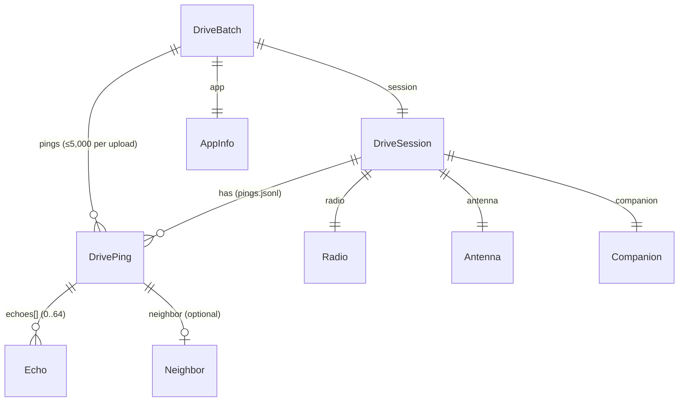

# MeshSonar data model and storage

The records MeshSonar keeps, how they're stored on the device, and how they reach the server. The wire format is
**MeshSonar Drive Format v1**. CMAT's spec is authoritative:
[`meshcore-insights/docs/MESHSONAR_DRIVE_FORMAT.md`](https://github.com/Innovatex-AI/meshcore-insights/blob/main/docs/MESHSONAR_DRIVE_FORMAT.md)
(validator: `src/lib/drive/validate.ts`). The Dart types are in `lib/core/model.dart` and `lib/core/api.dart`.

Three rules apply everywhere:

- **Unmeasured = `null`.** Values are never guessed or clamped into range. The engine nulls out-of-range readings
  before they're stored.
- **"Heard nothing" is data.** A `tx` ping with `echoes: []` is kept, stored and uploaded.
- **Phone-made UUIDs.** Every session and ping has a UUID v4 made on the phone, so re-sending is harmless (the server
  counts duplicates).



## 1. Records

JSON keys are snake_case. The "Server range" column is what CMAT accepts; anything outside it gets the ping rejected
or fails the upload.

### DriveSession (`session`)

| Field | Dart | JSON | Unit / format | Server range | Null when | Set by |
|---|---|---|---|---|---|---|
| id | `String id` | `id` | UUID v4 | required UUID | never | `services.newId()` at Start |
| startedAt | `DateTime` | `started_at` | ISO 8601 UTC | 2015 … now+1 day | never | phone clock at Start |
| endedAt | `DateTime?` | `ended_at` | ISO 8601 UTC | ≥ started_at | while driving (a crashed drive is closed at the next launch) | `endSession` at Stop, or `closeOrphanedSessions` at launch |
| label | `String?` | `label` | text | ≤ 80 chars | until the drive is named | `renameSession` (Rename), or `startDrive(label:)` |
| channel | `String?` | `channel` | e.g. `#wardriving` | ≤ 40 chars | — | settings |
| radio | `Radio` | `radio` | object | see below | fields individually | `SelfInfo` |
| antenna | `Antenna` | `antenna` | object | see below | fields individually | settings |
| companion | `Companion` | `companion` | object | see below | fields individually | `SelfInfo` |

Note: **Rename** calls `DriveStore.renameSession`, which rewrites `session.json` with the new `label` (blank → null)
and writes `resend.txt`, so the next sync sends the session again (an upload with `pings: []` if nothing else is
pending); CMAT upserts the session, so the new name replaces the old one. Exports carry the label. Names typed under
0.2.x lived only in `ui_prefs.json`; they are moved into their drives once at launch (`migrateLegacyLabels`).

### Radio (`session.radio`)

| Field | JSON | Unit | Server range | Source |
|---|---|---|---|---|
| freqMhz | `freq_mhz` | MHz | 100–3000 | SELF_INFO freq (kHz) ÷ 1000; null if 0 |
| bwKhz | `bw_khz` | kHz | 1–1000 | SELF_INFO bw (Hz) ÷ 1000; null if 0 |
| sf | `sf` | integer | 5–12 | SELF_INFO; null if 0 |
| cr | `cr` | integer | 5–8 | SELF_INFO; null if 0 |
| txDbm | `tx_dbm` | dBm | −10…40 | SELF_INFO tx_power_dbm |

### Antenna (`session.antenna`)

| Field | JSON | Unit | Server range | Source |
|---|---|---|---|---|
| type | `type` | `"internal"` or `"external"` | text ≤ 20 | Settings / Drive-screen toggle. Older or unknown values load as `internal`. |
| gainDbi | `gain_dbi` | dBi | −10…20 | Settings (optional) |
| heightM | `height_m` | m above ground | 0…300 | Settings (optional) |

### Companion (`session.companion`)

| Field | JSON | Format | Source |
|---|---|---|---|
| publicKey | `public_key` | lower-case hex (64 chars) | SELF_INFO |
| name | `name` | text ≤ 40 | SELF_INFO node name |
| firmware | `firmware` | text ≤ 40 | DEVICE_INFO `fw_version`, else `"ver <code>"` |

### DrivePing (`pings[]`)

| Field | JSON | Unit | Server range | Null when |
|---|---|---|---|---|
| id | `id` | UUID v4 | required | never |
| ts | `ts` | ISO 8601 UTC (ms) | 2015 … now+1 day | never. For `tx` it's when the send command was issued. |
| lat, lon | `lat`, `lon` | degrees (WGS-84) | ±90 / ±180, not (0,0) | never. The *filtered* fix the ping was sent at. |
| gpsAccuracyM | `gps_accuracy_m` | m (platform's horizontal accuracy) | 0…10,000 | platform didn't report it |
| speedMps | `speed_mps` | m/s | 0…150 | platform didn't measure it. A filtered fix held while parked reports 0. |
| kind | `kind` | `"tx"` / `"rx"` | enum | — The engine only produces `tx`; `rx` exists in the format for overheard packets. |
| noiseFloorDbm | `noise_floor_dbm` | dBm | −160…0 | firmware has no stats, reading was 0 (uncalibrated), or timeout |
| echoes | `echoes` | list of Echo | 0…64 | never null. `[]` = heard nothing. |
| neighbor | `neighbor` | Neighbor | — | no discovery exchange (always today; discovery is off) |
| pktHash *(v1.1)* | `pkt_hash` | MeshCore packet hash, 16 lower-case hex (8 bytes) | 16 hex | non-companion link, or nothing heard and no node name. From a heard repeat when there is one, else rebuilt from the send (see below). |
| txEpochS *(v1.1)* | `tx_epoch_s` | epoch seconds, the timestamp inside the sent packet | integer 2015…2³²−1 | non-companion link. Can be `ts`'s second + 1 (sends keep it strictly increasing). |
| txDbm *(v1.1)* | `tx_dbm` | dBm, radio TX power for this ping | −10…40 | the radio didn't report it |

**Drive Format v1.1 ping fields (0.6.0).** The server joins each ping to observer receptions by `pkt_hash` (meshsonar-infra
`docs/specs/m2-observer-ingest.md` §3). `pkt_hash` = MeshCore `Packet::calculatePacketHash` = SHA-256(payload type ‖
payload)[0..8] (TRACE also hashes `path_len`); route bits, transport codes and the path are not hashed, so every repeat
has the same hash. A channel send gets only `RESP_CODE_OK` back (no hash), but the companion's GRP_TXT is
deterministic: `[channel hash][MAC x2][AES-128-ECB(ts u32 LE ‖ 0x00 ‖ "<node name>: <text>")]`
(`buildGroupTextPayload`, `lib/radio/packet.dart`). Verified against the Oct 17 observer capture: 456/456 hashes, 301/301
MeshSonar copies rebuilt byte for byte (`test/radio/packet_hash_test.dart`). The fields ride on the `meshsonar.drive.v1`
id: live CMAT accepts only that id and ignores fields it doesn't know.

`DrivePing.heardNothing` is `kind == tx && echoes.isEmpty && neighbor == null`.

### Echo (`pings[].echoes[]`)

| Field | JSON | Unit | Server range | Meaning |
|---|---|---|---|---|
| repeater | `repeater` | lower-case hex, whole bytes | 2–64 hex chars | `path[0]`: the repeater that heard the phone directly (a 1–3 byte key prefix) |
| snrDb | `snr_db` | dB | −40…40 | SNR of the copy we heard (the **last** hop's transmission) |
| rssiDbm | `rssi_dbm` | dBm | −160…0 | RSSI of the copy we heard |
| hops | `hops` | integer | 0…64 | number of path entries. **1 = heard the repeater directly**; only those measure the phone↔repeater link. |
| path | `path` | list of hex | ≤ 64 entries | every hop's hash, first hop first |
| delayMs | `delay_ms` | ms | 0…600,000 | arrival minus send (phone clock) |

One echo per repeater per ping. The copy with the fewest hops wins, then the best SNR (see
[PROTOCOL.md §5.3](PROTOCOL.md#53-from-matches-to-echos-defaultwardriveengine_buildechoes)).

### Neighbor (`pings[].neighbor`)

| Field | JSON | Unit | Meaning |
|---|---|---|---|
| repeater | `repeater` | hex (full 32-byte key) | repeater that answered NODE_DISCOVER |
| localSnrDb | `local_snr_db` | dB (−40…40) | how we heard its answer |
| localRssiDbm | `local_rssi_dbm` | dBm (−160…0) | RSSI of its answer |
| remoteSnrDb | `remote_snr_db` | dB (−40…40) | how it heard our request |

### AppInfo (`app`)

`{name: "MeshSonar", version, platform}`. `version` is `pubspec.yaml`'s `X.Y.Z`, read at run time with
`package_info_plus` (`lib/platform/app_version.dart`); null if the platform can't report it. See
[DEVELOPMENT.md §6](DEVELOPMENT.md#6-bumping-the-version).
`platform` is `defaultTargetPlatform.name` (`android`, `iOS`, `macOS`, `linux`, `windows`) or `web`.

### RepeaterRef

`{key: full hex public key (lower-cased on read), name, lat, lon}`. It comes from CMAT's `drive-repeaters` endpoint
(cached in `repeaters.json`) or from the public node directory (cached in `node_directory.json`). It's used for names,
positions and distances only. It never changes recorded data.

### Settings (`settings.json`)

| Field | JSON | Default | Range (clamped on load) | Notes |
|---|---|---|---|---|
| serverUrl | `server_url` | `https://meshsonar.com` | http(s) URL | trailing `/` removed when edited; a saved `cmh-meshcore.lovable.app` URL is rewritten to the default at launch (0.5.0, key kept) |
| driverKey | `driver_key` | null | — | shown by the server once; the UI shows only `••••` + last 4 |
| keyStatus | `key_status` | `none` | `none`, `pending`, `approved`, `rejected`, `revoked`, `unknown` | `unknown` = server said 401 |
| display | `display` | null | — | public handle from the server |
| channel | `channel` | `#wardriving` | — | the UI always prefixes `#` |
| intervalSec | `interval_sec` | 30 | **10…120** | auto-ping interval. An old `0` ("manual only") loads as 10. |
| minDistanceM | `min_distance_m` | 100 | **15…500** | auto-ping distance |
| antenna | `antenna` | `{type: internal}` | type ∈ internal/external | gain/height optional |
| autoSync | `auto_sync` | true | — | "Upload at end of drive" |
| syncDuringDrive | `sync_during_drive` | true | — | "Upload during the drive" (needs autoSync) |
| syncEveryMin | `sync_every_min` | 5 | **1…30** | in-drive upload period |
| heardHoldPings | `heard_hold_pings` | 3 | **1…20** (slider 1…10) | heard-box hold |

## 2. On-device storage layout

Root: `getApplicationSupportDirectory()/meshsonar/` (falls back to the Documents directory). On Linux that's
`$XDG_DATA_HOME/com.meshsonar.app/meshsonar/`, usually `~/.local/share/…`. path_provider uses the legacy
`~/.local/share/meshsonar/` folder instead if that one already exists.

```
<root>/
├── settings.json              Settings (atomic: settings.json.tmp → rename)
├── repeaters.json             [RepeaterRef] from CMAT drive-repeaters (atomic)
├── node_directory.json        DirectorySnapshot from map.meshcore.io (atomic)
├── ui_prefs.json              {"onboarding_seen": bool, "labels": {}} (atomic; labels only from 0.2.x, migrated away)
└── sessions/
    └── <session id>/          id must match ^[A-Za-z0-9_-]{1,100}$ (path-like ids refused)
        ├── session.json       DriveSession JSON; rewritten atomically at start, rename and end
        ├── pings.jsonl        one DrivePing JSON per line; appended + flushed per ping
        ├── synced.txt         append-only ping ids the server confirmed (stored or duplicate)
        ├── rejected.txt       append-only ping ids the server rejected (kept locally, never re-sent)
        ├── end_sent.txt       the ended_at the server has been told about (ISO 8601)
        └── resend.txt         present after a rename until an upload carries the new session; holds a token so a
                               rename made during an upload stays marked
<temp dir>/meshsonar_export/   export files and report .txt files written before sharing
```

`node_directory.json` holds `{v: 1, source, fetched_at, center: {lat, lon}, radius_km, total_nodes, repeaters[]}`.

### Derived per-drive numbers (`SessionSummary`)

`pingCount` = readable unique pings. `heardCount` = tx pings with an echo or a neighbour. `syncedCount` = pings
whose id is in `synced.txt`. `rejectedCount` = pings in `rejected.txt` (and not in `synced.txt`).
`unsyncedCount = pingCount − syncedCount − rejectedCount` (never below 0): rejected pings are never re-sent, so they
aren't "waiting". `sessionResendPending` = `resend.txt` exists. `hasSomethingToSync = unsyncedCount > 0 ||
sessionResendPending` drives the Sync buttons. The list is sorted newest `started_at` first.

### Crash recovery rules

| Situation | Behaviour |
|---|---|
| Crash during an append leaves a last line without `\n` | Readers skip unparseable lines. The first append to that session in a new process truncates back to the last `\n` (`_repairTail`), so the next ping starts on a fresh line. |
| Garbage line in the middle of `pings.jsonl` | Skipped; the rest is kept. |
| The same ping id appears twice | The first copy is kept. |
| Crash between writing `session.json.tmp` and the rename | `session.json.tmp` is read as a fallback. |
| `settings.json` missing or corrupt | Defaults are used. A one-line notice appears if the read threw. Numbers are read num-tolerantly (`30.0` loads as 30), and a field with the wrong type falls back to its own default without resetting the others. |
| `repeaters.json`, `node_directory.json` or `ui_prefs.json` damaged | Treated as empty or first run; this only costs names or the intro. |
| App killed mid-drive | Pings already appended are safe. At the next launch `closeOrphanedSessions` (`lib/core/drive_store.dart`, called from `AppState.init`) sets `ended_at` to the latest ping time, or `started_at` with no pings. With auto-upload on and an approved key the drive is then synced quietly, so the server learns its end. |
| `engine.start` fails | A drive with no pings is deleted (no empty drive left behind); one with pings is closed and kept. |
| A write throws during a drive | The ping stays in memory and is retried before the next ping and at Stop. See [ARCHITECTURE.md §5](ARCHITECTURE.md#5-error-handling-and-the-save-first-rule). |

## 3. Export file = Drive Format v1

**Export & share** (drive card, drive detail) writes exactly one upload body for the whole drive and opens the share
sheet:

```jsonc
{
  "format": "meshsonar.drive.v1",
  "app": {"name": "MeshSonar", "version": "0.1.0", "platform": "iOS"},
  "session": { …DriveSession… },
  "pings": [ …every readable ping, file order… ]     // not split at 5,000
}
```

- File name: `meshsonar-<started_at UTC yyyyMMdd-HHmm>-<first 8 chars of session id>.json`.
- It includes every ping, including synced and rejected ones. Because the file isn't chunked, a drive with more than
  5,000 pings must be split before it can be POSTed to `drive-upload` as one request.
- `test/core/drive_store_test.dart` checks the file against a Dart mirror of the validator's shape rules
  (`test/core/helpers.dart`).

## 4. Server endpoints used

`HttpCmatClient` (`<base>/api/cmh/<name>`, JSON, `accept: application/json`):

| Endpoint | Request | Success | Timeout |
|---|---|---|---|
| `driver-request` | `POST {name, callsign?, email?}` | 200/201 `{driverId, key, status, display}` | 30 s |
| `driver-status` | `GET`, header `x-driver-key` | `{status, display}` | 30 s |
| `drive-upload` | `POST` Drive Format v1 body, header `x-driver-key` | `{sessionId, stored, duplicate, rejected, rejections[≤20]: {index, id, reason}}` | 120 s |
| `drive-repeaters` | `GET`, header `x-driver-key` | `{repeaters: [{key, name, lat, lon}], at}` | 30 s |

Errors arrive as `{error}` (a 403 also carries `status`) and are thrown as `CmatException(message, status: http
code)`. Network failures and timeouts become `CmatException` with `status: null`.

## 5. Sync rules

Implemented in `DefaultSyncService` (`lib/core/sync_service.dart`):

1. **Needs an approved key.** No key → "no driver key". A key that isn't approved → "key not approved". In both cases
   nothing is sent.
2. **What's pending** = `unsyncedPings` (not in `synced.txt` or `rejected.txt`), in file order.
3. **Chunks of ≤ 5,000 pings.** Each request carries the full session object.
4. **Marked synced only after a 200.** Stored and duplicate both count as synced. A lost 200 is safe: the re-send
   comes back as duplicates.
5. **Rejections.** Pings the server names (by `index`, else by `id`) go into `rejected.txt` and are never re-sent.
   They stay in the store and in exports. The server lists at most 20 rejections. If it rejected more than it named,
   the rest of the chunk is re-sent (already-stored pings come back as duplicates) until every rejected ping is
   identified. This takes at most one round per ping. If the server rejects pings without naming any, nothing is
   marked and the error says it will retry.
6. **End time and session changes.** If the session has `ended_at`, a chunk upload carries it and `end_sent.txt` is
   written. If nothing was pending and the server hasn't confirmed this exact `ended_at`, **or** the drive was renamed
   (`resend.txt`), one upload with `pings: []` is sent. Any successful upload clears the rename mark (only if no newer
   rename happened meanwhile). An open drive renamed with nothing pending gets one session-only upload with
   `ended_at: null`.
7. **Errors.** 403 → "key not approved", 401 → "driver key not recognised by the server". Both are fatal for
   `syncAll`, which stops at the first session. Any other error stops that session and keeps everything.
8. **One at a time.** Calls are serialised, so overlapping syncs never send the same pings twice.
9. **`syncAll`** goes through sessions oldest first, so a backlog drains in drive order.
10. **When it runs.** In-drive timer, Stop, Sync on a card or in drive detail, and Sync all. See
    [FEATURES.md §Uploads](FEATURES.md#uploads).
11. **Drive context (Drive Format v1.2).** Only when the upload server's site-config lists `meshsonar.drive.v1.2`
    (unknown = no) and there is something to send, a request is v1.2: `session.device`, the radio extras merged into
    `session.companion`, `session.enrich.weather`, per-ping `ctx` and up to 2,000 `samples`
    (`lib/core/drive_context_wire.dart`; the server rejects unknown keys, so `ble_rssi` and any value its validator
    refuses never leave). Delivered context is recorded beside the drive: `ctx_sent.txt` (ping ids), `samples_sent.txt`
    (`src|ts` keys), `context_sent.txt` (fingerprint of the device / radio part), each written only after a 200. Context
    recorded after its ping was confirmed, or for a drive uploaded before v1.2, goes through `POST drive-context`
    (ping context) and a ping-less v1.2 upload (samples, device, radio extras). A v1.2 body answered 400 as a whole is
    sent again as the plain drive (that session, this run); a ping whose `ctx` is refused is sent again without it. A
    category that is off is never in a body.

On a store that doesn't implement `SyncLedger` (test fakes), rejected ids and end markers are tracked in memory for
the life of the sync service, and renames are not re-sent on their own.

## 6. What CMAT does with it (for orientation)

Not part of the app, but useful when reading coverage numbers. CMAT's community view (`src/lib/drive/drive-read.ts`)
sums **tx** pings into ~220 m cells (0.002° lat × 0.0025° lon). A cell counts as heard when the ping has
`echoes.length > 0`. Best SNR and the cell's repeaters use only direct echoes (`hops` 1 or null). Public views trim
500 m at each end of a drive. The app's drive report uses the same cell grid ([FEATURES.md §Report](FEATURES.md#drive-report)).
