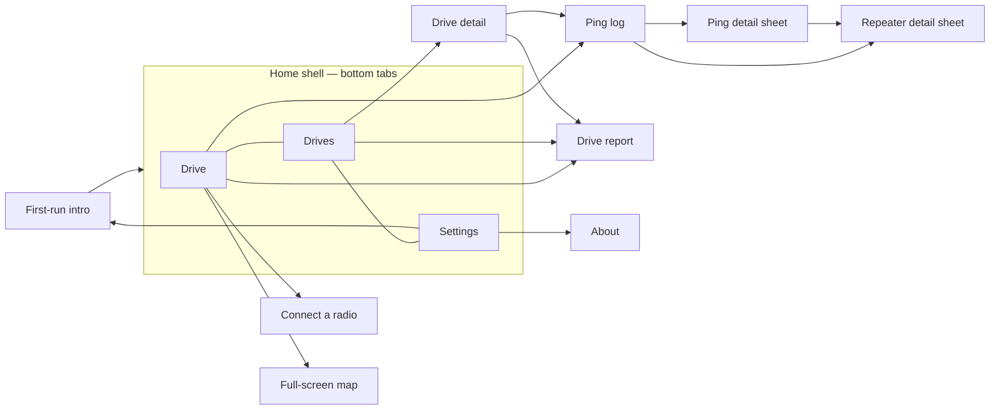

# MeshSonar features and behaviour rules

Every screen and every user-visible rule in v0.4.0, with the numbers the code uses. Widget keys are given where
tests rely on them (`Key('…')`), because a port's UI tests can reuse the same names.

## First-run intro (onboarding)

Files: `ui/onboarding/*`. The intro has three pages and is shown once. `ui_prefs.json` `onboarding_seen` is set when
it's finished or skipped.

| Page | Content | Buttons |
|---|---|---|
| 1 "Map your mesh by driving it" | What MeshSonar does; heard-nothing pings count | Next |
| 2 "Connect your radio" | BLE pairing; Simulator | **Connect radio** → Drive tab + Connect screen; **Try the Simulator** → connects the simulator |
| 3 "Get a driver key" | Drives are saved locally; key needed to upload | **Request a driver key** → Settings tab; **Get started** → Drive tab |

**Skip** is always available. Settings → "Show the welcome tour" reopens the intro. When there's no prefs file (tests),
the intro counts as already seen.

## Drive screen (tab 1)

File: `ui/drive_screen.dart` + `ui/drive/*`. It's built for one hand in a moving car. In landscape (width > height
and ≥ 640 px) the map sits on the left and the controls on the right.

- **App bar:** MeshSonar title. The **connection chip** (`connection-chip`) shows "Not connected", "Connecting…", the
  radio name, or "Simulator" with a *SIMULATED GPS & RADIO* tag. Tap it to open Connect.
- **Live coverage map** (see [Map](#coverage-map)), with these overlays:
  - **Heard box** (top left, see below), shown once a ping exists and while driving or something has been heard.
  - **Full-screen** (`map-fullscreen`) and **Layers** (`drive-map-layers`) buttons (top right).
  - **Map hint** (`map-hint`) while there are no pings: what to do next.
  - **Ping result flash** (`ping-flash`) for ~4 s after each ping: "Heard by <name or N> · +x.x dB" or "No repeaters
    heard", coloured by result.
  - **View drive report** card (`drive-report-card`) after Stop, until dismissed or a new drive starts.
- **Status row** (`status-line`): the engine's message ("Joining #wardriving", "Pinging", "Listening for repeaters",
  "Heard 2 repeaters", "Heard nothing", "Move 40 m more to ping", "No GPS fix: waiting to ping", "Radio disconnected",
  …), with a spinner, error icon or live dot.
- **Next-ping indicator:** a countdown ring "Next ping N" (time), "Move N m" (distance), "Keep moving", or "Waiting
  for GPS".
- **Stats strip:** Pings · *N heard* with heard % · Last SNR dB ("none" if the last ping heard nothing) · Synced. These
  are the current drive's numbers, or the last drive's after Stop.
- **Live stats strip, while actually driving only** (hidden before Start and after Stop — the drive report covers the
  final figures once it's over): Distance and Elapsed for this session (`DriveMapModel`/`AppState.drivePings`, same
  haversine math as `DriveStats`/`DriveReport`) · a running **new vs. repeat grid-cell tally** — *N repeat* / *N new*
  — the live counterpart of the drive report's "new grids" figure (`DriveLiveStats`, same `cellIndexOf` cell identity
  and earlier-local-drives history rule as `drive_report.dart`, kept incrementally instead of recomputed once at the
  end) · **GPS accuracy** of the current fix ("±N m", colour-coded good/fair/poor; "No fix" while waiting for one).
- **Unsaved banner** while pings are waiting to be written to the device.
- **Antenna chip** (`antenna-chip`): the connected radio's antenna, e.g. "Roof mag-mount · 5.8 dBi · 1.8 m". Tap it
  to change it before a drive. While driving it's **locked** and shows what the drive records ("External · 5.8 dBi ·
  1.8 m"). A radio that hasn't been set up shows "Set up this radio's antenna" instead (`antenna-setup`, also on the
  full-screen map), and Start drive is disabled until it is.
- **Antenna setup, once per radio** (`antenna-sheet`): when a radio without a saved antenna connects, "How is this
  radio's antenna set up?" opens: mount (`mount-handheld`, `mount-insideCar`, `mount-roofMagMount`,
  `mount-fixedMast`), gain −10 to 20 dBi or "Don't know" (`antenna-gain-unknown`), height 0 to 300 m. Saved per
  companion public key; handheld and inside car upload as `internal`, the others as `external`. After an upgrade
  from 0.3.x (an old setting other than the untouched default), gain and height are prefilled, "Don't know" is on
  when the old gain was empty, and the matching mounts are offered first. Save stays disabled, with "Pick a mount,
  enter the height, and a gain or Don't know" under it, until all three are valid. The simulator follows the same
  rule.
- **Log** button (`open-log`): "Log · N". Opens the live ping log.
- **Start drive / Stop drive** (`start-stop`). It reads "Connect radio" when nothing is connected. Next to it is **Ping
  now** (`ping-now`), enabled only while driving and not already pinging.
- **Failed start:** if the engine can't start (e.g. the channel can't be joined), "Couldn't start the drive. …" is
  shown. A drive that recorded no pings is deleted, so no empty 0-ping drive is left in the list; one that already
  has pings is closed and kept.
- **Crash or app kill mid-drive:** at the next launch any drive still open (`ended_at` null) is closed at its last
  ping's time (or its start time if it has no pings). With *Upload at end of drive* on and an approved key, those
  drives are then uploaded quietly in the background, so the server learns their end.
- **Keep awake:** the screen wake lock is on while driving (`wakelock_plus`).
- **Haptics:** a light tap when a ping is heard, a medium tap when it heard nothing.

### Auto-ping cadence

(`DefaultWardriveEngine`, settings *Auto-ping* and *Minimum distance*)

- An auto-ping goes out when **both** of these are true:
  1. **Time:** at least `intervalSec` (10–120 s; default 30) since the last ping, auto or manual. The gap is never
     shorter than one listen window (7 s).
  2. **Distance:** the current filtered GPS fix is at least `minDistanceM` (15–500 m; default 100) from where the last
     ping was sent (haversine, R = 6,371 km).
- The **first ping goes out as soon as the drive starts** (no previous ping, so time and distance are both met).
- The check runs on **every GPS fix** and on a **1 s tick**.
- **Ping now** is allowed any time while driving. It queues behind a ping already on the air, and it **resets both
  the timer and the distance anchor**.
- No GPS fix: the status says "No GPS fix: waiting to ping", and it pings once a fix arrives (if the other rules
  allow).
- After a failed auto ping, the engine waits 5 s before trying again.
- Pings never overlap: each one owns the radio for its listen window.
- Changing interval or distance in Settings **during a drive applies immediately** (`engine.updateConfig`). The
  channel can't change mid-drive.
- Values are clamped by the engine as well as by Settings. The engine also supports `intervalSec = 0` (manual only),
  but Settings can no longer produce it.

### GPS filter

(`lib/core/position_filter.dart`, applies to real GPS only; the simulator's fixes are clean)

| Rule | Value |
|---|---|
| Drop a fix with reported accuracy worse than | **50 m** — unless no fix ≤ 50 m has arrived for **10 s**, then poor fixes are used |
| Accuracy assumed when none is reported | 10 m |
| Smoothing | Accuracy-weighted 1-D Kalman on position. Process noise = (speed × dt)², speed ≥ 1 m/s, from reported speed or raw fix-to-fix speed. |
| "Stopped" speed | < **1.0 m/s** |
| "Moving" speed | ≥ **2.0 m/s** on 2 fixes in a row |
| "Clearly driving" speed | ≥ **5.0 m/s** on one fix |
| Hold radius around the parked anchor | max(2 × accuracy, **15 m**) |
| Leave the hold without speed | **3** fixes in a row beyond the radius, each further than the last, the last at least max(2 × radius, **50 m**) out (4 × radius when the phone reports speed < 1 m/s) |
| Enter the hold | First fix with no speed or speed < 1 m/s; reported speed < 1 m/s on 2 fixes in a row; or, with no speed, the last 3 fixes within the radius of their centre |
| While holding | The output is the anchor position with speed 0. Accuracy is always the raw value. |
| On leaving | The smoother restarts at the fix that proved movement (no pull-back lag) |
| `current()` | Returns the last filtered fix if it arrived within **3 s**, else asks the platform. An older cached fix never rewinds the filter. |

The filter keeps a parked phone from "driving around" and triggering distance pings. The map, the engine and the
ping positions all share one filter instance.

## Heard box

(`ui/drive/heard_box.dart`, `core/heard.dart`, setting *Heard list hold*)

- One row per repeater heard on this drive, keyed by the hex id as heard (`path[0]`).
- **Hold:** a repeater stays **live** while it was heard within the last `heardHoldPings` tx pings (1–10 on the
  slider, default 3). With hold 3, a repeater heard on ping *n* is still live on pings *n+1* and *n+2*, and goes
  **stale** on *n+3*. Every tx ping counts, including ones that heard nothing.
- Phases: **fresh** (heard on the latest ping: full colour, `×times heard`), **holding** (missed the latest ping:
  dimmed, "missed N", pips for the pings left), **stale** (greyed, folded into "+N earlier"; tap to expand up to 8).
- Rows are sorted live first, most recently heard first, then by last SNR.
- Each row shows the name (CMAT first, then map.meshcore.io; ambiguous prefix → "ABC (2 possible)"; unknown → hex), the
  live distance from the current position when the repeater's position is known, and the last SNR.
- Up to `maxRows` live rows fit (it depends on map height, max 5; 7 in full-screen portrait), then "+N more in range".
- Tap the header to collapse it to one line. Tap a row to select the repeater on the map; the map frames the repeater
  together with your position.
- The tracker resets at each Start. It is never cleared during a drive.
- Changing *Heard list hold* in Settings applies at once, even mid-drive: the live/stale rule and the pips both use the
  new value straight away (a shorter hold can grey out repeaters immediately; a longer one can bring them back).

## Coverage map

(`ui/map/coverage_map.dart`; used on the Drive screen, in full-screen, in drive detail; the report has its own cell map)

Layers, bottom to top: a chart grid (visible with no tiles), **OpenStreetMap tiles** (colour-graded to the theme; after
two tile errors a "Map offline. Pings still record." pill appears), **network coverage** (every driver's measured
cells from `GET /api/cmh/public-coverage`, squares or H3 hexagons depending on the region's grid, coloured by best
SNR on the website's own 4-step legend — a quiet "where hasn't this been driven" background layer; an area nobody
has measured is simply left blank, which is itself the gap indicator, so there's no "no data" placeholder), **range
rings** at 1 km and 2 km, **links** to every live heard repeater with a known position (solid for fresh, dashed for
holding, each with a distance label), **repeater markers** (amber diamonds that pop and glow when fresh, stay lit
while holding and grey out when stale; the CMAT list plus heard repeaters found in the public directory, plus the
simulator's repeaters in Simulator mode), **ping dots**, and the current **position**.

- Ping colours: **red** = heard nothing. Heard pings are coloured by best SNR on a **−10 → +10 dB** scale (blue → teal
  → green), or plain green in "Heard / not" mode. Unknown SNR shows mid teal. The newest dot pulses once.
- **Follow mode** keeps the position centred. Dragging turns it off and shows **Recenter** (`map-recenter`).
- Tap a repeater to see its name, a short key, "Heard N pings ago", SNR and distance.
- **Layers sheet** (`layers-sheet`): Network coverage, Hex coverage, Pings (colour by SNR / heard-not), Repeaters,
  Links to heard repeaters, Range rings. All are on by default. The choices are shared between the Drive and
  full-screen maps but not saved. Network coverage fetches once at startup (and again if the server URL changes);
  a fetch failure keeps showing whatever was already drawn rather than clearing it.
- Attribution "© OpenStreetMap contributors" is always shown with tiles. Tiles are off under `flutter test`.
- If there's no position or pings, the map centres on Columbus, Ohio (39.9612, −82.9988).

## Full-screen map

(`ui/map/fullscreen_map.dart`, `fullscreen-map`) The whole screen is map. It shows the heard box (top left), exit
(`fullscreen-close`) and layers buttons (top right), the ping flash, and a bottom panel with the status row plus
compact **Stop / Ping now** buttons (bottom-right half in landscape). **Two-finger rotate** is enabled, and a compass
returns to north-up. It respects safe areas. It shares the `DriveMapModel` with the Drive screen, so the selection,
layers and GPS stream are shared.

## Connect a radio

(`ui/connect_screen.dart`) Scanning starts automatically when nothing is connected. It lists MeshCore companions
advertising the service UUID, sorted by RSSI, with signal bars and dBm labels (≥ −60 strong, ≥ −80 good, else weak).
The page also has a **Scan again** button, a **Simulator (no radio)** entry, and the tip "Only one app can talk to the
radio at a time".

- Errors are mapped to plain text: permission (with where to fix it on iPhone/Android), Bluetooth off/unavailable,
  or a generic failure.
- If a scan stream never closes, the screen stops showing "Scanning" after 15 s.
- A connected radio shows a card with its firmware and **Disconnect**. You can't disconnect or switch radios while
  driving.
- Connect timeouts: transport 25 s, `start()` 20 s → "The radio didn't answer…".

## Simulator

(`lib/radio/simulator.dart`) With no hardware, the simulator plays the radio *and* the GPS:

- **GPS:** a ~16 km loop through Westerville, Ohio at 13 m/s (≈ 47 km/h). Accuracy is 4–6 m, with one fix per second.
  The position is a pure function of the clock.
- **Radio:** it speaks the real companion protocol. It has 8 channel slots (slot 0 = Public), firmware v9
  "v1.18.0-sim", 910.525 MHz / 62.5 kHz / SF7 / CR5 / 22 dBm, and a noise floor of −112 ± 2 dBm.
- **Mesh:** 7 made-up repeaters. Echo odds and SNR come from a log-distance path-loss model with shadowing and a
  logistic decode curve. Repeaters that heard a first-hop repeater produce 2-hop echoes. Reported SNR saturates at
  about +11.5 dB like real LoRa. 30% of pings also produce background Public traffic that must not count as an echo.
- **Labelled everywhere:** the connection chip and the map show *SIMULATED GPS & RADIO*. The simulator's repeaters are
  drawn on the map and named in the heard box.

## Ping log

(`ui/ping_log_screen.dart`, `ping-log`) Opened from **Log** (the current drive, live; after Stop it shows the drive
that just ended) or from drive detail (a saved drive; live if it's the one being driven).

- Summary: Pings · Heard % (tx) · Repeaters.
- **Pings** tab: newest first, filters **All / Heard / Heard nothing**. Each row shows the time, the result, up to 4
  repeater chips (name + hex id, `?` for an ambiguous id) and an SNR pill. Tap a row for the ping detail.
- **Repeaters** tab: repeaters aggregated over the drive, most heard first, with best SNR, times heard, last distance
  and hops. Stale ones are greyed (live log only). Tap a row for the repeater detail.

### Ping detail sheet

(`ping-detail`) Shows the result, time, SNR, position, GPS accuracy, speed (km/h and mph) and noise floor. **Every
echo** is listed with name, id, SNR, "direct" or "N hops", RSSI, delay, distance + compass bearing, source badge
(CMAT / map) and the "via A → B" path. For an ambiguous short id, the nearest 3 candidates are listed. The neighbour
exchange is shown when present. **Copy as text** (`ping-copy`) leaves unmeasured values out.

### Repeater detail sheet

(`repeater-detail`) Shows the name, id as heard, full key (or "N known repeaters share this id" / "Not in any repeater
list"), position, distance and bearing from the newest ping, times heard, last and best SNR, last heard time and hops,
and "Name from CMAT / map.meshcore.io". An **SNR sparkline** (`snr-sparkline`) plots each hearing, with gaps for
unmeasured values and a dashed 0 dB line.

## Drives list (tab 2)

(`ui/sessions_screen.dart`)

- **Overview card:** "N drives · N pings" and "N pings waiting to upload" (or "N drive names waiting to upload" after
  a rename), with **Sync all** (`sync-all`). Rejected pings don't count as waiting.
- **Drive card:** name (the drive's label, else date/time), date and channel, a "Recording" chip for the
  drive in progress, duration, distance, pings, Heard %, the **heard strip** (one bar per tx ping, bucketed so each bar
  is ≥ ~3 px; red = nothing heard, otherwise SNR colour and height ∝ heard fraction), a **sync badge**, Sync now,
  Export & share, and a menu (Sync now, Drive report, Export & share, Rename, Delete).
- **Sync badge:** *Nothing to sync* (0 pings), *All synced*, *N not synced*, *Name not synced* (renamed, every ping
  already up), *N not synced · Sync failed* (after a failed sync), *Syncing…*. Pings the server **rejected** are
  counted apart and shown as *· N rejected* (e.g. *Synced · 2 rejected*). They stay on the phone and in exports, are
  never re-sent, and don't enable Sync: **Sync now** is enabled only when there are pings waiting or a new name to send.
- **Swipe left to delete** (not for the drive in progress). The confirm dialog warns how many pings are not uploaded.
- **Rename** saves the name in the drive itself (`DriveStore.renameSession` rewrites `session.json`), so exports carry
  it, and marks the drive so the next sync sends the session again with the new name, even if every ping is already
  up. Empty clears the name (the card shows the date). Names typed under 0.2.x, which lived only in `ui_prefs.json`,
  are moved into their drives once at launch.
- Pull to refresh, or use the refresh button.

## Drive detail

(`ui/drive_detail_screen.dart`, `drive-detail`) Shows the whole route on a map (framed to the pings, zoom ≤ 15.5, no
rings or links), a header (name, date, channel, radio name, antenna, sync badge), **Sync N / Synced**, **Export**,
**Ping log**, then an 8-tile stats grid, the heard strip, "Repeaters heard" (most pings first, with a bar), and the
pings (newest first, 60 at a time, "Show all N pings"). The app bar has **Report**, **Rename**, **Delete**
(disabled while recording) and a ⋮ menu (`detail-more`) with "Report a problem with this drive".

Stats definitions (`DriveStats.of`):

| Tile | Definition |
|---|---|
| Pings | All readable pings |
| Heard | tx pings not "heard nothing" ÷ tx pings, rounded % |
| Distance | Sum of great-circle distances between consecutive pings in time order. This is ping-to-ping, not the GPS track. |
| Duration | `ended_at` (or the last ping's time) − `started_at` |
| Best SNR / Median SNR | Over each ping's best SNR (echoes and neighbour) |
| Repeaters | Distinct repeater ids heard |
| Multi-hop | Echoes with hops > 1 |

## Drive report

(`ui/report/*`, `drive-report`) Opened from the Drive screen card after Stop, from drive detail ("Report") and from the
drive card menu. It's computed once per open. **Share report** (`report-share`, `report-share-button`) shares a
plain-text summary (`.txt` plus the text itself).

Sections: **hero** (distance in km and mi, date, duration, antenna; grids mapped, % pings heard, repeaters),
**highlights**, a **grid map** of cells coloured by heard % (red = 0%, then blue → teal → green), with new cells
outlined and heard repeaters with known positions marked. Then **the drive** numbers, **signal over the drive** (SNR
chart and heard strip), **how echoes came back** (hops), the **repeater leaderboard** (`NEW`, `not on CMAT` tags) and
**best / dead spot**.

Metric definitions (`DriveReport.compute`):

| Metric | Definition |
|---|---|
| Grid cell | Same as CMAT: `(floor(lat / 0.002), floor(lon / 0.0025))`, ≈ 220 m × 210 m in central Ohio. **tx pings only.** |
| Grids mapped / with coverage | Distinct cells with ≥ 1 tx ping / with ≥ 1 heard tx ping |
| New grids | Cells no earlier drive on this phone pinged in. "Earlier" means drives that started before this one. |
| Heard % | Heard tx pings ÷ tx pings |
| Distance | Ping-to-ping haversine sum (as above) |
| Avg speed | Distance ÷ (last ping time − first ping time) |
| Top speed | Highest GPS-reported `speed_mps`. With none reported, the fastest ping-to-ping segment at least 5 s long, ignoring jumps > 70 m/s. |
| Best SNR | Highest per-ping best SNR |
| Cell best SNR | Highest per-ping best SNR in the cell. This uses **all** echoes; CMAT's map uses direct echoes only. |
| Repeater times heard | Pings on which it was heard (echo or neighbour), once per ping |
| Repeater farthest | Greatest distance from a ping position at which it was heard (known positions only) |
| New repeater | Id not heard on any earlier drive. Prefixes of different lengths match each other. |
| Not on CMAT | Not resolved from CMAT's repeater list. Only flagged when that list is loaded. |
| Hops | Echo counts: direct (1), 2, 3+ (and unknown) |
| Best spot | Heard cell with the highest best SNR, then highest heard % |
| Dead spot | Cell with unanswered pings and the lowest heard %, then the most unanswered |
| Highlights | First drive ("every grid is new"), or N new grids; new repeaters (if there are earlier drives); farthest repeater; repeaters not on CMAT |

## Settings (tab 3)

(`ui/settings_screen.dart`) Changes are saved immediately, and sliders save when the drag ends.

| Section | Item | Behaviour |
|---|---|---|
| Driver & server | **Driver key** | Without a key: a request form (name required, callsign and email optional) → `driver-request`. With a key: a status badge (No key / Pending approval / Approved / Rejected / Revoked / Not recognised by this server), the public display name, the masked key `••••abcd`, **Refresh** (`driver-status`) and **Remove key**. Approval also downloads repeater names. |
| | **Server URL** | Must be http(s) with a host. Any Drive Format v1 server works, and keys are per server: with a key saved, changing the URL first asks "Change server and remove your key?" (explaining that a key only works on the server that issued it), then removes the key and its status. Unsent drives stay on the phone and upload to the new server once it gives you a key. |
| | **Connected to** (`site-region`) | Read-only, from `GET /api/cmh/site-config`. Names the host the server URL resolves to (e.g. `cmh.meshsonar.com`; there is no separate region name on the wire). Shown only once the server has answered; absent while loading, on a server with no `site-config` endpoint, or on any fetch failure — the Server URL tile above it is unaffected either way. Refetched once at startup and again whenever the server URL changes (the old value is cleared immediately on a change, so a stale region never shows against the new server). |
| | **Radio preset** (`site-radio-preset`) | Informational comparison only — the app never writes to the radio. Shows the region's suggested MeshCore RF preset (name, frequency, bandwidth, spreading factor, coding rate) from `site-config`'s `radioPreset`. States: no `siteConfig` yet → nothing shown; `radioPreset: null` → "This region has no suggested preset."; a preset with no radio connected → the preset plus "No radio connected to compare."; a preset with a radio connected → both shown side by side, labeled "Yours" and the region's preset name. |
| | **Account link** | Under the driver key (with or without one): "Manage your drives and privacy at `<server>/me` — sign in with the same email you registered with", **Get a key on the website** (opens `<server>/me/devices`), and **Manage privacy zones on the website** (`privacy-zones-website`, opens `<server>/me/privacy`) — both in the browser (url_launcher). If no browser opens, a message gives the address. |
| Wardriving | **Channel** | Default `#wardriving`; `#` is added if missing |
| | **Auto-ping** | Slider, every 5 s from **10 to 120 s** (default 30) |
| | **Minimum distance** | Slider stops 15, 25, 50, 75, 100, 125, 150, 200, 250, 300, 400, **500 m** (default 100) |
| | **Heard list hold** | 1–10 pings (default 3) |
| Antenna | **Each saved radio** (`antenna-profile-<key>`) | Name (or key prefix) with mount, gain and height. Tap to edit; **Forget** (`antenna-forget-<key>`) asks again on that radio's next connect. Both are locked for the radio in use while driving ("Locked while driving") |
| Upload | **Upload at end of drive** | `autoSync`, default on |
| | **Upload during the drive** | Default on; needs the end-of-drive toggle |
| | **Upload interval** | 1–30 min (default 5) |
| | Last upload | "Uploading…", "Last upload HH:MM:SS · OK", "Last upload failed: …", or "No uploads yet" |
| | **Repeater names** | Count saved for offline use. Tap (needs a key) to refresh CMAT names and force a public-directory refresh. |
| About | **Report a problem** (`report-problem`) | See [Report a problem](#report-a-problem) |
| | **About MeshSonar** | Version (from the build via `package_info_plus`), MIT text, short notices, Flutter licence page |
| | **Show the welcome tour** | Reopens the intro |

## Region data, telemetry and timeline (0.19)

- **ETag cache** (`lib/core/etag_client.dart`, `region_cache.dart`): region reads send `If-None-Match`; a 304 reuses the stored body. With no network the Region tab shows the stored data labelled "Offline - as of <time>".
- **Idle region detection** (`lib/core/idle_region_watcher.dart`): when not driving, a coarse, distance-filtered location stream (at most one fix per 20 s) feeds the region tracker so the Region tab follows the phone. It is cancelled during a drive and in the background unless "Always" location is granted. The last fix is kept in `last_known_fix.json` so the next launch shows the right region before the first GPS fix. The radio preset is never changed silently: same preset notifies and switches, a different preset prompts.
- **Telemetry uploader** (`lib/core/telemetry_uploader.dart`, `telemetry.dart`): on by default with a first-run disclosure and a visible opt-out in Settings. Sends packet headers and metadata only (type, route, path hashes, SNR/RSSI, time, packet hash) to `POST /api/cmh/telemetry` with the driver key. Never payloads, coordinates, your own pings or private message types. Turning it off clears the queue and offers `DELETE` to erase what was already shared.
- **Coverage timeline**: Map layers > Network coverage > Coverage options > "Coverage growth (as of)" slider with play/pause and a Live reset. Built from windowed `public-coverage?until=` calls; the first-data day comes from `region-timeline` (days only).

## Drive context: data collected (stream 7, core only, not switched on yet)

Built as pure-Dart pieces; nothing below is collected in a drive until the drive flow starts the recorder and the
versioned disclosure + Settings categories ship (separate work). Design: meshsonar-infra planning
`stream-7-data-collection.md`.

- **Categories** (`lib/core/data_categories.dart`): packet headers (live today), motion and altitude, air pressure,
  phone battery, phone and app details, radio health, radio settings, weather. Each has a stable id, title, exact
  disclosure sentence, the stored keys it owns, default ON (opt-out, Andy Oct 24 2026), destination and availability
  (`live`, `recorderReady`, `needsSensorPlugin`, `needsServer`) so the UI never presents uncollected data as collected.
- **Radio health** (`lib/radio/radio_health.dart`): every 60 s during a drive, GET_STATS radio/core/packets plus
  GET_BATT_AND_STORAGE every 15 min; never while a ping is in flight (it waits, then skips); firmware that lacks a
  command is asked once. Values the radio did not measure stay empty (0 mV battery, 0 noise floor, 0 RSSI).
  `err_flags` is the firmware's sticky error bitmask, not a counter. Channel utilisation is not reported by MeshCore.
- **Storage** (`JsonlDriveStore`): `samples.jsonl` (no coordinates), `ctx.jsonl` (per ping), `context.json` (per
  drive) beside the drive, crash-safe like `pings.jsonl`. The upload and the export are byte-identical to before.
  Turning a category off strips its keys from stored context (`stripCategories`, atomic rewrite).
- **GPS extras**: `GeoFix` keeps altitude, vertical accuracy, course over ground and its accuracy, speed accuracy
  (null when the phone did not measure them); they are context only, never part of the drive upload.
- **Simulator**: answers every stats command with counters that follow what it did (pings sent, packets heard,
  airtime, a slowly draining battery, 120 / 1984 KB storage).

## Uploads

- **During the drive:** a timer every `syncEveryMin` minutes runs while *driving* **and** both toggles are on
  **and** the key is approved. Settings changes start, stop or restart it right away. A tick is skipped while the
  previous upload is still running or a start/stop is in progress. Uploads wait for pending local writes. Failures
  are quiet (shown in Settings → Last upload) and retried on the next tick. A 403 or "not approved" triggers a quiet
  key-status refresh.
- **At Stop:** after the drive is closed and any in-flight upload finishes, the drive is synced if *Upload at end of
  drive* is on and the key is approved. The user then sees "Uploaded N new pings…", or "Drive saved. Nothing new to
  upload." If the key isn't approved yet: "Drive saved. It will upload once your driver key is approved." Otherwise:
  "Drive saved on this phone."
- **Manual:** Sync on a drive card or in drive detail, and Sync all. Without an approved key these explain what to do.
  Sync is enabled when pings are waiting or a renamed drive's new name hasn't been sent; rejected pings never enable it.
- **At launch:** drives closed after a crash (see Drive screen) are uploaded quietly when the key is approved.
- Rules for what's sent are in [DATA_MODEL.md §5](DATA_MODEL.md#5-sync-rules).
- **Where data goes:** drives (and problem reports) are sent **only to the server in Settings**. The only other
  hosts the app contacts are `map.meshcore.io` (a GET of the public node map, with no location in it) and the map
  tiles. There is no MeshMapper forwarding (`test/integration/hosts_test.dart`).

## Report a problem

(`ui/report_problem_screen.dart`, `report-screen`) From Settings → About or a drive's ⋮ menu (which attaches that
drive). Needs a driver key that is pending or approved; otherwise the screen says why (`report-needs-key`), and
**Open driver key settings** (`report-key-settings`) opens the driver key over the form; Back returns to the form as
it was.

- **Form:** category chips (`report-category-<bug|radio|gps|upload|map|idea|other>`); description, 1 to 4,000
  characters with a live counter (`report-counter`, red over the limit); **Include app log** (on by default);
  **Attach a drive** (none or one of the 20 most recent; only its id is sent). **Review report** (`report-review`).
- **Review** (`report-preview`): the exact JSON body that will be sent, selectable; its size ("0.2 MB of 5 MB");
  "We removed N keys and rounded M locations."; "Log shortened to fit 5 MB." when the oldest log lines had to go.
  **Send report** (`report-send`) is the only Send button.
- **What's added:** app name, version, build and platform; the phone's OS, OS version and locale; the connected
  radio's name, firmware and radio settings (not its public key); with the log, the last 1,000 app events plus a
  settings snapshot (server host only). Everything is redacted on the phone first (`lib/core/redact.dart`), and the
  driver key and full server address are removed word for word from the log.
- **Results:** 201 "Sent. Thank you." with the first 8 characters of the report id; 401 "The server doesn't
  recognise this driver key."; 403 "This driver key can't send reports (rejected or revoked)."; 429 "Too many reports
  in the last hour. Try again later." (each followed by "Your report is saved on this phone."); 404/503 "This server
  doesn't accept problem reports."; 413 "The report is too large."; 400 "The server couldn't accept this report as
  written." with **Edit report** (`report-edit`) and **Discard** (`report-discard`); no signal, a timeout or a 5xx
  "Not sent. Your report is saved on this phone; send it when you have signal."
- **Saved report:** the report and its form are saved (`report_draft.json`) before sending and deleted only when the
  server takes it. Opening Report a problem then restores the form and offers **Send saved report** (the same review
  again) or **Discard**. It is never sent without that tap.

## Repeater directory (names and positions)

- **CMAT list** (`drive-repeaters`, needs an approved key): fetched at launch when approved, after approval, and on
  "Repeater names" tap. It's cached in `repeaters.json`. An empty answer never wipes existing names.
- **Public node map** (`https://map.meshcore.io/api/v1/nodes`, ~66k nodes, ~17 MB gzipped): the body is streamed and
  split object by object. The app keeps **repeaters (type 2) with a position within 150 km** of the centre, nearest
  first, max 3,000. It skips adverts older than 180 days (never-heard dates are kept) and (0,0) positions, and caps
  names at 64 chars. The cache goes to `node_directory.json`.
  - Refreshed when the cache is older than **7 days** (the app setting; the class default is 24 h), when the drive
    area moves more than **75 km** (half the radius), or when forced.
  - It's triggered at launch (if stale) and on the **first ping of each drive** (around that position).
  - A failure backs off for **30 min**. There's a 20 s idle timeout, a 120 s total cap, and the download stops above
    120 MiB. It never throws: offline only means fewer names.
- **Lookup order:** CMAT first, then the public map. A prefix that matches several different keys is "ambiguous" and
  is never guessed. Two entries with the same full key count as one.

## Export & share

The drive card and drive detail write one Drive Format v1 JSON file (see [DATA_MODEL.md §3](DATA_MODEL.md#3-export-file--drive-format-v1))
to the temp folder and open the platform share sheet (`share_plus`). The drive report shares a `.txt` file and its
text.

## Messages

All errors are turned into one short plain-language line (`lib/app/messages.dart`). Data-safety wording ("your data is
safe on this phone") is used for network and server errors. 401, 403, 413 and 429 each get their own text.
