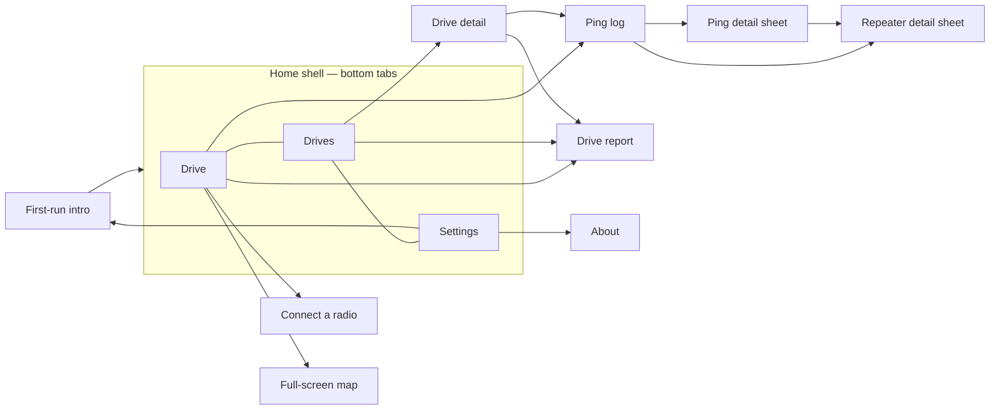

# MeshSonar features and behaviour rules

Every screen and every user-visible rule in v0.4.0, with the numbers the code uses. Widget keys are given where
tests rely on them (`Key('…')`), because a port's UI tests can reuse the same names.

## First-run intro (onboarding)

Files: `ui/onboarding/*`. The intro has three pages and is shown once. `ui_prefs.json` `onboarding_seen` is set when
it's finished or skipped.

| Page | Content | Buttons |
|---|---|---|
| 1 "Map your mesh by driving it" | What MeshSonar does; heard-nothing pings count | Next |
| 2 "Connect your radio" | BLE pairing; Simulator | **Connect radio** → Drive tab + Connect screen; **Try the Simulator** → connects the simulator |
| 3 "Nothing to sign up for" | The driver key is created automatically; drives are saved locally and upload on their own | **Get started** → Drive tab |

**Skip** is always available. Settings → "Show the welcome tour" reopens the intro. When there's no prefs file (tests),
the intro counts as already seen.

## Drive screen (tab 1)

File: `ui/drive_screen.dart` + `ui/drive/*`. It's built for one hand in a moving car. In landscape (width > height
and ≥ 640 px) the map sits on the left and the controls on the right.

- **App bar:** MeshSonar title. The **connection chip** (`connection-chip`) shows "Not connected", "Connecting…", the
  radio name, or "Simulator" with a *SIMULATED GPS & RADIO* tag. Tap it to open Connect.
- **Live coverage map** (see [Map](#coverage-map)), with these overlays:
  - **Heard box** (top left, see below), shown once a ping exists and while driving or something has been heard.
  - **Full-screen** (`map-fullscreen`) and **Layers** (`drive-map-layers`) buttons (top right).
  - **Map hint** (`map-hint`) while there are no pings: what to do next.
  - **Ping result flash** (`ping-flash`) for ~4 s after each ping: "Heard by <name or N> · +x.x dB" or "No repeaters
    heard", coloured by result.
  - **View drive report** card (`drive-report-card`) after Stop, until dismissed or a new drive starts.
- **Status row** (`status-line`): the engine's message ("Joining #wardriving", "Pinging", "Listening for repeaters",
  "Heard 2 repeaters", "Heard nothing", "Move 40 m more to ping", "No GPS fix: waiting to ping", "Radio disconnected",
  …), with a spinner, error icon or live dot.
- **Next-ping indicator:** a countdown ring "Next ping N" (time), "Move N m" (distance), "Keep moving", or "Waiting
  for GPS".
- **Stats strip:** Pings · *N heard* with heard % · Last SNR dB ("none" if the last ping heard nothing) · Synced. These
  are the current drive's numbers, or the last drive's after Stop.
- **Live stats strip, while actually driving only** (hidden before Start and after Stop — the drive report covers the
  final figures once it's over): Distance and Elapsed for this session (`DriveMapModel`/`AppState.drivePings`, same
  haversine math as `DriveStats`/`DriveReport`) · a running **new vs. repeat grid-cell tally** — *N repeat* / *N new*
  — the live counterpart of the drive report's "new grids" figure (`DriveLiveStats`, same `cellIndexOf` cell identity
  and earlier-local-drives history rule as `drive_report.dart`, kept incrementally instead of recomputed once at the
  end) · **GPS accuracy** of the current fix ("±N m", colour-coded good/fair/poor; "No fix" while waiting for one).
- **Unsaved banner** while pings are waiting to be written to the device.
- **Antenna chip** (`antenna-chip`): the connected radio's antenna, e.g. "Roof mag-mount · 5.8 dBi · 1.8 m". Tap it
  to change it before a drive. While driving it's **locked** and shows what the drive records ("External · 5.8 dBi ·
  1.8 m"). A radio that hasn't been set up shows "Set up this radio's antenna" instead (`antenna-setup`, also on the
  full-screen map), and Start drive is disabled until it is.
- **Antenna setup, once per radio** (`antenna-sheet`): when a radio without a saved antenna connects, "How is this
  radio's antenna set up?" opens: mount (`mount-handheld`, `mount-insideCar`, `mount-roofMagMount`,
  `mount-fixedMast`), gain −10 to 20 dBi or "Don't know" (`antenna-gain-unknown`), height 0 to 300 m. Saved per
  companion public key; handheld and inside car upload as `internal`, the others as `external`. After an upgrade
  from 0.3.x (an old setting other than the untouched default), gain and height are prefilled, "Don't know" is on
  when the old gain was empty, and the matching mounts are offered first. Save stays disabled, with "Pick a mount,
  enter the height, and a gain or Don't know" under it, until all three are valid. The simulator follows the same
  rule.
- **Log** button (`open-log`): "Log · N". Opens the live ping log.
- **Start drive / Stop drive** (`start-stop`). It reads "Connect radio" when nothing is connected. Next to it is **Ping
  now** (`ping-now`), enabled only while driving and not already pinging.
- **Failed start:** if the engine can't start (e.g. the channel can't be joined), "Couldn't start the drive. …" is
  shown. A drive that recorded no pings is deleted, so no empty 0-ping drive is left in the list; one that already
  has pings is closed and kept.
- **Crash or app kill mid-drive:** at the next launch any drive still open (`ended_at` null) is closed at its last
  ping's time (or its start time if it has no pings). With *Upload at end of drive* on and an approved key, those
  drives are then uploaded quietly in the background, so the server learns their end.
- **Keep awake:** the screen wake lock is on while driving (`wakelock_plus`).
- **Haptics:** a light tap when a ping is heard, a medium tap when it heard nothing.

### Auto-ping cadence

(`DefaultWardriveEngine`, settings *Auto-ping* and *Minimum distance*)

- An auto-ping goes out when **both** of these are true:
  1. **Time:** at least `intervalSec` (10–120 s; default 30) since the last ping, auto or manual. The gap is never
     shorter than one listen window (7 s).
  2. **Distance:** the current filtered GPS fix is at least `minDistanceM` (15–500 m; default 100) from where the last
     ping was sent (haversine, R = 6,371 km).
- The **first ping goes out as soon as the drive starts** (no previous ping, so time and distance are both met).
- The check runs on **every GPS fix** and on a **1 s tick**.
- **Ping now** is allowed any time while driving. It queues behind a ping already on the air, and it **resets both
  the timer and the distance anchor**.
- No GPS fix: the status says "No GPS fix: waiting to ping", and it pings once a fix arrives (if the other rules
  allow).
- After a failed auto ping, the engine waits 5 s before trying again.
- Pings never overlap: each one owns the radio for its listen window.
- Changing interval or distance in Settings **during a drive applies immediately** (`engine.updateConfig`). The
  channel can't change mid-drive.
- Values are clamped by the engine as well as by Settings. The engine also supports `intervalSec = 0` (manual only),
  but Settings can no longer produce it.

### GPS filter

(`lib/core/position_filter.dart`, applies to real GPS only; the simulator's fixes are clean)

| Rule | Value |
|---|---|
| Drop a fix with reported accuracy worse than | **50 m** — unless no fix ≤ 50 m has arrived for **10 s**, then poor fixes are used |
| Accuracy assumed when none is reported | 10 m |
| Smoothing | Accuracy-weighted 1-D Kalman on position. Process noise = (speed × dt)², speed ≥ 1 m/s, from reported speed or raw fix-to-fix speed. |
| "Stopped" speed | < **1.0 m/s** |
| "Moving" speed | ≥ **2.0 m/s** on 2 fixes in a row |
| "Clearly driving" speed | ≥ **5.0 m/s** on one fix |
| Hold radius around the parked anchor | max(2 × accuracy, **15 m**) |
| Leave the hold without speed | **3** fixes in a row beyond the radius, each further than the last, the last at least max(2 × radius, **50 m**) out (4 × radius when the phone reports speed < 1 m/s) |
| Enter the hold | First fix with no speed or speed < 1 m/s; reported speed < 1 m/s on 2 fixes in a row; or, with no speed, the last 3 fixes within the radius of their centre |
| While holding | The output is the anchor position with speed 0. Accuracy is always the raw value. |
| On leaving | The smoother restarts at the fix that proved movement (no pull-back lag) |
| `current()` | Returns the last filtered fix if it arrived within **3 s**, else asks the platform. An older cached fix never rewinds the filter. |

The filter keeps a parked phone from "driving around" and triggering distance pings. The map, the engine and the
ping positions all share one filter instance.

## Heard box

(`ui/drive/heard_box.dart`, `core/heard.dart`, setting *Heard list hold*)

- One row per repeater heard on this drive, keyed by the hex id as heard (`path[0]`).
- **Hold:** a repeater stays **live** while it was heard within the last `heardHoldPings` tx pings (1–10 on the
  slider, default 3). With hold 3, a repeater heard on ping *n* is still live on pings *n+1* and *n+2*, and goes
  **stale** on *n+3*. Every tx ping counts, including ones that heard nothing.
- Phases: **fresh** (heard on the latest ping: full colour, `×times heard`), **holding** (missed the latest ping:
  dimmed, "missed N", pips for the pings left), **stale** (greyed, folded into "+N earlier"; tap to expand up to 8).
- Rows are sorted live first, most recently heard first, then by last SNR.
- Each row shows the name (CMAT first, then map.meshcore.io; ambiguous prefix → "ABC (2 possible)"; unknown → hex), the
  live distance from the current position when the repeater's position is known, and the last SNR.
- Up to `maxRows` live rows fit (it depends on map height, max 5; 7 in full-screen portrait), then "+N more in range".
- Tap the header to collapse it to one line. Tap a row to select the repeater on the map; the map frames the repeater
  together with your position.
- The tracker resets at each Start. It is never cleared during a drive.
- Changing *Heard list hold* in Settings applies at once, even mid-drive: the live/stale rule and the pips both use the
  new value straight away (a shorter hold can grey out repeaters immediately; a longer one can bring them back).

## Coverage map

(`ui/map/coverage_map.dart`; used on the Drive screen, in full-screen, in drive detail; the report has its own cell map)

Layers, bottom to top: a chart grid (visible with no tiles), a downloaded **offline region pack** where one covers the
view (see [Offline maps](#offline-maps-region-packs)), otherwise **OpenStreetMap tiles** (colour-graded to the theme; after
two tile errors a "Map offline. Pings still record." pill appears), **network coverage** (every driver's measured
cells from `GET /api/cmh/public-coverage`, squares or H3 hexagons depending on the region's grid, coloured by best
SNR on the website's own 4-step legend — a quiet "where hasn't this been driven" background layer; an area nobody
has measured is simply left blank, which is itself the gap indicator, so there's no "no data" placeholder), **range
rings** at 1 km and 2 km, **links** to every live heard repeater with a known position (solid for fresh, dashed for
holding, each with a distance label), **repeater markers** (amber diamonds that pop and glow when fresh, stay lit
while holding and grey out when stale; the CMAT list plus heard repeaters found in the public directory, plus the
simulator's repeaters in Simulator mode), **ping dots**, and the current **position**.

- Ping colours: **red** = heard nothing. Heard pings are coloured by best SNR on a **−10 → +10 dB** scale (blue → teal
  → green), or plain green in "Heard / not" mode. Unknown SNR shows mid teal. The newest dot pulses once.
- **Follow mode** keeps the position centred. Dragging turns it off and shows **Recenter** (`map-recenter`).
- **Repeater names** are written beside every repeater marker (layers sheet > Network > Repeater names, on by default and
  remembered): collision-avoided, zoom-dependent (none below zoom 9; heard-this-drive from 9; the rest from 11; at most 8/14/24/36/60
  labels by zoom), heard first then nearest, with a halo for contrast. Names also appear on the drive report map.
- **Grid resolution follows the zoom** for both the drive's hexagons and the network layer: res 7 (zoom < 11.5), 8 (< 12.5), 9 (< 14),
  10 (< 15.5), 11. A resolution pinned in Coverage options applies to both.
- Tap a repeater to see its name, a short key, "Heard N pings ago", SNR and distance.
- **Layers sheet** (`layers-sheet`), generated from the layer registry, in four sections: **This drive** (Hex
  coverage, Links to heard repeaters, Repeaters heard, Pings with colour by SNR / heard-not), **Coverage** (Network
  coverage with its colour-by / detail / since / source controls), **Network** (All MeshCore repeaters, Region repeaters, Observers, Repeater names) and **Around you** (Range rings). Drive layers, Network coverage, All MeshCore repeaters and Repeater names are on by
  default; Region repeaters and Observers are off. A default-on layer the server cannot offer shows off and disabled. Every server-fed layer says where it stands under its switch: a count and source ("3
  repeaters · 4 hidden by their owners · Data: MeshCore Map (map.meshcore.io)", "1 observer with a public position",
  "753 cells measured"), "Loading…", "Couldn't load. Check the connection and retry." with **Retry**, "… · Offline - as
  of 2h ago" for a stored copy (with Retry), or a reason with the switch disabled: "Not available on this server yet"
  (the server answers 404), "No repeaters reported yet", "Pick a region to see its observers". A layer that is on can
  always be switched off. The choices are shared between the Drive and full-screen maps but not saved (except Repeater names). Network coverage
  fetches once at startup (and again if the server URL changes); a fetch failure keeps showing whatever was already
  drawn rather than clearing it.
- **All MeshCore repeaters** (`network`, on by default): every repeater and room server with a public position, from
  the server's `network-repeaters` list (live since Oct 24 2026, 55.6k rows; synced on open, at most every 6 h, stored for offline use, about 6 MB on disk). **Cheap refresh:** once a list is stored and the server advertises `networkRepeatersDelta` (site-config), a refresh asks only for what changed since the stored cursor (`?updated_since=`): about 0.2 MB on the wire instead of 3.6 MB, applied to the stored list (removals first, then rows by key) and saved atomically. Anything unexpected (410 too old, a body that does not add up, a stored list more than 13 days behind, a last full download over 30 days ago, no capability) quietly downloads the full list once instead, never an error. Clustered: one
  painter, only what is on screen, clusters with counts that split as you zoom. Colour = last advert (24 h green, 7 days
  blue, 30 days amber, older grey; room servers are rings). **Scope**: when your region is known (the phone is in it,
  you picked it, or it is the remembered one while the phone's position is unknown) only that region's repeaters plus
  40 km around its edges are drawn ("N repeaters in and around Columbus, US"); otherwise (new visitor, phone outside
  every region) the whole world as count bubbles, like the other online MeshCore maps: bubbles show their total (13/15
  px heavy text on an opaque fill, ink chosen for at least 4.5:1 contrast in light and dark), split as you zoom in,
  merge as you zoom out, single dots at street zoom; screen readers hear "1,234 repeaters". The list is built off the
  UI thread and the layer appears when it is ready. Legend in the sheet with the data's "as of" time, and a
  small legend + "Data: MeshCore Map (map.meshcore.io)" on the map while it is on. Advert-age colours are recomputed
  when the list is refreshed (also a 304 "unchanged") and when the layer is switched on if they are over 10 minutes
  old. With Region repeaters also on, roster repeaters are drawn once, by the roster layer.
- **Region repeaters** (`repeaters`): the viewed region's roster from the repeater sync (offline copy included),
  clustered, coloured by status (active, quiet, new, stale; legend in the sheet).
- **Observers** (`observers`): the viewed region's observers whose owner made the position public
  (`region-observers`, fetched when the layer is switched on and when the viewed region changes), triangles (online
  filled teal, offline outline).
- **Tap for detail**: a coverage cell opens the cell sheet; a repeater (either layer) the repeater sheet (name, type,
  copyable key, last advert / last heard, distance from you in your Units, roster status / SNR / grade / adverts /
  neighbours / hash prefix when known, source, **Open repeater page** for a roster repeater); several repeaters on one
  spot a list; a cluster zooms to its members (follow stops, Recenter appears); an observer the observer sheet (online
  state, last seen, noise floor, packets per hour, nodes heard in 24 h, radio, reported battery mV, distance, source and
  how the position was published).
- Attribution "© OpenStreetMap contributors" is always shown with tiles. Tiles are off under `flutter test`.
- If there's no position or pings, the map centres on Columbus, Ohio (39.9612, −82.9988).

### Map layer engine

Building blocks behind the layers above (stream-1-maps.md), in `ui/map/layers/` and `ui/map/sheets/`:

- **Layer registry**: every map layer with the website's `?show=` key where the website has the same layer
  (`measured`, `repeaters`, `observers`, `network`) and app-only keys for the drive layers (`hexes`, `links`,
  `neighbours`, `heard`, `pings`, `rings`). `neighbours` (links of the selected repeater) is registered but not drawn
  yet, so the sheet does not list it.
- **Map links**: `MapViewState` reads and writes `https://<region>.meshsonar.com/coverage?show=…&color=…&since=…&src=…
  &res=…&lat=…&lon=…` (the website's own parameters, same validation) plus `z` and `until`, and the same query on
  `meshsonar://map?…&region=cmh`. Opening such a link in the app (URL scheme, app_links) is not built yet.

## Full-screen map

(`ui/map/fullscreen_map.dart`, `fullscreen-map`) The whole screen is map. It shows the heard box (top left), exit
(`fullscreen-close`) and layers buttons (top right), the ping flash, and a bottom panel with the status row plus
compact **Stop / Ping now** buttons (bottom-right half in landscape). **Two-finger rotate** is enabled, and a compass
returns to north-up. It respects safe areas. It shares the `DriveMapModel` with the Drive screen, so the selection,
layers and GPS stream are shared.

## Connect a radio

(`ui/connect_screen.dart`) Scanning starts automatically when nothing is connected. It lists MeshCore companions
advertising the service UUID, sorted by RSSI, with signal bars and dBm labels (≥ −60 strong, ≥ −80 good, else weak).
The page also has a **Scan again** button, a **Simulator (no radio)** entry, and the tip "Only one app can talk to the
radio at a time".

- Errors are mapped to plain text: permission (with where to fix it on iPhone/Android), Bluetooth off/unavailable,
  or a generic failure.
- If a scan stream never closes, the screen stops showing "Scanning" after 15 s.
- A connected radio shows a card with its firmware and **Disconnect**. You can't disconnect or switch radios while
  driving.
- Connect timeouts: transport 25 s, `start()` 20 s → "The radio didn't answer…".

## Simulator (debug builds only)

Release and TestFlight builds do not contain the Simulator (`lib/app/build_flags.dart`); the description below applies to debug builds and tests.

(`lib/radio/simulator.dart`) With no hardware, the simulator plays the radio *and* the GPS:

- **GPS:** a ~16 km loop through Westerville, Ohio at 13 m/s (≈ 47 km/h). Accuracy is 4–6 m, with one fix per second.
  The position is a pure function of the clock.
- **Radio:** it speaks the real companion protocol. It has 8 channel slots (slot 0 = Public), firmware v9
  "v1.18.0-sim", 910.525 MHz / 62.5 kHz / SF7 / CR5 / 22 dBm, and a noise floor of −112 ± 2 dBm.
- **Mesh:** 7 made-up repeaters. Echo odds and SNR come from a log-distance path-loss model with shadowing and a
  logistic decode curve. Repeaters that heard a first-hop repeater produce 2-hop echoes. Reported SNR saturates at
  about +11.5 dB like real LoRa. 30% of pings also produce background Public traffic that must not count as an echo.
- **Labelled everywhere:** the connection chip and the map show *SIMULATED GPS & RADIO*. The simulator's repeaters are
  drawn on the map and named in the heard box.

## Ping log

(`ui/ping_log_screen.dart`, `ping-log`) Opened from **Log** (the current drive, live; after Stop it shows the drive
that just ended) or from drive detail (a saved drive; live if it's the one being driven).

- Summary: Pings · Heard % (tx) · Repeaters.
- **Pings** tab: newest first, filters **All / Heard / Heard nothing**. Each row shows the time, the result, up to 4
  repeater chips (name + hex id, `?` for an ambiguous id) and an SNR pill. Tap a row for the ping detail.
- **Repeaters** tab: repeaters aggregated over the drive, most heard first, with best SNR, times heard, last distance
  and hops. Stale ones are greyed (live log only). Tap a row for the repeater detail.

### Ping detail sheet

(`ping-detail`) Shows the result, time, SNR, position, GPS accuracy, speed (km/h and mph) and noise floor. **Every
echo** is listed with name, id, SNR, "direct" or "N hops", RSSI, delay, distance + compass bearing, source badge
(CMAT / map) and the "via A → B" path. For an ambiguous short id, the nearest 3 candidates are listed. The neighbour
exchange is shown when present. **Copy as text** (`ping-copy`) leaves unmeasured values out.

### Repeater detail sheet

(`repeater-detail`) Shows the name, id as heard, full key (or "N known repeaters share this id" / "Not in any repeater
list"), position, distance and bearing from the newest ping, times heard, last and best SNR, last heard time and hops,
and "Name from CMAT / map.meshcore.io". An **SNR sparkline** (`snr-sparkline`) plots each hearing, with gaps for
unmeasured values and a dashed 0 dB line.

## Drives list (tab 2)

(`ui/sessions_screen.dart`)

- **Overview card:** "N drives · N pings" and "N pings waiting to upload" (or "N drive names waiting to upload" after
  a rename), with **Sync all** (`sync-all`). Rejected pings don't count as waiting.
- **Drive card:** name (the drive's label, else date/time), date and channel, a "Recording" chip for the
  drive in progress, duration, distance, pings, Heard %, the **heard strip** (one bar per tx ping, bucketed so each bar
  is ≥ ~3 px; red = nothing heard, otherwise SNR colour and height ∝ heard fraction), a **sync badge**, Sync now,
  Export & share, and a menu (Sync now, Drive report, Export & share, Rename, Delete).
- **Sync badge:** *Nothing to sync* (0 pings), *All synced*, *N not synced*, *Name not synced* (renamed, every ping
  already up), *N not synced · Sync failed* (after a failed sync), *Syncing…*. Pings the server **rejected** are
  counted apart and shown as *· N rejected* (e.g. *Synced · 2 rejected*). They stay on the phone and in exports, are
  never re-sent, and don't enable Sync: **Sync now** is enabled only when there are pings waiting or a new name to send.
- **Swipe left to delete** (not for the drive in progress). The confirm dialog warns how many pings are not uploaded.
- **Rename** saves the name in the drive itself (`DriveStore.renameSession` rewrites `session.json`), so exports carry
  it, and marks the drive so the next sync sends the session again with the new name, even if every ping is already
  up. Empty clears the name (the card shows the date). Names typed under 0.2.x, which lived only in `ui_prefs.json`,
  are moved into their drives once at launch.
- **Your progress card** (`progress-card`, under the overview): this ISO week from the drive list ("This week (since
  Monday Oct 12): 2 drives, 412 pings, 61% heard"); tap for **Your progress** (below).
- Pull to refresh, or use the refresh button.

## Your progress

(`ui/report/progress_screen.dart`, maths in `core/personal_progress.dart`) Every drive stored on this phone, and it
says so at the top ("From drives stored on this phone: N drives since ... Drives deleted from this phone or recorded on
another phone are not included."). With a server that offers `driverSummary` and an approved or pending key, a switch adds the account's history from the server (see "Your progress, server view" below). A drive that cannot be read is skipped and counted in a banner.

- **Totals:** drives, distance, time driving, pings, heard %, grid cells, repeaters heard, best SNR.
- **By week** (ISO weeks starting Monday in the phone's local time, zone named in every caption; a drive counts in the
  week it started; weeks run without holes to the current week; charts show the last 26 weeks, tables all):
  distance per week (km or mi), heard % per week (no bar = no pings), new grid cells per week and new repeaters per
  week (new = first time any drive on this phone had it; tables carry the running totals).
- **Best drives:** longest drive, longest time out, best heard % (at least 10 pings), most new grid cells, most
  repeaters on one drive, best SNR; tap one for its drive report.
- **Your radio:** noise floor per drive (median, -100 dBm line), noise floor by hour of day (local), TX power per drive
  (one line when it never changed). Only what the radio reported; "Your radio has not reported ..." otherwise.
- Every chart has the Chart / Table switch and its numbers in the semantics label. Empty store: "No drives yet".

## Drive detail

(`ui/drive_detail_screen.dart`, `drive-detail`) Shows the whole route on a map (framed to the pings, zoom ≤ 15.5, no
rings or links), a header (name, date, channel, radio name, antenna, sync badge), **Sync N / Synced**, **Export**,
**Ping log**, then an 8-tile stats grid, the heard strip, "Repeaters heard" (most pings first, with a bar), and the
pings (newest first, 60 at a time, "Show all N pings"). The app bar has **Report**, **Rename**, **Delete**
(disabled while recording) and a ⋮ menu (`detail-more`) with "Report a problem with this drive".

Stats definitions (`DriveStats.of`):

| Tile | Definition |
|---|---|
| Pings | All readable pings |
| Heard | tx pings not "heard nothing" ÷ tx pings, rounded % |
| Distance | Sum of great-circle distances between consecutive pings in time order. This is ping-to-ping, not the GPS track. |
| Duration | `ended_at` (or the last ping's time) − `started_at` |
| Best SNR / Median SNR | Over each ping's best SNR (echoes and neighbour) |
| Repeaters | Distinct repeater ids heard |
| Multi-hop | Echoes with hops > 1 |

## Drive report

(`ui/report/*`, maths in `core/drive_report.dart` + `core/drive_report_rf.dart`) Opened from the Drive screen card
after Stop, from drive detail ("Report") and from the drive card menu. It's computed once per open. **Export**
(app bar menu `report-export`: `report-export-text`, `report-export-csv`, `report-export-pdf`; buttons
`report-share-button`, `report-csv-button`) shares a plain-text summary (`.txt`, in the person's units and saying
which), ONE CSV file (`core/drive_report_export.dart`: first column `table` = `pings`, `cells`, `repeaters`,
`snr-by-distance`, `heard-by-speed`; SI units in the column names, UTC ISO times; the menu says "Contains your exact
track") or a **PDF** (`core/drive_report_pdf.dart`: summary, SNR / noise floor charts drawn as vector graphics with
their numbers in words, distance and speed bars, TX power, GPS, the repeaters table and the grid-cells table; the menu
says "Contains where you drove (grid cells)"; units as set, phone local time with the zone named; Barlow embedded,
characters it lacks shown as "?" and said in the footer). PDF and CSV are disabled for a drive with no pings.

Sections: **hero** (distance in km and mi, date, duration, antenna; grids mapped, % pings heard, repeaters),
**highlights**, a **grid map** of cells coloured by heard % (red = 0%, then blue → teal → green), with new cells
outlined and heard repeaters with known positions marked. Then **the drive** numbers, **signal over the drive** (SNR
chart and heard strip), **noise floor** (line with the -100 dBm interference line; "Your radio did not report a noise
floor for this drive." when there is none), **reply strength** (strongest reply RSSI per ping), **transmit power** (one
line, or its change points), **how echoes came back** (hops), **signal by distance** (mean direct-link SNR per band),
**heard by speed**, **GPS accuracy** (median, 90%, fixes worse than 50 m), the **repeater leaderboard** (`NEW`,
`not on CMAT` tags) and **best / dead spot**. Every chart is a `ChartFrame` (`ui/charts/`): a Chart / Table switch and
a semantics label carrying the numbers; times are the phone's local time; distances and speeds follow Settings > Units.

Metric definitions (`DriveReport.compute`):

| Metric | Definition |
|---|---|
| Grid cell | Same as CMAT: `(floor(lat / 0.002), floor(lon / 0.0025))`, ≈ 220 m × 210 m in central Ohio. **tx pings only.** |
| Grids mapped / with coverage | Distinct cells with ≥ 1 tx ping / with ≥ 1 heard tx ping |
| New grids | Cells no earlier drive on this phone pinged in. "Earlier" means drives that started before this one. |
| Heard % | Heard tx pings ÷ tx pings |
| Distance | Ping-to-ping haversine sum (as above) |
| Avg speed | Distance ÷ (last ping time − first ping time) |
| Top speed | Highest GPS-reported `speed_mps`. With none reported, the fastest ping-to-ping segment at least 5 s long, ignoring jumps > 70 m/s. |
| Best SNR | Highest per-ping best SNR |
| Cell best SNR | Highest per-ping best SNR in the cell. This uses **all** echoes; CMAT's map uses direct echoes only. |
| Repeater times heard | Pings on which it was heard (echo or neighbour), once per ping |
| Repeater farthest | Greatest distance from a ping position at which it was heard (known positions only) |
| New repeater | Id not heard on any earlier drive. Prefixes of different lengths match each other. |
| Not on CMAT | Not resolved from CMAT's repeater list. Only flagged when that list is loaded. |
| Hops | Echo counts: direct (1), 2, 3+ (and unknown) |
| Best spot | Heard cell with the highest best SNR, then highest heard % |
| Dead spot | Cell with unanswered pings and the lowest heard %, then the most unanswered |
| Highlights | First drive ("every grid is new"), or N new grids; new repeaters (if there are earlier drives); farthest repeater; repeaters not on CMAT |
| Noise floor | `noise_floor_dbm` of every ping (tx and rx) that carried one; median, range |
| Reply RSSI | Per tx ping, the strongest `rssi_dbm` of its echoes or the neighbour reply |
| TX power | `tx_dbm` change points (first value, then each change) |
| Signal by distance | Direct links only (echo hops = 1, or a neighbour reply's local SNR) from repeaters with a known position, in the server's repeater-reach bands 0-1, 1-2, 2-5, 5-10, 10-20, 20+ km (an edge belongs to the band above). Multi-hop echoes are left out: their SNR is the last hop's, not the named repeater's. |
| Heard by speed | Tx pings with a speed, bands 0-5, 5-15, 15-25, 25+ m/s; heard ÷ pings |
| GPS accuracy | `gps_accuracy_m` of every ping: median, nearest-rank 90th percentile, count above 50 m |

## Settings (tab 5)

(`ui/settings_screen.dart` is the shell; each section is its own file in `ui/settings/`.) Changes are saved
immediately, and sliders save when the drag ends. Every row has a one-line explanation of what it does. Anything
destructive or that starts sharing asks first and states the consequence; nothing changes silently.

**Layout.** Phone: one scrolling list of section cards; tapping a section header folds it (the header says
expanded/collapsed to screen readers). Wide screens (>= 840 dp, iPad landscape): sections in a left pane, the chosen
section on the right. **Search** (`settings-search`, top of the list / left pane) matches titles, explanations,
keywords and section names (every word must match; title hits first); tapping a result clears the search, opens the
section, scrolls to the row and tints it, and announces "<row>, in <section>". Rows that are not on screen in the
current state (no key, no site-config yet) are never offered. The index lives in `ui/settings/settings_index.dart`.

Phone layout: one list of section cards (expanded; a header tap folds one), search at the top, and two app bar
buttons: **Search** (back to the field from anywhere) and **Sections** (a sheet listing every section; tap to open and
scroll to it). No dead ends: every row is actionable, a declared information row, or says why it is unavailable and
how to make it available (e.g. "Off in discovery mode: nothing is transmitted. Turn Discovery (listen-only) off to use
it."); `test/ui/settings_no_dead_end_test.dart` enforces it.

| Section | Item | Behaviour |
|---|---|---|
| Account & driver key (`driver`) | **Driver key** | Without a key (the app normally creates one by itself at launch, `AppState.ensureKey`; not after the person removed theirs): **Create my key** (name, callsign and email optional) → `driver-request`, or paste a key from the website. With a key: a status badge (No key / Pending approval / Approved / Rejected / Revoked / Not recognised by this server), the public display name, the masked key (tap to reveal for 30 s, copy), **Refresh** (`driver-status`) and **Remove key** (asks; says drives stay on the phone and headers stop). Approval also downloads repeater names. "Manage your drives at `<server>/me`" and **Get a key on the website**. |
| | **Server URL** | Must be http(s) with a host. Keys are per server: with a key saved, moving to another server asks "Change server and remove your key?", then removes the key. Another address of the same server keeps it. Unsent drives stay on the phone. |
| Region (`region`) | **Region** | Which region the app shows (follows your location unless you pick one; opens the switcher). |
| | **Connected to** (`site-region`), **Radio preset** (`site-radio-preset`) | From `GET /api/cmh/site-config`, shown only once it has answered. The preset row compares the region's suggested preset with the connected radio's own ("Yours"); states: no preset, preset with no radio, both. Information only: the app never writes to the radio. |
| Units & display (`display`) | **Units** | Auto / Metric / Imperial with the explanation of what Auto resolves to on this phone ("Auto follows your phone's region: imperial in the US, Liberia and Myanmar, metric elsewhere. Showing imperial (ft, mi, mph)."). Stored data never changes. With any per-quantity unit set it says which ("Own choice below: speed in mph") and offers **Make every quantity follow Units** (Undo in the snackbar). |
| | **Distance**, **Speed**, **Height and altitude**, **Temperature**, **Air pressure** (`unit-*`) | Each "Follows Units" by default; tap for a picker: Follow / Metric / Imperial (temperature °C / °F; pressure hPa / inHg / mmHg). Applies everywhere numbers are shown (all formatting goes through `core/units.dart`; reports say e.g. "Units: metric, with speed in mph"). Saved as `unit_overrides` in settings.json. |
| | **Heard list hold** | 1–10 pings (default 3). |
| Map & offline maps (`maps`) | **Offline maps** | Opens the offline map packs screen (download, update, delete per region). |
| Privacy & data sharing (`privacy`) | **One switch per data category** | From the registry in `ui/settings/data_sharing.dart`; today only **Share packet headers** (`telemetry-toggle`). On by default (opt-out). The row shows its state: off, on but waiting for a key, or N headers waiting on the phone. Turning it **on** asks first and lists exactly what is shared and never shared. Turning it **off** stops collection at once and deletes the unsent queue; with a key it then offers to erase the server copy (`DELETE /api/cmh/telemetry`). |
| | **Erase shared packet headers** (`telemetry-erase-now`, with a key) | Destructive confirm, then `DELETE`; sharing stays as it was. Shows when an erase is waiting to be retried. |
| | **What MeshSonar shares** | One page: every category (state, shared, never shared, where it goes), the other flows (drives, the on-air ping, problem reports, region/map downloads) and the location points. |
| | **Location while driving** | Opens the same "Always" explainer as first run, read-only (Done; no permission prompt). |
| | **Manage privacy zones on the website** (`privacy-zones-website`) | Opens `<server>/me/privacy`. |
| Radio (`radio`) | **Radio details** | Opens the Radio tab's read-only screen. |
| | **Channel** | Default `#wardriving`; `#` is added if missing. |
| | **Discovery (listen-only)** | The next drive transmits nothing. Locked (disabled, not hidden) while driving. |
| | **Auto-ping** | Every 5 s from **10 to 120 s** (default 30). |
| | **Minimum distance** | Stops 15 … 500 m (feet in imperial; default 100 m). |
| | **Each saved radio** (`antenna-profile-<key>`) | Mount, gain and height; tap to edit; **Forget** asks. Locked for the radio in use while driving. |
| Drives & uploads (`drives`) | **Upload at end of drive**, **Upload during the drive**, **Upload interval** (1–30 min), last upload line | As before; during-drive needs end-of-drive. |
| Data & storage (`storage`) | **Drives on this phone** | Count and bytes; "N fully uploaded, M not fully uploaded". **Remove uploaded drives** removes only ended drives whose every ping the server confirmed (none waiting, none rejected, no rename pending) and never the drive being recorded; the dialog says what stays and how many pings the server lacks. Others are deleted one by one from Drives. |
| | **Saved region data** | Bytes of the per-region cache and the shared ETag cache; **Clear** (asks) deletes them; they download again. |
| | **Repeater names** (`refresh-repeaters`) | Count; tap to refresh (needs a key); **Forget saved names** (asks). |
| | **Public node map** | Repeaters and bytes of the map.meshcore.io cache; **Clear** (asks); it downloads again around the next drive's first ping. |
| | **Offline maps space** | Packs and bytes; opens the Offline maps screen to delete (each asks). |
| | **Unsent problem report** | Only when one is saved; **Discard** (asks). |
| Diagnostics (`diagnostics`) | **Diagnostic log** | Memory-only log since the app started. View (shown redacted), **Copy** (app line + settings snapshot + log, through `core/redact.dart`: keys/tokens/passwords replaced, coordinates rounded to 3 decimals; the snackbar says how many were hidden/rounded), **Clear** (asks). |
| | **Report a problem** (`report-problem`) | See [Report a problem](#report-a-problem). |
| About (`about-section`) | **About MeshSonar**, **Show the welcome tour** | Version and licences; reopens the intro. |

The first-run disclosure sheet lists every registry category with exactly what is shared and never shared, where it
goes, and "Change your mind any time in Settings, under Privacy & data sharing"; both choices stay pinned on screen.

## Regions at 559 (0.20.1)

Design, numbers and the asks for the server: [REGIONS_AT_SCALE.md](REGIONS_AT_SCALE.md).

- **Picker**: lazily built, search (accents, name, code, country), Near you, countries as headings, "you are also here (shared border)".
- **All regions**: one `regions-figures` read fills every row (no per-region requests; "Numbers as of" line); only a server without it gets the old per-row reads (rows on screen, 3 at a time, 429 pause); collapsed comparison card.
- **Country and outlines**: the server's `country` / `country_code` group and search the list (name-suffix reading only for an older server); a `machine_derived` region shows a quiet "Machine-derived outline" note on the Region tab.
- **Detection**: holes and MultiPolygon, most specific region first, seams within 300 m, exact outline near an edge.
- **Index**: parsed off the main isolate, written only when changed, re-asked after 6 h in the foreground, 429 back-off.

## Region data, telemetry and timeline (0.19)

- **ETag cache** (`lib/core/etag_client.dart`, `region_cache.dart`): region reads send `If-None-Match`; a 304 reuses the stored body. With no network the Region tab shows the stored data labelled "Offline - as of <time>".
- **Idle region detection** (`lib/core/idle_region_watcher.dart`): when not driving, a coarse, distance-filtered location stream (at most one fix per 20 s) feeds the region tracker so the Region tab follows the phone. It is cancelled during a drive and whenever the app is in the background, even with "Always" location granted (background location is for recording a drive only). The last fix is kept in `last_known_fix.json` so the next launch shows the right region before the first GPS fix. The radio preset is never changed silently: same preset notifies and switches, a different preset prompts.
- **Telemetry uploader** (`lib/core/telemetry_uploader.dart`, `telemetry.dart`): on by default with a first-run disclosure and a visible opt-out in Settings. Sends packet headers and metadata only (type, route, path hashes, SNR/RSSI, time, packet hash) to `POST /api/cmh/telemetry` with the driver key. Never payloads, coordinates, your own pings or private message types. Turning it off clears the queue and offers `DELETE` to erase what was already shared.
- **Coverage timeline**: Map layers > Network coverage > Coverage options > "Coverage growth (as of)" slider with play/pause and a Live reset. Built from windowed `public-coverage?until=` calls; the first-data day comes from `region-timeline` (days only).

## Offline maps (region packs)

Settings > Map & offline maps > **Offline maps** (`lib/ui/settings/offline_packs_screen.dart`, logic in `lib/core/offline_packs.dart`).
Packs are our own OpenStreetMap-derived vector tiles (PMTiles, OpenMapTiles schema, z0-14) hosted at
`https://tiles.meshsonar.com/manifest.json`; today one pack: CMH (50.5 MB).

- **Download** verifies size and SHA-256 before installing. Interrupted downloads keep a `.part` and resume with an
  HTTP Range request; a `.part` from another version is discarded. A transfer that stalls for 30 s fails (Retry resumes).
- **Download on Wi-Fi only** (default on). On cellular the app shows the pack size and asks: *Download now* or *Wait
  for Wi-Fi*. Queued downloads start by themselves when Wi-Fi is back, when the app returns to the foreground, and
  after a restart (with the app open; there is no iOS background transfer). Dropping to cellular mid-download pauses it
  ("Waiting for Wi-Fi"). Pausing by hand is never resumed automatically.
- **Updates**: a newer manifest version shows "Update available (size)"; the installed version stays in use until the
  new one is verified, then the map switches to it.
- **Storage**: per-pack size, total, Delete and Delete all (also removes partial and stray files). Free device space is
  not shown (no plugin for it); a full disk gives "Not enough free space on this device" and keeps the partial file.
- **Offline list**: the manifest is cached with its ETag (304 when unchanged); offline the screen shows the saved list
  with "Offline - pack list as of <time>".
- **On the map** (`lib/ui/map/offline_basemap.dart`): when an installed pack covers the view centre it replaces the
  online OSM tiles; the map follows the camera into another pack (sticking with the current one where packs overlap)
  and falls back to online tiles outside every pack. Style (`lib/core/offline_style.dart`): the online map's look,
  i.e. OpenStreetMap Carto's colours and road hierarchy (motorway/trunk/primary/secondary/tertiary/minor with casings,
  land use, parks, woods, water, rivers, buildings, rail, paths, state boundaries) passed through the same colour
  matrix the app applies to online OSM tiles, so light stays grey/paper and dark stays the inverted chart. Labels:
  cities/towns/villages/neighbourhoods by zoom, road names along roads, motorway refs, water names, with wide halos,
  drawn with the bundled Barlow fonts (no glyph files in the app). The same style code writes the MapLibre web
  styles (`tool/make_web_styles.dart`).

## Region tab offline

- Every panel (Overview, Observers, Packets, Analysis, Reports, Stats) shows the last copy saved on the phone with an
  "Offline - as of 2 h ago" banner and a Retry.
- Nothing saved yet and no connection: the panel says "No connection" plainly, with no endless spinner, and Retry
  fetches again. Packets keeps polling while offline and the list returns by itself when the connection does.
- Stats: numbers and leaderboard come from the saved copy; the live-drivers chip is never saved and says "Live drivers
  need a connection."
- Live tab: when it can't reach the stream it says "Live needs a connection", keeps retrying in the background, and
  Retry reconnects right away.
- Reports and the Analysis "Busiest hours" card are saved for offline use in every region.

## Opening on the phone (unreleased)

- **Instant start** (`lib/core/startup_location.dart`): at launch the last-known fix (`last_known_fix.json`) is applied
  at once, so the Drive map and the Region tab open on the phone and its region without waiting for GPS. A fresh fix is
  asked for in parallel (up to 20 s) and wins when it arrives: the map moves to it only if the person has not dragged
  it. Every live fix is saved as the next launch's last-known (at most once a minute). The idle region watcher starts
  after that.
- **No fake border crossings:** a region seeded from an old fix (last-known, or an OS-cached one older than 15 min) is
  re-seeded by the first live fix, so opening the app somewhere else never shows "Entered ..." or a preset prompt.
- **Stale fixes** (older than 72 h) are labelled ("Last known location, 4 d ago") and may still centre the map as a
  fallback, but never move the region: no switch, no "Entered ..." notice, no preset prompt. A picked or remembered
  region that does not hold the stale fix wins the map centre. Any non-live fix is labelled until a live fix arrives.
- **Fallbacks:** no fix at all: the last viewed region's centre; never viewed a region: the middle of every region; no
  regions known either: the whole world. A region picked by hand that does not contain the phone opens on that region.
- **Location states** (Drive tab under the map, Region tab on top; `lib/ui/location_status.dart`): not asked / denied
  ("Allow location", which shows the system question only after the tap), denied for good / restricted ("Open
  Settings"), services off ("Open Settings" for location services), approximate ("drives need Precise Location").
  Each offers "Choose region" too, and the app still opens on the last region. The state is read again on every
  resume (back from Settings). Nothing prompts on launch.

## Region RF, Growth and report export

(`ui/region/rf_panel.dart`, `growth_panel.dart`, `region_report_export_sheet.dart`; shared shell
`region_dataset_view.dart`) Two Region tabs after Analysis, as on the website's /analysis:

- **RF** (`region-rf`, `core/region_rf_api.dart`): the website's one-line reading, figures (observers reporting,
  quietest and noisiest mean noise floor, weak-signal share), "What this means" per observer, noise floor by observer
  over time (up to 6 lines, -100 dBm line, a line breaks after 3 hours without data, the axis runs to the server's
  computedAt), noise floor by hour of day (shifted from the server's UTC hours to the phone's hours when its offset is
  whole hours; otherwise UTC, said so), SNR histogram. An observer that stopped reporting is named with the time of its
  last reading ("INNO-OB-2 has sent no noise reading since ... Its line stops there.").
- **Time window** (only when the viewed region's site-config lists `capabilities.rfWindow`; otherwise no control and the plain request): a selector `rf-window` (24 hours, 7 days, 30 days, 90 days; starts on 7 days; kept while the tab lives) asks `region-rf?bucket=hour|day&days=1|7|30|90`. 24 h and 7 d are hourly; 30 d and 90 d are one point per UTC day (the mean of that day's hourly means, days named as UTC). The x axis spans the server's `window`; a line breaks after 3 hours (hourly) or 2 days (daily) without data; an observer is called silent when its last reading is that much before the window end; the SNR histogram says which days it covers. Each window is cached separately for offline use ('Offline - as of'). States: loading (the selector stays), error with Retry (keeps the window), 400 'This server cannot show the N window', empty window, 404 not published.
- **Growth** (`region-ext-growth?days=365`, `core/region_growth_api.dart`): source attribution, known nodes over time
  (running total, UTC days), churn by week (appeared / gone), nodes by role and by hash size; firmware only when the
  server sends any.
- Both: loading, error with Retry, "not published for this region" (404), the server's status chip and reason, the
  offline "Offline - as of ..." label when the ETag cache served a stored copy, an honest empty state.
- **Export region report** (app bar icon `region-report-export`): fetches `region-report` and shares a text summary,
  the JSON (pretty-printed like the website's download), every table in one CSV, or any single table as the website's
  own file (`<slug>-<table>.csv`, same column heads and bytes; checked against the site's code on the recorded cmh
  body), or a **PDF** (`export-pdf`, `<slug>-region-report.pdf`, `core/region_report_pdf.dart`: overview, packets per
  hour, repeater status and every repeater row, observers, noise floor by hour with the -100 dBm line, SNR histogram,
  noise by observer, hash sizes and shared prefixes, hops and top carriers, coverage in the person's units, recent
  changes; a section the server marks partial/pending quotes its reason). Empty tables are disabled. Times in the files
  are UTC, like the website.

## Repeater "Your drives"

(`ui/your_drives_section.dart`, maths in `core/repeater_history.dart`) At the end of the repeater detail screen (Region
tab) and the drive repeater sheet (ping log): how the drives stored on this phone heard this repeater. A heard id
matches when either it or the key is a prefix of the other; an id the repeater lists give to another repeater is not
counted, and hearings by a short id several known repeaters share are counted and said ("some may be another
repeater"). Shows times heard and on how many drives (direct = 1 hop or a neighbour reply), best SNR and on which
drive, last and first heard, farthest from the repeater (units), the grid cells (about 220 m x 210 m, never the raw
track) on a small map coloured by best SNR, and the 5 newest drives (tap for the drive report). "From drives stored on
this phone."; "None of the N drives on this phone heard this repeater." when none did.

## Your progress, server view

(`ui/report/server_progress.dart`, `core/driver_summary.dart`): when the upload server's site-config says `driverSummary` and the key is approved or pending, a switch (`progress-source`) offers "On the server": your account's history across phones and installs from `GET driver-summary`. It shows:

- totals in your Units and the share confirmed by the mesh among settled pings;
- distance, heard % and new grid cells per UTC Monday week, with the Chart/Table switch;
- the newest 200 server drives;
- a line comparing server drives with this phone by id.

It is the default view when offered and is never mixed with the phone's numbers. The answer is stored on the phone, one file per server and key hash, with no key stored. It is fresh for 5 minutes, pull-to-refresh runs at most every 10 seconds, it shows as "Offline - as of ..." when the server is unreachable, and it is deleted when the key is removed or refused. States: loading, no connection, 401 (key not recognised), 403 (rejected, revoked or banned in words), 429 (pause), empty account, and unreadable rows (counted). Tapping a drive that is on the phone opens its report. A server-only drive opens a detail sheet. At large text sizes the Chart/Table toggle sits under the chart title.

**Repeater "Where MeshSonar drives heard this repeater"** (`ui/repeater_reach_section.dart`, `core/repeater_reach.dart`) Under "Your drives" on the Region tab's repeater screen, and on the drive repeater sheet for a resolved repeater: where ALL MeshSonar drivers heard it, from `GET repeater-reach?key=&lat=&lon=` with the approved driver key. It is shown only when the upload server's site-config has `reachDriverKey` and the repeater's full key is known (at least 8 hex characters). The lat/lon sent is the repeater's own position, never the phone's. The server counts only visible pings of public drives (each drive's start and end trimmed, privacy zones removed), direct echoes, in 0.0025 degree cells, with times rounded down to the hour. The section is labelled as network-wide and says it is not the phone-only "Your drives". Content: tiles (heard pings, drives and drivers, best and median SNR, farthest in Units, last heard), a map of the reach cells coloured by best SNR (cells about 280 m by 210 m, never raw tracks), and a "Signal by distance from this repeater" bar chart (six server bands in Units, Chart / Table switch, numbers in the semantics label). Without the repeater position there is no farthest value and no chart, and the section says why. States: capability absent (nothing shown), key missing or pending (one line plus "Open driver key settings"), loading, 401 / 403 / 429 / other server errors in words with Retry, "No connection" with nothing stored, nothing heard (with the privacy reason), and a stored copy labelled "Offline - as of ...". Answers are stored on disk per server and repeater (10 minutes fresh, at most 40 entries, no driver key stored); a refused key (401/403) never serves a stored copy.

## Repeater 30-day signal trend

`region-repeater` `snrDaily` (shown when the viewed region's site-config lists `capabilities.snrDaily` and the answer carries the field; `ui/region/snr_trend_card.dart`, maths in `core/snr_trend.dart`). Mean SNR per UTC day of this repeater's adverts heard directly (0 hops) by MeshSonar's trusted observers, up to 30 days. Chart/Table switch (the table lists every day with its advert count and 'no reading' for gaps), latest/lowest/highest in words, a trend sentence only with at least 7 days of readings (the last k days with readings against the k before: 'steady within 1 dB' or 'about X dB stronger/weaker'), gaps never interpolated, days are UTC. No readings in 30 days says so and why; an older server or a missing capability shows no card.

## Drive context: data collected (stream 7)

Collected during drives, on this phone, OPT-OUT (on by default, Andy Oct 24 2026), after the person has seen the
version-2 disclosure. Uploaded with the drive only to a server whose `site-config` lists `meshsonar.drive.v1.2`
(stream 7 WP5, see "Upload and erase" below); every other server gets exactly the plain drive. Design:
meshsonar-infra planning `stream-7-data-collection.md`.

- **Categories** (`lib/core/data_categories.dart`, mapped one-to-one in `lib/ui/settings/data_sharing.dart`): packet
  headers (the live feed, unchanged), motion and altitude, air pressure, phone battery, phone and app details, radio
  health, radio settings, weather (the server looks it up from the uploaded drive; live when the upload server says
  `driveEnv` and accepts v1.2, otherwise "Not available yet on this server").
- **Disclosure v2** (`lib/ui/telemetry_sheet.dart`): "What MeshSonar collects", one block and one switch per category
  (packet headers with its full shared / never-shared list), the "saved with your drive" note, the air-temperature
  note, and two equal buttons, Continue (keeps the switches) and Turn all off. The flag is versioned
  (`ui_prefs.json` `collection_disclosed_v: 2`): people who saw only the packet-header sheet see it once. Packet headers
  keep their earlier consent; every new category waits for v2 (`AppState.collectionOn`). Seen mid-drive, collection
  starts at once.
- **Settings > Privacy & data sharing**: one switch per category (keys `telemetry-toggle`, `collect-<id>-toggle`),
  subtitle = the category sentence, plus a live status (no barometer support / the last drive got no barometer
  readings / weather not available yet), and one line per category saying where its data goes with the connected
  server: "Uploaded with your drive." (server accepts v1.2), "Saved on this phone only: this server does not accept it
  yet.", or "...until the app can check what this server accepts" while the server is unknown. On asks first with what
  is collected. Off takes effect at once (the collector stops); see "Upload and erase" for what happens to the data.
  Stored as `collection_off: [ids]` in settings.json, only when something is off; unknown ids are kept.
- **When**: only while a drive runs (`lib/core/drive_context_session.dart`, started/stopped by AppState with the
  drive). Radio health every 60 s, never while a ping is in flight; barometer 1 Hz kept as a one-minute median and a
  per-ping median (readings within 15 s of the ping); phone battery once a minute and on charging changes; phone/app
  details and radio identity once per drive. Ping context is written only after the ping itself is saved.
- **Sensors** (`lib/platform/phone_sensors_plus.dart`, seams `lib/core/phone_sensors.dart`): sensors_plus barometer
  (iOS asks Motion & Fitness at the first drive with Air pressure on), battery_plus, device_info_plus (hardware model
  identifier, never the device name). No phone air temperature: iPhones have no sensor; not invented.
- **Radio health** (`lib/radio/radio_health.dart`): GET_STATS radio/core/packets every minute plus
  GET_BATT_AND_STORAGE every 15 min; unsupported commands asked once. `err_flags` is a sticky bitmask shown as flags.
  Channel utilisation is not reported by MeshCore; the report shows own-radio airtime and says it is not channel load.
  BLE signal phone<->radio is NOT read yet (stored key exists, not claimed in the disclosure).
- **Radio chip temperature**: the companion's "self" telemetry (CMD_SEND_TELEMETRY_REQ with 3 reserved bytes, answered
  by PUSH_CODE_TELEMETRY_RESPONSE with CayenneLPP), channel-1 LPP_TEMPERATURE = the board's MCU temperature (ESP32 and
  nRF52 boards; others send none). Read once a minute with the other radio stats (`mcu_temp_c`); everything else in
  that answer (environment sensors, the board's GPS position) is skipped and never stored. The drive report charts it
  (°C / °F) and shows noise floor and SNR by 5-degree band.
- **Privacy manifest and App Store answers** (`ios/Runner/PrivacyInfo.xcprivacy`, `Info.plist`): the manifest lists
  exactly what the categories collect and nothing else. Precise Location = drive positions plus altitude and course
  (motion); Other Data = packet headers and barometer pressure; Performance Data = phone battery; Other Diagnostic Data =
  phone/app details, radio health, radio settings, problem reports; User ID / Name / Email = driver key and key requests;
  Other User Content = problem-report text. All linked to the driver key, none for tracking, no tracking domains. The
  only Info.plist string the sensors need is `NSMotionUsageDescription` (barometer; battery and device model need no
  permission). Android needs no permission for any of them. Change a category and this paragraph, the manifest and the
  App Store answers together.
- **Storage**: `samples.jsonl` (no coordinates), `ctx.jsonl`, `context.json` beside the drive, plus the sent-ledger
  (`ctx_sent.txt`, `samples_sent.txt`, `context_sent.txt`: what the server already has). The upload to a server without
  v1.2 is byte-identical to before. The drive's Export file adds a `context` object (format
  `meshsonar.drive-context.local.v1`) only when context exists; the drive part is byte-identical.
- **Upload and erase** (WP5): the app reads the UPLOAD server's `site-config` (not the viewed region's; cached, works
  offline from the cache). Only when it lists `meshsonar.drive.v1.2` AND there is something to say, an upload is
  Drive Format v1.2: `session.device`, the radio extras merged into `session.companion`, `session.enrich.weather`
  (the Weather switch), each ping's `ctx` and up to 2,000 `samples` per request, never a coordinate and never a
  local-only key (`ble_rssi`); values the server's strict validator would refuse (a desktop OS, a model with a
  parenthesis) are left out, not sent. Unknown or absent capability = the plain drive. If the server answers a v1.2
  body with 400 as a whole, the drive is sent once more as the plain drive for that session this run (never lost; the
  context waits for the next run); a ping whose `ctx` the server refuses is re-sent without it. Refused samples and
  context are counted in the upload line ("3 context items refused by the server"). Context recorded after its ping
  was confirmed, and the context of drives uploaded before the server accepted v1.2, goes through
  `POST drive-context` (ping context) and a ping-less v1.2 upload (samples, device, radio extras), automatically once
  per run after the capability is known. Retries are idempotent (the server dedupes samples by session, source and
  time; marks are written only after a 200).
  **Off**: the collector stops; every drive's context the server does NOT have is stripped from the phone, so it is
  never uploaded later even if the switch is turned back on (what was already uploaded stays on the phone; only for a
  server that accepts v1.2, otherwise the local-delete dialog decides). A switch that is off is never in an upload
  body, whatever is still on the phone. With a key and a server that accepts v1.2, a dialog offers to erase what the
  server already holds (`DELETE drive-context?category=<id>`; Erase is the highlighted button); a server that cannot
  erase says so in plain words and claims nothing else; then the (default Keep) delete of the context saved on this
  phone. Weather off sends `enrich.weather=false` and asks the server to stop and delete (`category=weather`),
  remembered and retried (settings key `context_erase_pending`) when offline or rate limited.
- **Delete my collected data** (Settings > Privacy & data sharing): one action for the server (all drive context,
  `category=all`, and the packet headers), with the server's counts; the hourly limit (429: "try again in an
  hour"), an unknown key, no key, no connection and an older server (button disabled, with the reason) are all said in
  words. A separate action, never the default, deletes the context saved on this phone. The drives stay.
- **Weather** (the switch plus the drive report block below): the Weather switch is the `session.enrich.weather` flag of a v1.2 upload (live in the switch's status when the upload server says `driveEnv` and accepts v1.2); the server looks up Open-Meteo for an uploaded drive
  (about a 5 km cell, UTC hour) and the app shows its answer; the phone contacts no weather service and shows no
  coordinate.
- **Drive report, Weather**: always present, never silent. The server is only asked when `driveEnv` is true (upload
  server first, then the viewed region), the driver key is approved, the Weather category is on and the drive has
  uploaded; otherwise the block says which of these is missing (`AppState.driveWeatherGate`) or, for a drive not yet
  uploaded, that weather is added after upload (the server waits until the drive has been quiet for 2 hours, then
  runs every 30 minutes: expect 2 to 3 hours after the drive ends). The weather choice is also re-sent for drives the
  server holds with the other choice (uploaded as plain v1, or Weather switched on or off since; drives under 60 days). Asked
  once when the block scrolls into view (`GET drive-env`, `lib/core/drive_env_cache.dart`): a `ready` answer is kept
  on disk for 1 hour (and is dropped when the server's weather is erased or the Weather switch goes off), `pending` / `disabled` / `unavailable` are asked again only after 5 minutes, at most 50 asks a
  minute, and a failed ask shows the stored copy as "Offline - as of ...". Content: summary tiles (temperature, dew
  point, humidity, wind with the compass point it comes from, precipitation, cloud, station pressure), charts with
  the Chart / Table switch (temperature and dew point, wind, air pressure) and "All hourly values". Pressure compares
  the weather model's station pressure ("model value for about a 5 km cell") with the phone barometer ("cabin
  pressure") and says the mean difference over the hours both have. Units follow the per-quantity choices
  (temperature, speed, pressure, precipitation mm / in with distance). States: not looked up yet (the server checks
  every 30 minutes after a drive has been quiet for 2 hours), partly looked up, off for this drive, nothing to look up
  (nothing publicly visible - the start / end trim can cause it - or older than 60 days), offline, 404 (server does not
  know the drive), 429 and other errors with Retry. The line "Weather data by Open-Meteo.com (CC BY 4.0)" links to
  open-meteo.com and sits directly under any values; it is also in About and THIRD_PARTY_NOTICES.md. **Exports**: the text
  summary, the CSV (a `weather` table, SI units, UTC hours, empty cell = the source gave none) and the PDF (a Weather
  section with the facts and the hourly table in the person's units, local hours) include the same hourly values when
  the answer is `ready`; with no weather (pending, off, offline with nothing stored, no key, not uploaded) they carry
  no weather section and say nothing about it. Each repeats the Open-Meteo line and says the values are model values
  for a cell of about 5 km, not measured at the car (`core/drive_weather_export.dart`).
- **Drive report**: "Phone and radio context" section: air pressure (hPa / inHg, labelled phone barometer, cabin
  pressure), GPS altitude (m / ft), phone battery %, radio battery V, radio uptime, airtime %, packets sent / heard,
  storage, error flags in words, phone and radio details. "No phone or radio context was recorded" for older drives.
- **Simulator**: answers every stats command, so a simulator drive records radio health.

## Uploads

- **During the drive:** a timer every `syncEveryMin` minutes runs while *driving* **and** both toggles are on
  **and** the key is approved. Settings changes start, stop or restart it right away. A tick is skipped while the
  previous upload is still running or a start/stop is in progress. Uploads wait for pending local writes. Failures
  are quiet (shown in Settings → Last upload) and retried on the next tick. A 403 or "not approved" triggers a quiet
  key-status refresh.
- **At Stop:** after the drive is closed and any in-flight upload finishes, the drive is synced if *Upload at end of
  drive* is on and the key is approved. The user then sees "Uploaded N new pings…", or "Drive saved. Nothing new to
  upload." If the key isn't approved yet: "Drive saved. It will upload once your driver key is approved." Otherwise:
  "Drive saved on this phone."
- **Manual:** Sync on a drive card or in drive detail, and Sync all. Without an approved key these explain what to do.
  Sync is enabled when pings are waiting or a renamed drive's new name hasn't been sent; rejected pings never enable it.
- **At launch:** drives closed after a crash (see Drive screen) are uploaded quietly when the key is approved.
- Rules for what's sent are in [DATA_MODEL.md §5](DATA_MODEL.md#5-sync-rules).
- **Where data goes:** drives (and problem reports) are sent **only to the server in Settings**. The only other
  hosts the app contacts are `map.meshcore.io` (a GET of the public node map, with no location in it) and the map
  tiles. There is no MeshMapper forwarding (`test/integration/hosts_test.dart`).

## Report a problem

(`ui/report_problem_screen.dart`, `report-screen`) From Settings → About or a drive's ⋮ menu (which attaches that
drive). Needs a driver key that is pending or approved; otherwise the screen says why (`report-needs-key`), and
**Open driver key settings** (`report-key-settings`) opens the driver key over the form; Back returns to the form as
it was.

- **Form:** category chips (`report-category-<bug|radio|gps|upload|map|idea|other>`); description, 1 to 4,000
  characters with a live counter (`report-counter`, red over the limit); **Include app log** (on by default);
  **Attach a drive** (none or one of the 20 most recent; only its id is sent). **Review report** (`report-review`).
- **Review** (`report-preview`): the exact JSON body that will be sent, selectable; its size ("0.2 MB of 5 MB");
  "We removed N keys and rounded M locations."; "Log shortened to fit 5 MB." when the oldest log lines had to go.
  **Send report** (`report-send`) is the only Send button.
- **What's added:** app name, version, build and platform; the phone's OS, OS version and locale; the connected
  radio's name, firmware and radio settings (not its public key); with the log, the last 1,000 app events plus a
  settings snapshot (server host only). Everything is redacted on the phone first (`lib/core/redact.dart`), and the
  driver key and full server address are removed word for word from the log.
- **Results:** 201 "Sent. Thank you." with the first 8 characters of the report id; 401 "The server doesn't
  recognise this driver key."; 403 "This driver key can't send reports (rejected or revoked)."; 429 "Too many reports
  in the last hour. Try again later." (each followed by "Your report is saved on this phone."); 404/503 "This server
  doesn't accept problem reports."; 413 "The report is too large."; 400 "The server couldn't accept this report as
  written." with **Edit report** (`report-edit`) and **Discard** (`report-discard`); no signal, a timeout or a 5xx
  "Not sent. Your report is saved on this phone; send it when you have signal."
- **Saved report:** the report and its form are saved (`report_draft.json`) before sending and deleted only when the
  server takes it. Opening Report a problem then restores the form and offers **Send saved report** (the same review
  again) or **Discard**. It is never sent without that tap.

## Repeater directory (names and positions)

- **CMAT list** (`drive-repeaters`, needs an approved key): fetched at launch when approved, after approval, and on
  "Repeater names" tap. It's cached in `repeaters.json`. An empty answer never wipes existing names.
- **Public node map** (`https://map.meshcore.io/api/v1/nodes`, ~66k nodes, ~17 MB gzipped): the body is streamed and
  split object by object. The app keeps **repeaters (type 2) with a position within 150 km** of the centre, nearest
  first, max 3,000. It skips adverts older than 180 days (never-heard dates are kept) and (0,0) positions, and caps
  names at 64 chars. The cache goes to `node_directory.json`.
  - Refreshed when the cache is older than **7 days** (the app setting; the class default is 24 h), when the drive
    area moves more than **75 km** (half the radius), or when forced.
  - It's triggered at launch (if stale) and on the **first ping of each drive** (around that position).
  - A failure backs off for **30 min**. There's a 20 s idle timeout, a 120 s total cap, and the download stops above
    120 MiB. It never throws: offline only means fewer names.
- **Synced lists (unreleased, `lib/core/repeater_sync.dart`):** on app open, on resume and on a region switch the app
  syncs the roster of the region the phone is in and of the viewed region (`region-repeaters`, ETag/304) and the global
  network list (`GET <server>/api/cmh/network-repeaters`, not deployed yet: a 404 means "not offered", logged only). Both
  are stored in `repeater_sync/` (versioned, atomic, at most 8 rosters, 24 MB per file) and read at launch before any
  network call, so names and pins work offline. Limits: no background fetch; a roster at most once per region per
  10 min on resume (launch always revalidates, a cheap 304); the network list at most once per 6 h unless pull to
  refresh; failures back off; a forced refresh is floored at 10 s. No key, no identifier and no position is sent.
- **Network list replaces the 17 MB download:** once the server offers the network list (and a copy confirmed within
  14 days is stored), the app no longer downloads map.meshcore.io's node list; names come from the network list near the
  phone (same 150 km / 180-day / 3,000 rules). Without it the directory works exactly as before.
- **Lookup order:** region roster, then `drive-repeaters` (both "MeshSonar"), then the network list near the phone, then
  the map.meshcore.io directory (both "map"). A prefix that matches several different keys is "ambiguous" and is never
  guessed; a prefix the region roster marks as shared (`ambiguous: true`) never resolves to one name from any list (a
  longer heard id can still). Two entries with the same full key count as one.

## Export & share

The drive card and drive detail write a Drive Format v1 JSON file (see [DATA_MODEL.md §3](DATA_MODEL.md#3-export-file--drive-format-v1))
to the temp folder and open the platform share sheet (`share_plus`). The server takes at most 5,000 pings per upload,
so a drive with more is written as several files (`...-part1of3.json`, ...), each a complete upload body for the same
session, shared in one sheet; the recorded drive context rides in part 1 only. A drive of 5,000 pings or fewer is the
single file it always was. The drive report shares a `.txt` file and its text.

## When the phone, the radio or the server misbehaves

- **Radio drops mid-drive** (walked away, Bluetooth switched off, radio rebooted): the drive stays open and the status
  row reads "Radio disconnected. Reconnecting (try N)…" (or "Bluetooth is off. Turn it on and MeshSonar reconnects by
  itself."). The app reconnects to the same radio (1 s, then 4, 6, … up to 20 s apart, until it answers or you press
  Stop), rejoins the channel and carries on in the same drive with the same ping cadence. A different radio answering
  at that address is refused.
- **No GPS** (Location turned off, permission taken away): pings wait; after 20 s the status says "No GPS fix. Check
  that Location is on and allowed for MeshSonar." and the drive resumes by itself when GPS is back. A remembered
  position older than 30 s is never used for a ping.
- **Wrong phone clock**: when GPS time and the phone clock differ by more than 5 minutes on three fixes in a row the
  app says so once per drive (the server refuses a ping stamped more than a day ahead).
- **App killed or phone died mid-drive**: every ping is on disk before anything else happens; at the next launch the
  open drive is closed at its last ping and uploaded.
- **Uploads that could not go out** (no signal, server down, rate limit) are tried again at launch and each time the
  app comes back to the front (at most every 2 minutes, never while driving, never during a server-requested wait).
  429 and 503 (with `Retry-After`) pause automatic uploads; 5xx and no network stop the run after the first failure;
  413 halves the request until the server takes it; 401/403 stop the run and refresh the key status. Nothing is
  marked uploaded before a 200.

## Messages

All errors are turned into one short plain-language line (`lib/app/messages.dart`). Data-safety wording ("your data is
safe on this phone") is used for network and server errors. 401, 403, 413 and 429 each get their own text.
